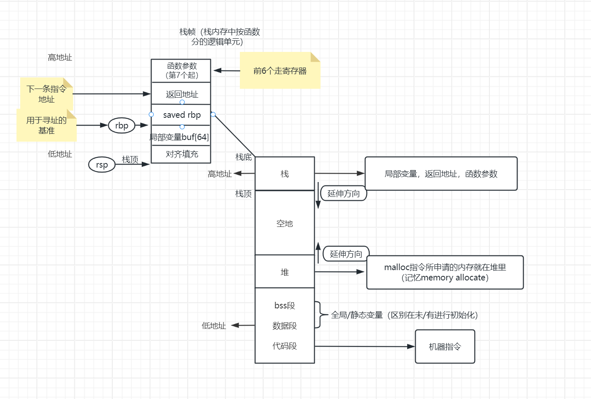
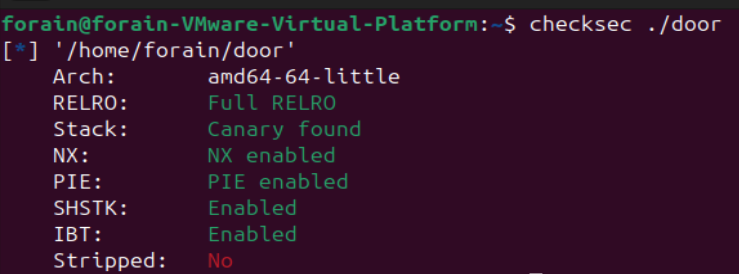
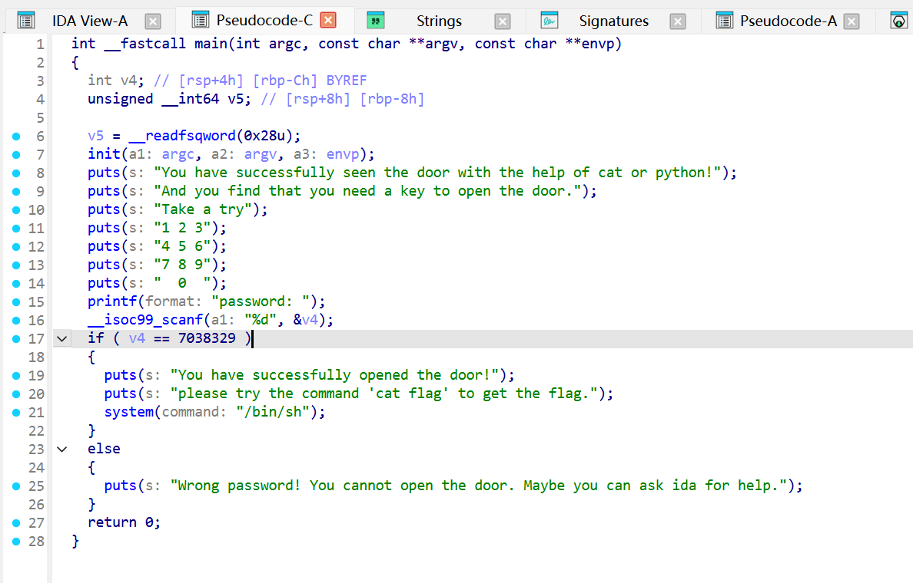
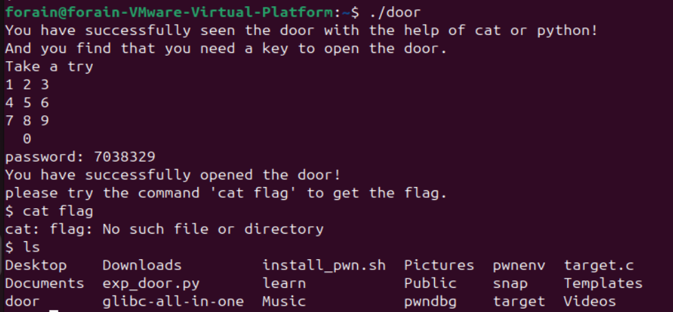
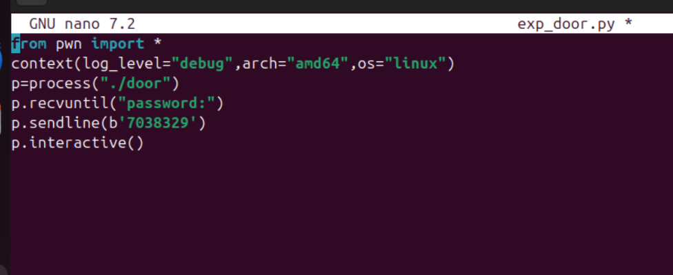
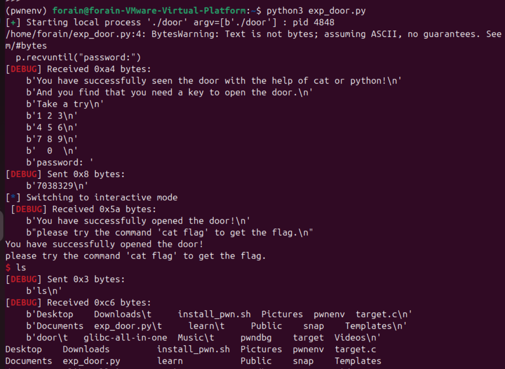

# 一编：

**10月10日-10月12日**

学习内容：
汇编语言（从内存结构到寄存器）
十六进制，二进制
对pwn相关术语大致了解
了解做题大致流程

碎碎念：在图书馆翻了一遍基本都是老书，以后可能比较多是在网上找东西学。找到一本王爽的汇编语言，结合ai把原文16位的架构延伸到现在64位。谁把咖啡洒书里了！！：（

**10月13日**
学习内容：
搭建Ubuntu系统的虚拟机
安装pwn工具m

完成题目：P0

碎碎念：IDA pro破解版？？呃真的不会下到病毒吗（pwn生涯还没开始就当头一棒）授权绕过研究了好半天（ai拒绝帮助，寒心）。想了想我好像不会啥检查的办法，于是看看没有什么奇怪的进程再用杀软扫了两遍之后决定听天由命。。希望它不是病毒吧

**10月14日：**

学习内容：使用VScode，IDA等工具，部分Linux基础知识

**10月15日-10月16日**

学习内容：C语言指针与数组扫障

**10月17日：**

学习内容：Linux基础补完

**10月18日：**

整理本周内容，写第一周作业

完成题目：P1

## 基础概念

理解概念：CPU与内存，三条线，内存地址，寄存器，物理地址，虚拟地址，寻址，栈相关（栈，栈底，栈顶，栈帧，压栈），堆，数据区，指令区

寄存器：现在15个，虽然不知道怎么应用，先了解

## 十六进制，二进制

内存地址一般都是用十六进制表示。0，1，2，3，4，5，6，7，8，9，a，b，c，d，e，f。用每一位上的数字依次乘以16的0到n次方就可以转化成十进制。二进制同理。

## 了解解题流程

1. 检查题目保护：开局拿信息，根据条件使用合适的打法

2. 反编译寻找漏洞：分析代码，找出可能的突破口

3. 虚拟机验证漏洞：验证上一步的突破口是否可行

4. 编写exp：使用工具写脚本，直到拿到flag

5. 编写wp：复盘写出解法思路

## Linux 基础：​

### 目录与路径、文件权限、执行权限和当前工作目录

目录从根目录开始一级一级延伸。根目录有/bin装命令，/etc 系统配置，/home用户数据，/var 日志等动态数据，/tmp 临时文件，/boot启动，/usr装软件

权限：x，运行，1；w，写，2；r，读，4。​

### 常用命令

pwd  查看当前所在路径

ls  列出当前目录所有文件

cd  切换目录（.. 上一级，.保持在原位，~ 主目录）

mkdir  创建目录

rm  删除目录

cp  复制文件

mv  移动或重命名

touch  创建文件

-r  递归，-f 强制

### 标准输入、标准输出、标准错误，管道与重定向

stdin，编号0

stdout，编号1

stderr，编号2

​

### 进程、PID、退出码、信号，以及端口连接的基本概念

退出码：给系统一个数字：0（成功）1（执行失败）2（命令参数错误）127（command not found）
可以用echo $？看，非0都是失败

端口：将IP比作大楼，端口就是房间号，也就是程序的窗口号，告诉数据包往哪送
​​

### 阅读终端报错，区分程序错误、依赖缺失和连接问题

1. Command Not Found：**shell**找不到命令->没装或者不在PATH里
2. ModuleNotFoundError：**python解释器**找不到这个模块->比如不在venv包间里
3. Permission denied：**内核**说权限不够->权限不够或者是所有者的问题->先想为什么没权限，再考虑要不要借权限

## 数组，指针

c语言课本内容+一点实践的结合

1. 数组名指的是首元素地址：a 就是 &a[0]
2. a[i] = *(a+i) 下标就是偏移量，好方便
3. &取地址，*解引用
4. 指针 +1 不是加 1 字节，是加1*类型，例如int*一次走 4 字节，char*走 1 字节
5. 数组传参会退化成指针：函数只收到首地址，不知道数组有多长
   所以 gets/strcpy 这类函数天生不知道边界，有栈溢出的操作空间
6. 值传递：函数拿到的是副本，改形参不影响实参；想改外面就传指针
7. 二级指针：指向指针的指针（存"地址的地址"）
8. 函数指针：存函数入口地址
9. gdb 里 print a / print &a[0] 亲手验证过

## 针对内存分区意识的学习

按理解画了张图

不知道理解准不准确，老大帮我看看：D

rsp：r指64位，sp = stack pointer栈指针，因此它一直跟着栈顶跑
rbp：r指64位，bp = base pointer基址指针，因此它钉着不动，可以拿来做参照
saved rbp：老的rbp，先存起来，后面return的时候取出来

# WP

## P1

1. 检查题目保护
   

2. IDA反汇编
   
- 对main按F5看伪代码，看出当变量为7038329可以“open the door”
3. 运行door，输入密码7038329
   
- 成功了，虽然用不了cat flag（本地目录里没有，但是ls可以使用，说明已经拿到shell
4. 编写exp
   
- 运行一下
  
- 起作用了
