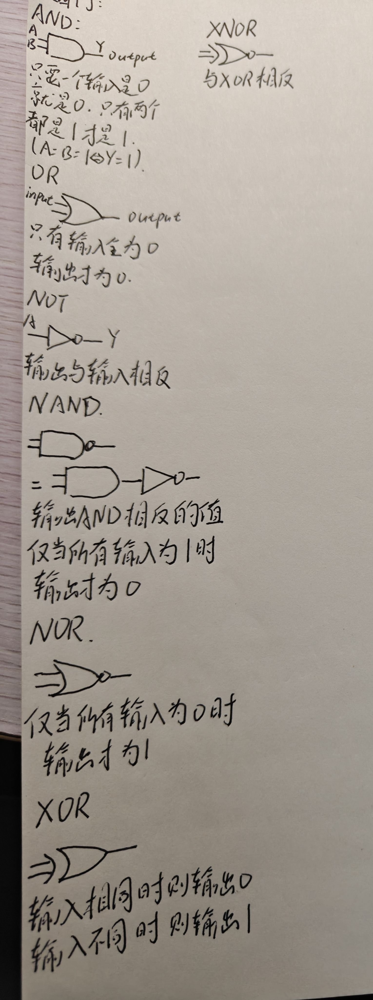
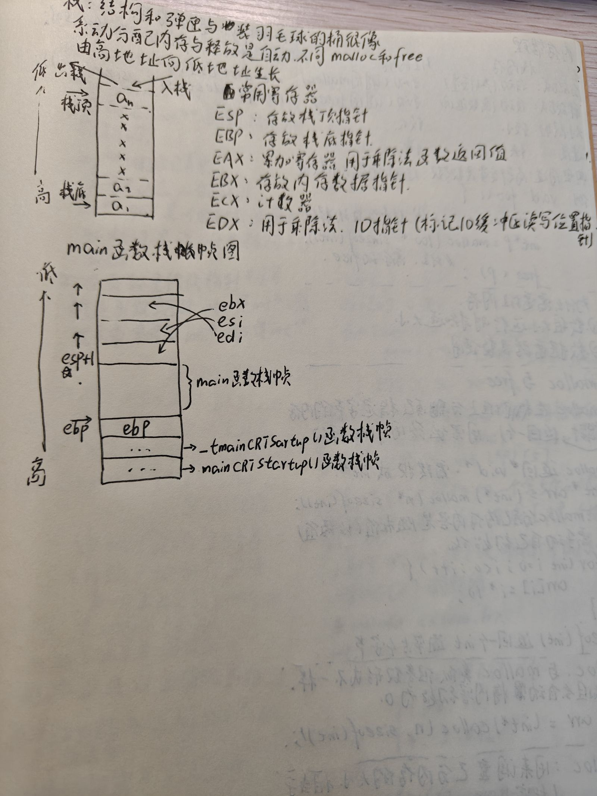
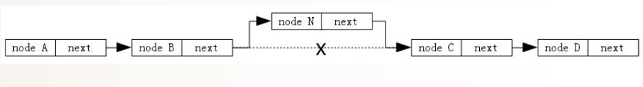

# week 2

## 1，了解什么是GDB以及基础命令

> GDB是Linux下非常好用且强大的调试工具

**调试**：就是让代码一步步执行，跟踪程序的运行过程

**开发版本的区分**：debug 和relese

> debug ——调试版本，gdb真正的作用之处
> releses——发行版本

**总结**：程序的发行版本有两种，debug和relese

- lunux gcc/g++出来的二进制程序，默认是relese模式
- 要使用gdb调试，必须在源码生成二进制程序的时候，加上-g选项
- 另外又学会一种组合指令的**方式**吧：就是Makefile‘目标：依赖文件<tab>命令’然后用make+目标。可以很快的执行这个命令

### GDB调试代码的指令学习

- `l 行号/函数名` ——显示对应的code，一次10行
- `r` ——无断电直接运行，有断点从第一个断点开始运行
- `b + 行号` ——在那一行打断点

。。。。。

**排查问题三剑客哈哈哈：**

- `until+行号` ——进行指定位置跳转，执行完区间代码
- `finish` ——在一个函数内部，执行到当前函数返回，然后停下来等待命令
- `c（continue）` ——从一个断点处，直接运行到下一个断点处

> 还是觉得上传图片好麻烦，所以干脆直接写了

**例子**

> 演示代码

```c
  1 #include <stdio.h>
  2
  3 int AddToTop(int top)
  4 {
  5     printf("Enter AddToTop\n");
  6
  7     int count = 0;
  8     for(int i = 1;i <= top; ++i)
  9     {
 10        count += i;
 11     }
 12
 13     printf("Quit AddToTop\n");
 14     return count;
 15 }
 16
 17 int main(void)
 18 {
 19     int top = 10;
 20     int ret = AddToTop(top);
 21
 22     printf("ret = %d\n", ret);
 23     return 0;
 24 }
```

当我执行until 13时，程序直接给我们最终的结果count；

finsh：首先s进到函数内部，接下来直接使用finsh，可以看到它直接回到了调用函数的位置，returned一个值；

c：假设我第一个断点20行的时候，直接敲c就可以运行到第二个断点，之后反复敲c的话，因为是一个单语句循环，所以下一次还是会执行到这

**例题1：使用指针交换两个数**

```
  1 #include <stdio.h>
  2
  3 void swap(int* x, int* y)
  4 {
  5     int t = *x;
  6     *x = *y;
  7     *y = t;
  8 }
  9 int main(void)
 10 {
 11     int a = 10;
 12     int b = 20;
 13
 14     printf("a = %d, b = %d\n", a, b);
 15
 16     swap(&a, &b);
 17
 18     printf("a = %d, b = %d\n", a, b);
 19     return 0;
 20 }
```

1. 在16行（b 16）设置了一个断点，然后从r（r）从15行运行，然后s进入swap函数，finish来立马执行这个函数，然后观察一下结果，发现a和b的结果发生了交换
2. 进行单步追踪一下（n），然后后面我就又按了一下r，弹出是否重新开始调试，后面就display a 和display &a记录了两个变量的值和地址，然后s进入swap函数，就看到函数内部已经接收到了这两个变量的地址

---

## 逻辑门

> 应为没有看懂汇编的位操作指令

**什么是逻辑门**：用于对二进制信号（0/1）执行与，或，非，异或，与非，或非等的逻辑运算



---

## 2，汇编语言的基础学习

> 因为上一次不是没有看懂那个.s文件所以就准备看一下，然后看到有大佬在群里面发了一个汇编的CSDN网页就看了一下

**什么是汇编语言**：是一种低级的编程语言，面对机器的语言，于特定CPU的机器指令集一一对应，需要通过汇编器转换为机器码的执行

**寄存器**：是由触发器构成，位于CPU内部高速小容量的存储单元，用于暂存指令，数据和地址，读写速度极快

### 基础命令

- **MOV**：数据传送 如 `mov rax，10`
- **LEF**：地址计算（不访问内存）如 `lea rsi，[rbx+rcx*4]`（计算的地址值放在rsi中）
- **XCHG**：交换数据，`xchg rax，rbx`
- **movzx**：零扩展传送 `movzx rax byte[mem]`（先从内存地址mem读取一个字节的数据，然后这个高位全部补0，扩展成64，送入rax）（mem是泛指一个内存地址）
- **movsx**：符号扩展传送 `movsx rax byte[mem]`

### 算数运算符指令

- **ADD**：加法 `add rax，10`
- **sub**：减法 `sub rax，rcx`
- **inc**：自增 `inc dword [mem]`（值+1）
- **dec**：自减 `dec esi` （值-1）
- **mul**：无符号乘法 `mul ecx`（默认乘数永远是EAX，只做无符号数）
- **imul**：有符号数 `imul eax，ebx` （eax = eax*ebx）
- **div**：无符号除法 `div ecx`

### 位操作指令

> 这个按位看解释没有看太懂后面看逻辑门去了

- **AND**：按位于 `and eax，0Fh`（&）
- **OR**：按位或 `or ebx，80h`
- ...
- **xor**：按位异或
- **not**：按位取反
- **shl**：逻辑左移 `shl edx ，4`（将二进制数整体向左移动指定位数，并在右侧补 0；其效果与算术左移完全相同）
- **shr**：逻辑右移（同上）
- **sal**：算数左移
- **sar**：算数右移

### 控制转移指令

- **jmp**：无条件跳转（执行指令时程序必定发生跳转不考虑任何条件，使得计算机将指定地址作为下一条指令
- **call**：`call func` 调用函数
- **ret**：`ret` 函数返回
- **je/jz**：`je target` 相等/为零时发生跳转
- **jne/jnz**：`jne target` 不相等/非零时跳转
- **loop**：`loop label` rcx 减1，非零跳转

### 栈操作指令

> 这个应该挺重要的吧，我认为

- **push**：`push rax`（入栈（esp地址递减/rsp的递减）
- **pop**：`pop rbx`（出栈 esp递增）

### 栈帧

栈帧是程序在调用函数时，在栈上为该函数分配的一块连续内存区域，用于存储函数执行所需的上下文信息，包括局部变量、参数和返回地址等



> 感觉还没有看完，另外留下一个点IO指针是啥，明天再看吧

### 系统调用指令对比

- **32位**：`int 0x80` EAX=调用号（ebx，ecx，edx，esi，edi，ebp=参数）
- **64位**：`sysca ll` RAX=调用号（rdi，rsi，rdx，r10，r8 ，r9

## 指针的进阶

### 多级指针

**多级指针的概念**：多级指针是指向指针的指针，通过增加间接寻址层次，实现对数据或指针的间接操作和修改

- 二级指针中存放的是一个指针变量的地址 例如：int a = 0;int *p = &a;int **p2 = &p;
**多级指针的应用**：指针机制实现数据结构中对结构内容的修改和变更常常要修改指针的内容 例如这个有序链表

```c
typedef struct s_node
{
  int key;
  struct s_node *next;
}s_node;
typedef struct s_list
{
  //头节点
  struct s_node *header
}s list
```

现在要在现有链表中插入一个新节点

二级指针实现办法

```c
int list_insret(s_list *list,int key)
{
  if(list == NULL)
  {
    return -1;
  }
}
//创建新节点
s_node *n = malloc(sizeof(s_node));
n->key = key;
n->next = NULL;
//二级指针
s_node **p = &list->header;
//找到第一个大于key的节点
while ((*p)!= NULL &&(*P)->key < key)
{
  p = &(*p)->next;
}
//插入新节点
n->next = *p;
*p = n;
return 0;
```

### 资料参考

> GDB的学习以及指令：<https://blog.csdn.net/weixin_45031801/article/details/134399664>
> 汇编语言的学习：<https://blog.csdn.net/2403_86572967/article/details/149548510?sharetype=blog&shareId=149548510&sharerefer=APP&sharesource=2402_87708608&sharefrom=link>
> 栈帧的学习：<https://blog.csdn.net/qq_41412237/article/details/119489211> 还有一些b站上的视频来理解的
