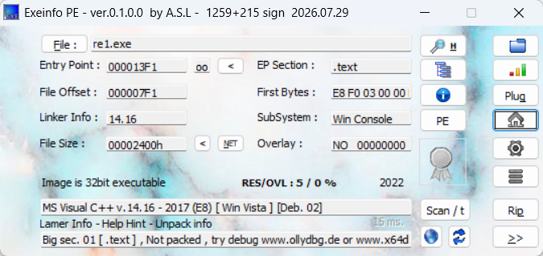
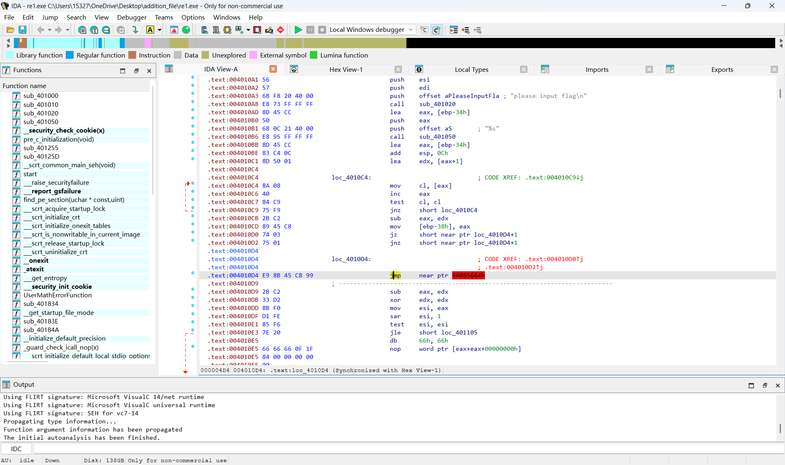
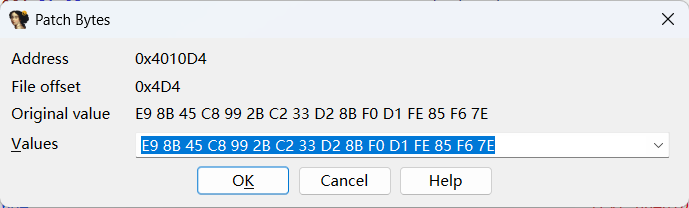
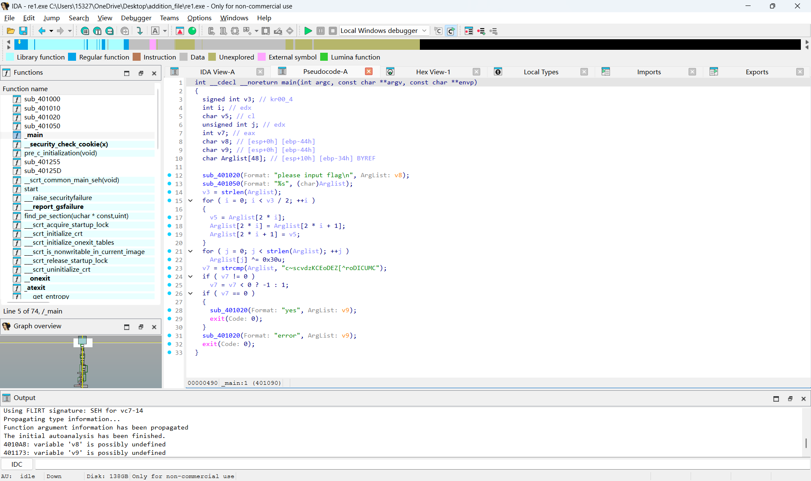
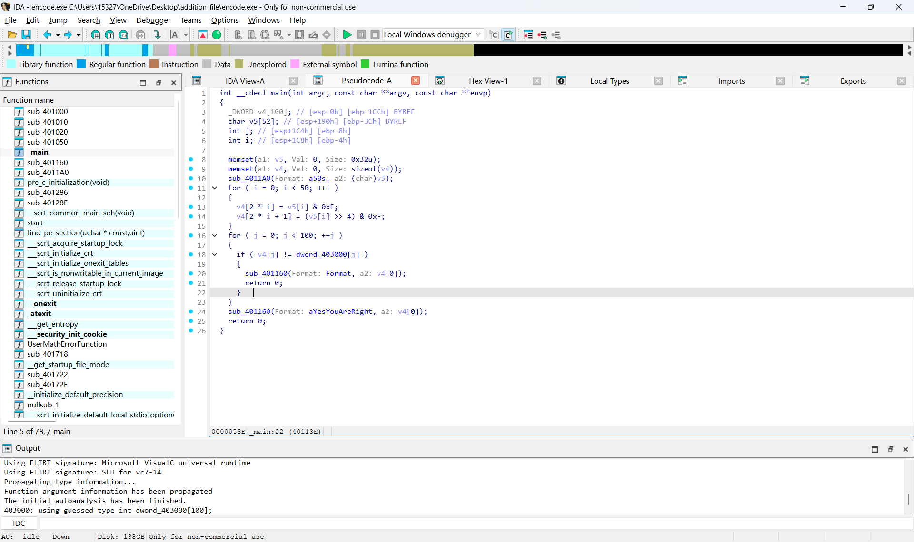
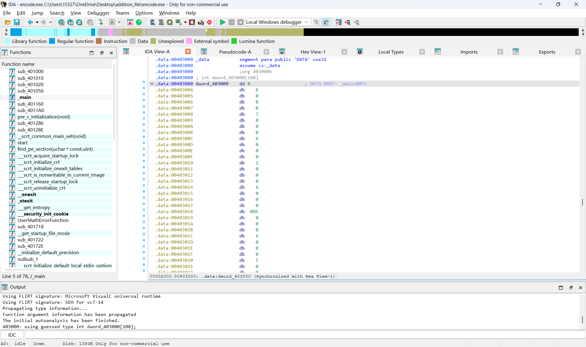
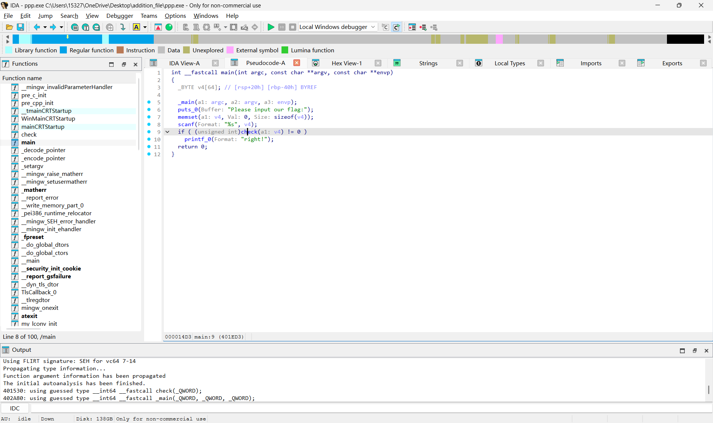
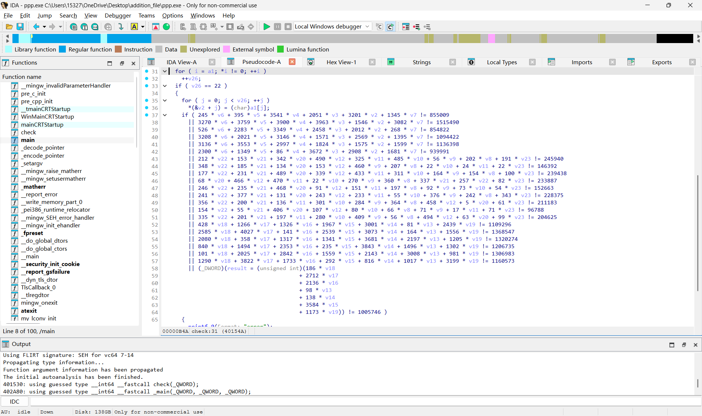

### 基本汇编语言
`Mov` 数据由原位置复制到目的位置，原操作数和目的操作数数据类型必须一致，**必须使用寄存器中转**  
`JMP` 直接跳转到指定目标继续执行，**不进行任何判断**，修改指令指针寄存器，修改代码寄存器的值实现跳转  
`JP` 条件跳转 检测CPU状态寄存器，奇偶标志位**PF=1**时跳转，反之为零就不跳转  
`Push` 入栈指令 CPU减小栈指针。数据写入新的栈顶位置  
`Pop` 出栈指令 读取当前栈指针指向的数据，把栈指针的值更新到栈顶  
`ADD` 加法  
`SUB` 减法  
`INC` 自增1  
`DEC` 自减1  
`MUL` 乘法  
`DIV` 除法  
`CMP` 比较  
`AND` 与  
`OR` 或  
`XOR` 异或  
`NOT`取反  

### 花指令
研究花指令的时候我弄混了魔术和操作码，机器指令的头字节叫opcode操作码，**只有这个头字节决定了执行那一条汇编语言**(汇编助记符) 其他字节不参与决定 
比如说，PUSH EAX的首字节是0x50，Pop  EAX是0x58,CALL是0XE8,Nop是**0x90**，前提必须是x86的CPU架构，且是32位程序，64位程序汇编语言的首字节也不同  
**CPU架构和操作系统是没关系的**，我开始也弄混了，x86是AMD的PC处理器，与之对应的是ARM，操作系统比如windows,Linux mac都是在CPU的系统软件  
有些教程提到把花指令nop掉，这个nop其实是汇编指令，不过该指令什么都不执行  
IDA就是读取二进制Opcode表(头字节)，解析成汇编语言让人看，花指令利用IDA解析的问题**构造一些字节**，在不影响CPU运行的前提下，使得IDA解析出错，函数和栈发生异常，所以花指令处会爆红，因为解析出错了
例子:  
`jmp  label+1 db 0xE8 label` 执行时jmp直接跳过了0xE8字节  
'jmp short $+2 db 0xC7' `$`是当前地址，`$+2`意味着跳过一个0xC7字节，如果改成+3，+4...会跳过更多字节  
`jz  next jnz next next`这个是条件跳转，不过jz,jnz**一定会有其中一个成立，一定会跳转到next**  
`call $+5`call直接**无条件**跳转，跳过后四个字节  
还有一些**无效的**堆栈操作，**无效的**运算
尝试在本地构造花指令，这个代码我不会写，抄了一遍AI写的    
#include <stdio.h>  
void junk1()  
{  
    __asm__(  
        "push eax\n"  
        "pop eax\n"  
        "jz label\n"  
        "jnz label\n"  
        "label:\n"  
    );  
}  
void junk2()  
{  
    __asm__(  
        "jmp short $+2\n"  
        ".byte 0xe8\n"  
    );  
}  
void junk3()  
{  
    __asm__(  
        "call $+5\n"  
        "pop eax\n"  
        "add eax, 0x10\n"  
    );  
}  
int main()  
{  
    junk1();  
    junk2();  
    junk3();  
    puts("hello my friend");  
    return 0;  
}

第一次编译报错了，AI解释说是内联汇编不兼容的问题，本地的GCC编译器不适配MSVC的汇编语言，修改后(AI提到强制切换汇编)编译成功  
很可惜，使用IDA打开后发现无爆红，观察发现IDA识别的函数全是**启动代码**之类的，**没有识别**junk123，应该还是代码本身的问题
### 基本逻辑运算，基本算法
#### 逻辑运算
逻辑与  两边都是真，真  
逻辑或 一边是真，真  
逻辑非 取反  
按位与 两个二进制都是1，1  
按位或 两个二进制只要有1，1  
按位异或 两个二进制不一样1，一样0  
按位取反 二进制按位取反  
C和Python的执行代码

| 运算   | C    | Python |
| :----: | :--: | :----: |
| 逻辑与 | `&&`   | `and`    |
| 逻辑或 | `\|\|` | `or`     |
| 逻辑非 | `!`    | `not`    |
| 按位与 | `&`    | `&`      |
| 按位或 | `\|`   | `\|`     |
| 按位异或 | `^`  | ^`      |
| 按位取反 | `~`  | `~`      |

使用C语言和python语言进行尝试，分析输出的结果是否符合预期

发现`unsigned char x = 0b1010`在按位取反运算时输出了4294967285,查资料发现运算`~x`时先把unsigned char类型(**8位**)升级为int类型(**32位**)，再按位取反，结果是0xFFFFFFFF5，使用**`%u`无符号32位整数**就是4294967285 
想获取8位的结果，必须把32位的数据与`0xFF`按位与，效果是**保留数据的最后低八位**，其他高位都变为零  
即**0xFFFFFFF5&0x000000FF=0xF5=245**
#### 算法
RC4:分为两个阶段，KSA，PRGA  
KSA是**密钥初始化**，S[]表示0-255的随机排列  
PRGA是**生成密文**，以S[]，明文为基础随机生成与明文等长的密文  
由于异或运算时可逆的，加密时**密文=明文^密钥**，解密时**明文=密文^密钥**  
python算法:  
def rc4(data,key):  
    s=list(range(256))  
    j=0  
    for i in range(256):  
        j=(j+s[i]+key[i%len(key)])%256  
        s[i],s[j]=s[j],s[i]  
    i=j=0  
    out=[]  
    for b in data:  
        i=(i+1)%256  
        j=(j+s[i])%256  
        s[i],s[j]=s[j],s[i]  
        k=s[(s[i]+s[j])%256]  
        out.append(b^k)  
    return bytes(out)  
AES:对称加密，分组固定为**128bit(16字节)**，包括四个基础变换  
字节代换:S盒替换字节  
行移位:矩阵行循环左移  
列混合:每一列和固定多项式强扩散  
密钥轮加:矩阵和当前密钥逐字节异或  
**以CBC模式为例，这里需要使用初始向量IV，密钥和IV的长度必须是16字节**  
python算法:
from Crypto.Cipher import AES  
from Crypto.Util.Padding import pad,unpad  
import os  
def aes_cbc_encrypt(plaintext: bytes,key:bytes,iv:bytes) -> bytes:  
    cipher=AES.new(key,AES.MODE_CBC,iv)  
    return cipher.encrypt(pad(plaintext,AES.block_size))  
def aes_cbc_decrypt(ciphertext: bytes,key: bytes,iv: bytes) -> bytes:  
    cipher=AES.new(key, AES.MODE_CBC, iv)  
    return unpad(cipher.decrypt(ciphertext),AES.block_size)  
key=b"1234567890123456"  
iv=os.urandom(16)  
msg=b"hello aes"  
cipher_data = aes_cbc_encrypt(msg,key,iv)  
plain_data = aes_cbc_decrypt(cipher_data,key, iv)  
print(iv.hex())  
print(cipher_data.hex())  
print(plain_data.decode())
Z3:是一种求解器，核心代码主要为
`solver()`**创建求解器**  
`Int()`创建待求解数据集合  
`.add()`添加条件  
`.check()`**判断是否存在解集**
`.model()`创建解集  
`.as_long()`**把结果转化为python字符**  
在学习之余我也尝试做了一些简单的题目，选取几道记录一下解题过程
### [HNCTF 2022 WEEK2]e@sy_flower
先查壳，发现没有壳

使用IDA打开，**直接发现JZ，JNZ花指令**，后面JMP出现爆红

在设置里点Edit-Patch program-Change bytes进行头字节的修改  
把头字节改为**90**，对应的汇编语言为**Nop(直接跳过)**

在main函数按**P**重新定义，出现新的汇编语言  
按**F5**生成伪代码并分析

Arglist为输入的明文，每两个字节进行互换，在把每个字节与0x30异或得到密文  
解密的过程反过来，**每个字节先与0x30异或(异或是可逆的)，再两两交换即可**  
代码  
enc='c~scvdzKCEoDEZ[^roDICUMC'  
value=[]  
for i in range(len(enc)):  
    value.append(chr(ord(enc[i])^0x30))  
for i in range(int(len(value)/2)):  
    tmp = value[2*i]  
    value[2*i] = value[2*i+1]  
    value[2*i+1] = tmp  
for i in value:  
    print(i,end='')
### [HGAME 2023 week1]encode
查壳发现没有壳，IDA打开，直接在main函数按F5生成伪代码

v5是明文，v4是密文，发现有一句`v4[j] != dword_403000` 
点击这个dword_403000，在IDAview里找到该数据并**去掉所有0，记录剩余所有数据**

一开始我也不知道**按位与0xF**是什么意思，查资料发现是分别**取低四位**，**高四位**
即`v5[i] & 0xF`提取低四位, `(v5[i] >> 4) & 0xF`源码右移四位后提取高四位  
把低四位，**左移四位后的高四位相加**就是原来的ASCII字符  
注意必须先把字符串`int`**转化为整数**，才能进行移位  
代码  
cipher=['8', '6', '7', '6', '1', '6', '13', '6', '5', '6', '11', '7', '5', '6', '14', '6', '3', '6', '15',
         '6', '4', '6', '5', '6', '15', '5', '9', '6', '3', '7', '15', '5', '5', '6', '1', '6', '3', '7',
           '9', '7', '15', '5', '6', '6', '15', '6', '2', '7', '15', '5', '1', '6', '15', '5', '2', '7',
             '5', '6', '6', '7', '5', '6', '2', '7', '3', '7', '5', '6', '15', '5', '5', '6', 
        '14', '6', '7', '6', '9', '6', '14', '6', '5', '6', '5', '6', '2', '7', '13', '7']  
value=''  
for i in range(len(cipher)//2):  
    ni=int(cipher[i*2+1])  
    hao=int(cipher[i*2])  
    byte=(ni<<4)+hao  
    value+=chr(byte)  
print(value)
### [HNCTF 2022 WEEK2]来解个方程?
查壳发现没有壳，IDA打开，在main函数按F5生成伪代码

发现有一个check，点击它，又有伪代码

进入if之前条件是`v6==22`即待求解的未知数是22个    
if条件语句里有**22个条件**，正好能解出**所有未知数**     
再把未知数`chr`转化为ASCII字符即为明文，这里需要使用Z3求解器  
代码  
from z3 import *  
s=Solver()  
v2,v3,v4,v5,v6,v7,v8,v9,v10,v11,v12,v13,v14,v15,v16,v17,v18,v19,v20,v21,v22,v23 = Ints("v2 v3 v4 v5 v6 v7 v8 v9 v10 v11 v12 v13 v14 v15 v16 v17 v18 v19 v20 v21 v22 v23")  
s.add(245 * v6 + 395 * v5 + 3541 * v4 + 2051 * v3 + 3201 * v2 + 1345 * v7 == 855009)  
s.add(3270 * v6 + 3759 * v5 + 3900 * v4 + 3963 * v3 + 1546 * v2 + 3082 * v7 == 1515490)  
s.add(526 * v6 + 2283 * v5 + 3349 * v4 + 2458 * v3 + 2012 * v2 + 268 * v7 == 854822)  
s.add(3208 * v6 + 2021 * v5 + 3146 * v4 + 1571 * v3 + 2569 * v2 + 1395 * v7 == 1094422)  
s.add(3136 * v6 + 3553 * v5 + 2997 * v4 + 1824 * v3 + 1575 * v2 + 1599 * v7 == 1136398)  
s.add(2300 * v6 + 1349 * v5 + 86 * v4 + 3672 * v3 + 2908 * v2 + 1681 * v7 == 939991)  
s.add(212 * v22 + 153 * v21 + 342 * v20 + 490 * v12 + 325 * v11 + 485 * v10 + 56 * v9 + 202 * v8 + 191 * v23 == 245940)  
s.add(348 * v22 + 185 * v21 + 134 * v20 + 153 * v12 + 460 * v9 + 207 * v8 + 22 * v10 + 24 * v11 + 22 * v23 == 146392)  
s.add(177 * v22 + 231 * v21 + 489 * v20 + 339 * v12 + 433 * v11 + 311 * v10 + 164 * v9 + 154 * v8 + 100 * v23 == 239438)  
s.add(68 * v20 + 466 * v12 + 470 * v11 + 22 * v10 + 270 * v9 + 360 * v8 + 337 * v21 + 257 * v22 + 82 * v23 == 233887)  
s.add(246 * v22 + 235 * v21 + 468 * v20 + 91 * v12 + 151 * v11 + 197 * v8 + 92 * v9 + 73 * v10 + 54 * v23 == 152663)  
s.add(241 * v22 + 377 * v21 + 131 * v20 + 243 * v12 + 233 * v11 + 55 * v10 + 376 * v9 + 242 * v8 + 343 * v23 == 228375)  
s.add(356 * v22 + 200 * v21 + 136 * v11 + 301 * v10 + 284 * v9 + 364 * v8 + 458 * v12 + 5 * v20 + 61 * v23 == 211183)  
s.add(154 * v22 + 55 * v21 + 406 * v20 + 107 * v12 + 80 * v10 + 66 * v8 + 71 * v9 + 17 * v11 + 71 * v23 == 96788)  
s.add(335 * v22 + 201 * v21 + 197 * v11 + 280 * v10 + 409 * v9 + 56 * v8 + 494 * v12 + 63 * v20 + 99 * v23 == 204625)  
s.add(428 * v18 + 1266 * v17 + 1326 * v16 + 1967 * v15 + 3001 * v14 + 81 * v13 + 2439 * v19 == 1109296)  
s.add(2585 * v18 + 4027 * v17 + 141 * v16 + 2539 * v15 + 3073 * v14 + 164 * v13 + 1556 * v19 == 1368547)  
s.add(2080 * v18 + 358 * v17 + 1317 * v16 + 1341 * v15 + 3681 * v14 + 2197 * v13 + 1205 * v19 == 1320274)  
s.add(840 * v18 + 1494 * v17 + 2353 * v16 + 235 * v15 + 3843 * v14 + 1496 * v13 + 1302 * v19 == 1206735)  
s.add(101 * v18 + 2025 * v17 + 2842 * v16 + 1559 * v15 + 2143 * v14 + 3008 * v13 + 981 * v19 == 1306983)  
s.add(1290 * v18 + 3822 * v17 + 1733 * v16 + 292 * v15 + 816 * v14 + 1017 * v13 + 3199 * v19 == 1160573)  
s.add(186 * v18 + 2712 * v17 + 2136 * v16 + 98 * v13 + 138 * v14 + 3584 * v15 + 1173 * v19 == 1005746)  
print(s.check())  
value=''  
ni=s.model()  
list=[v2,v3,v4,v5,v6,v7,v8,v9,v10,v11,v12,v13,v14,v15,v16,v17,v18,v19,v20,v21,v22,v23]  
for i in list:  
    value+=chr(ni[i].as_long())  
print(value)
