# 26级-web-ocat-10.25
# 对web的继续探索
## http练习题

**CTF+http练习题**

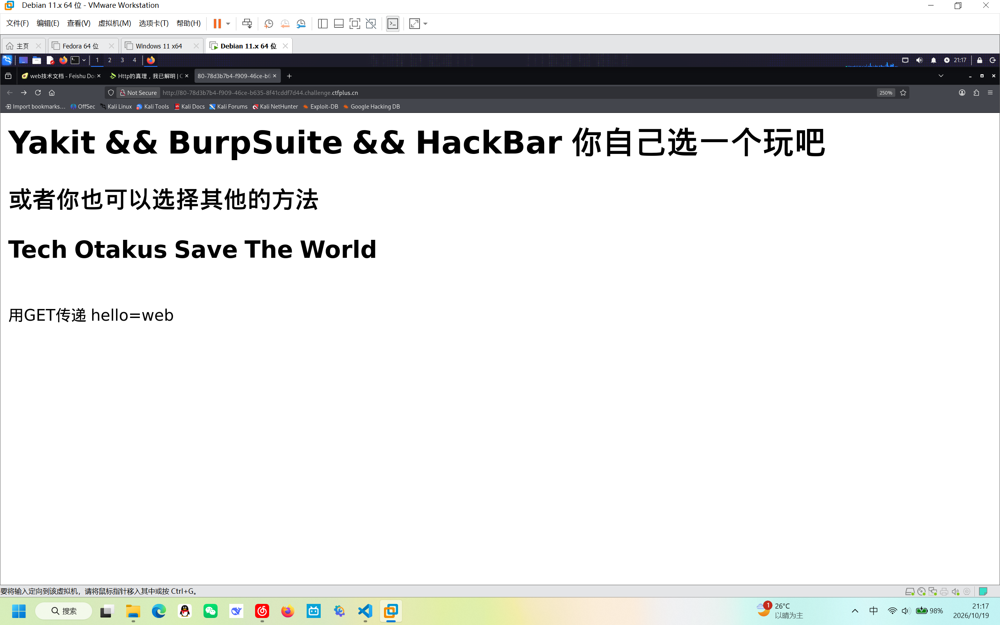

在URL使用？使用GET传递参数hell=web

这里打开burpsuite修改请求方法为POST，在body添加参数http=good（千万不能忘了添加Content-Type：application/x-www-form-urlencoded,这两个东西要对应）

>在这里我呆了半天，我自信的打开我hacbar的Raw模式的LOAD，自信地修改请求方法为POST，添加Content-Type，添加body，结果还是没法下一关，你猜我漏了什么————————————没错，就是Content-Length!因为当我们使用hacbar的basic模式和burpsuite时，content-length时自动添加的但是hacbar的raw模式是需要全部自己填写且确保无误的

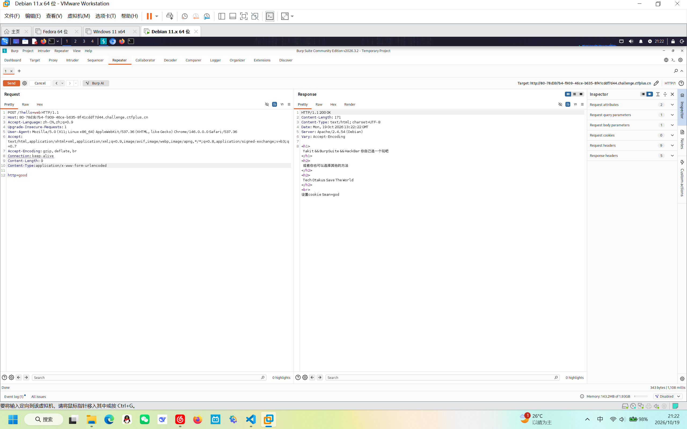

接着按题目要求修改Cookie：Sean=god

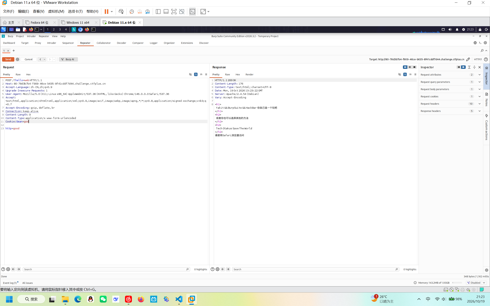

接着按题目要求构造Safari浏览器访问（也就是修改User-agent）

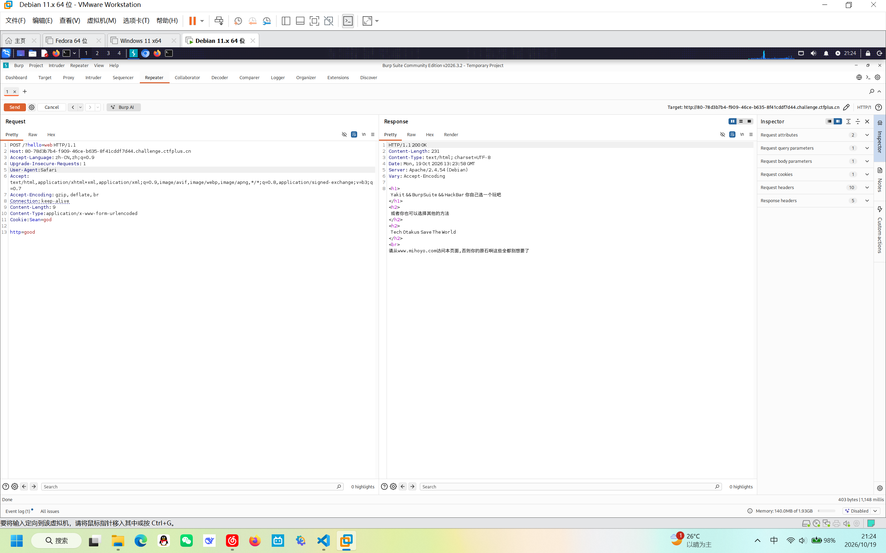

这时题目要求构造上一个网页访问（也就是修改Referer），所以按题修改

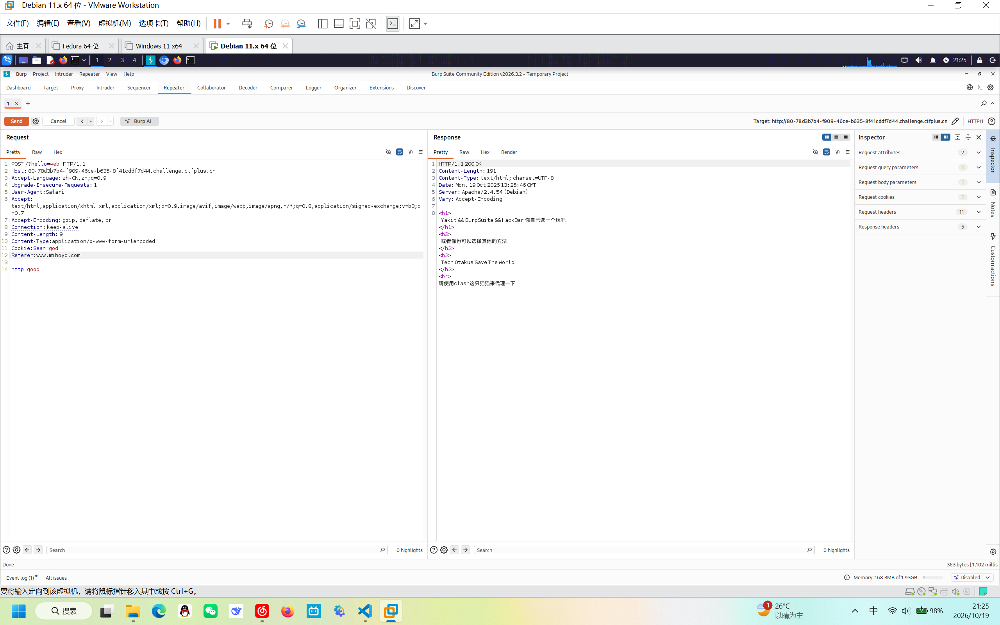

题目要求修改代理为clash（也就是修改Via）也就是改为Via:clash

>       这里要说明一下：我刚做到这里的时候
>       Q: 1.对“反向代理”概念不熟
>          2.为什么要用Via（因为知识库还没有涉及），既然是代理能用X-Forword-For/X-Real-IP/X-Client-IP/Client-IP码

>       A：1.反向代理服务：外部网络访问内部网络的一种安全服务。外部主机向反向代理服务器发送请求（此时是反向代理服务器代为内部服务器接收），从反向代理服务器向内部服务器发送请求，在内部服务器处理后将响应发送给反省代理服务器，反向代理服务器再将响应发送给主机
>           2.Via是标准的代理服务器头，而X-....只是为了给反向代理服务器看真实发送请求的是谁（通常本地访问或者特定IP时才用X-Forword-For:127.0.0.1）
>清楚了他们的区别，我想聪明的你应该知道了答案

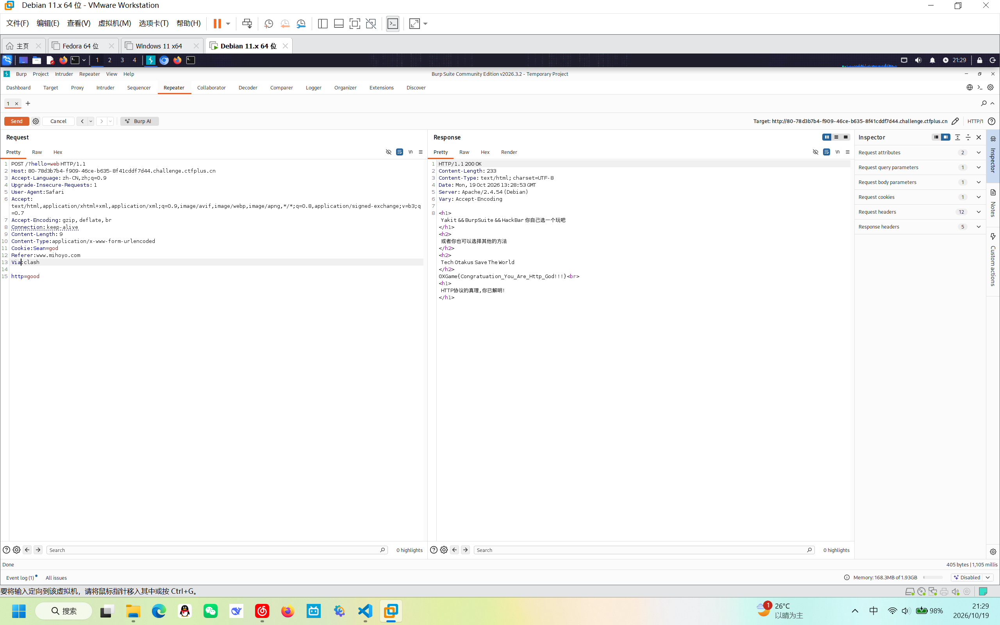

拿到flag

**黑神话悟空CTF**

设置时区，经过查询，黑神话悟空的发行时间为2024年8月20日，题目要求具体时间为00：00：00，所以使用hacbar添加时间Date：Tue, 20 2024 00:00:00
>一定要注意！表示星期的英文缩写后的逗号后一定要加个空格！！！！！！！！！！！不加空格是不规范的写法，大多服务器没法识别

老朋友“使用某某浏览器访问”，修改User-agent为题目中所给名称即可
>但真实环境是长长的字符串（比如Mozilla/5.0 (Windows NT 10.0; Win64; x64; rv:124.0) Gecko/20100101 Firefox/124.0 |||| 结构为Mozilla/5.0 (平台标识) 引擎标识 (兼容性标识) 浏览器标识）

曲奇=cookie，所以是修改cookie（但一定要注意cookie的形式：Cookie：xx=xx）

从哪里过来，其实就是在考Referer的运用，添加Referer即可：Referer：www.wukong.com

本地回环，又是老盆友，添加X-Forword-For：127.0.0.1即可

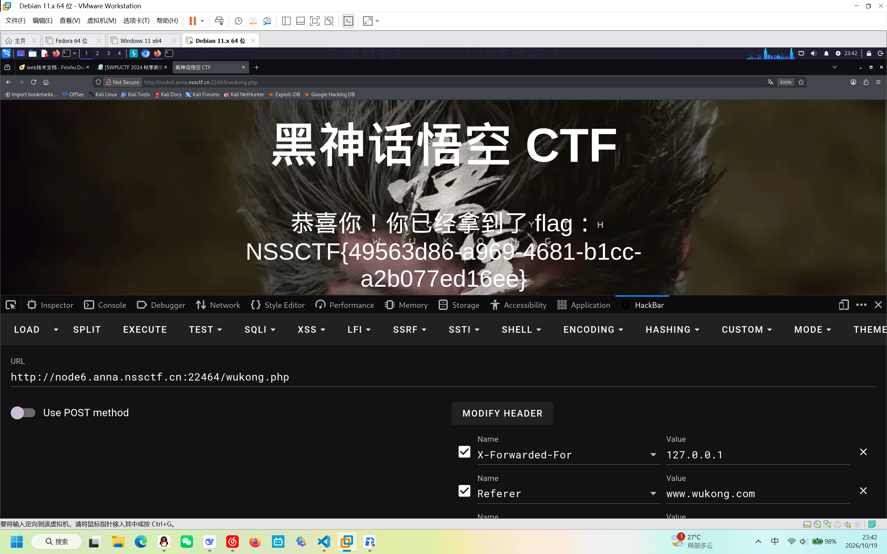

##  编程语言（这是在是长期马拉松，所以我会在每周学习一部分，并在每周上交作业时将学习内容写在笔记最前面

### C语言

**认识：**
    
    1.他是离硬件最近的语言
    
    2.极其精简，语言规范几乎没变，把硬件控制做到极致

**从内存视角看C语言：指针，数组与手动管理**

**1.1内存**：”一种储存变量的带编号的储物柜“

当你定义一种类型的变量，系统会为这个变量根据类型分配内存单元，大多数C语言编译器会这样分配：整型变量为4字节，单精度浮点型为4字节，字符型为1字节，每个字节都会有一个编号（通常多字节变量被&寻址的时候只看首字节的编号，除非使用“按字节访问”的指针时，才会一个一个字节处理）

**1.2指针**：相当于地址，通过它可以找到以他为地址的内存单元

>但要注意访问计算机的储存单元不仅需要地址，还需要**数据类型**

比如int *p = &a,这里有两层含义：1.p是指向整型的指针（让编译器以四字节作为一个整数），2。把a的地址存到了p，也就是p=&a

**1.2.1指针有什么用**

1.跨作用域操作

    有了指针，你可以在作用域内部修改外部变量（如果没有指针，那我们必须在每个作用域都重新修改变量，比较麻烦，有了指针，就可以打破作用域的壁垒），因为C语言默认是传递值（相当于是传递复印件），而指针是直接把地址给了出来，程序可以直接根据指针找到值

2.对“大体积”数据很友好
    
    因为有了指针就不需要把整个数据都传过去而是只给一个地址，让函数顺着地址去到地方操作就好

3.实现动态分配内存

    一般的数组都是提前定义好了内存，比如：int groundA[2]={100,200};但有时候会遇到不知道到底要存几个数据的情况，所以这个时候指针就发力了，指针与malloc函数的结合可以在程序运行过程中临时向系统借一块内存，用多了就删掉

>关于malloc函数，后面会讲解

**1.2.2指针该怎么用呢？**

指针有两个基本的符号：
    
    &：（取地址符）：找到你要的东西的地址，寻址的对象很多，比如某一个被定义的变量，数组中的一个元素，数组，函数，甚至是一个指针（比如int *p = &groundA[1],假设定义 int groundA[3]={100 ,200 ,300};）只要是占据了储存空间的实体都可以作为指针寻址的对象

    *：（解引用符）：顺着地址找到里面的东西

下面是实践部分：

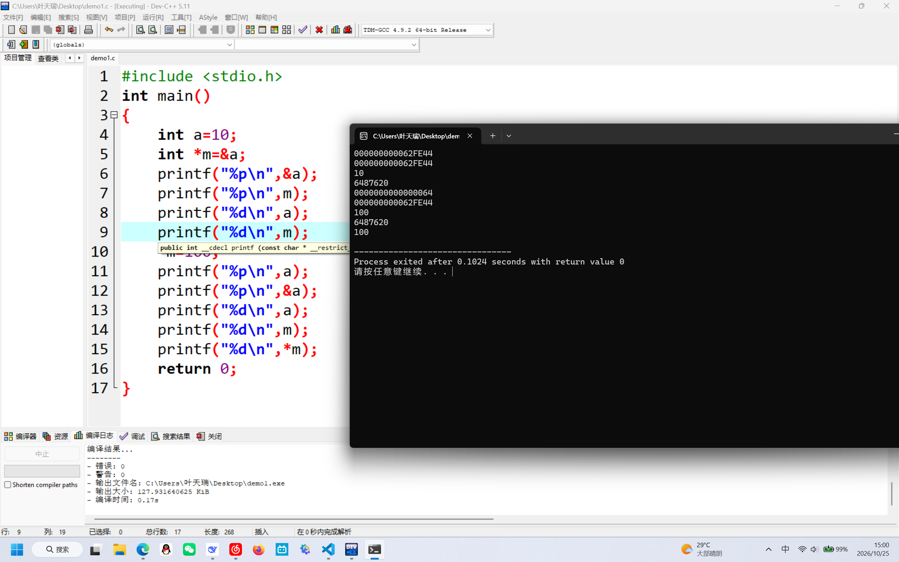

    #include <stdio.h>

    int main()

    {
	
    int a=10;
	
    int *m=&a;
	
    printf("%p\n",&a);
	
    printf("%p\n",m);
	
    printf("%d\n",a);
	
    printf("%d\n",m);
	
    *m=100;
	
    printf("%p\n",a);
	
    printf("%p\n",&a);
	
    printf("%d\n",a);
	
    printf("%d\n",m);
	
    printf("%d\n",*m);
	
    return 0;
    
    }

***********************************************  
    
    从上到下输出的分别是

    整型变量a的地址的十六进制编码

    同上

    a本身，也就是10

    a的源地址

    a本身的值的十六进制编码

    a的地址的十六进制编码

    a本身的值，现在被改为了100

    a的源地址

    循着a的地址找到的a的值（也就是100）

**我们发现，指针是直接改变了源地址中a的值（地址是没变的）**

刚刚对a的值的改变是在同一个函数中实现的，那有没有可能在多个函数也能实现对a在源地址的改变呢

    >这里就要涉及到一些重要的概念

        作用域：程序中限制变量和名称可用性的代码范围（在C语言中可以粗浅地理解为花括号所在的部分）
       > 
        根据作用范围，可分为全局作用域和局部作用域，全局变量随程序结束因析构函数而被清除，局部变量随作用域结束而被析构机制清除，留出内存

1.3数组与字符串的另一重身份

>在讲解之前，我自己要补充一下概念
    
    1.什么是数组：存在于连续空间的有限个相同类型的元素的集合   
    
            >连续空间：在一块内存区域内，各字节/各元素的地址是依次相连的
        
    2.什么是字符串：由数字，字母，下划线组成的一串字符，用于编程，概念说明，函数解释。在储存上类似于字符数组，所以其每一位的单独元素都可以单独取出来，在高精度运算时，可以把每一位转换为数字转入数组

1.4.C语言没有真正意义上的字符串类型，只有字符数组，例如 char str[] ="hi"

1.5.这个语句在定义一个字符数组（名字为str）这个字符数组实际上有三个字节“h” “i” “\0”这里的\0很关键，所有的字符处理函数，都以这个\0来判断长度

1.6.没有\0的字符序列不叫字符串，只是普通字节序列，如果这时强行调用字符串函数，会“越界读取”

>概念释义：

>1.越界读取：程度会读取缓冲区或内存的合法范围之外，比如读到内存里随机内容，轻则乱码，重则崩溃（？真的嘛）

>2.缓冲区：一块存放临时数据的内存区，C语言常用字符数组表示缓冲区，使用缓冲区必须注意他的容量，其读和写都不能超出容量

1.7.数组名有近似指针的作用，实际上数组名会被隐式转化为指向首元素的指针，但他们不是同一个东西，数组是一个固定大小的内存块，指针是一个可变地址变量

区别在于，指针可以修改后指向别处，而数组的“首地址”只能指向固定的地方

**malloc和free，借来的仓库必须自己还**

>本来到这里我就打算收尾了，可是就剩最后一点了，“加个钟好了！”

学习这一节的前提是一些概念的理解

    栈：一种运算限制的线性表
       > 线性表：基本概念：是一种数据结构，是n个具有相同特性的数据元素组成的有限序列

    堆：本质为基于完全二叉树的顺序的储存数组
        >什么是完全二叉树：其实就是我们所学的“树状图”，
            >但他有三个性质：
            1.只有最后一层才能不全满
            2.顺序从左到右
            3.最后一层不能有间隔
    
长什么样子？

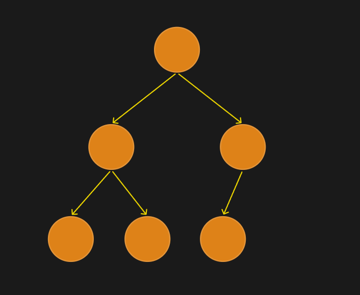

注意：这只是众多完全二叉树中的一个

    分类：1大根堆
    
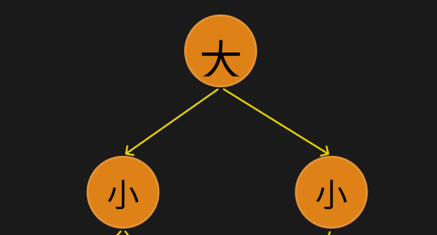

         2.小根堆

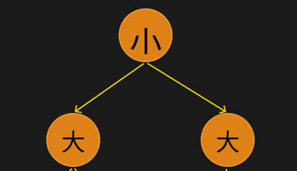

    可以根据从从上到下，从左到右的顺序排列成一个数组，例如下图：

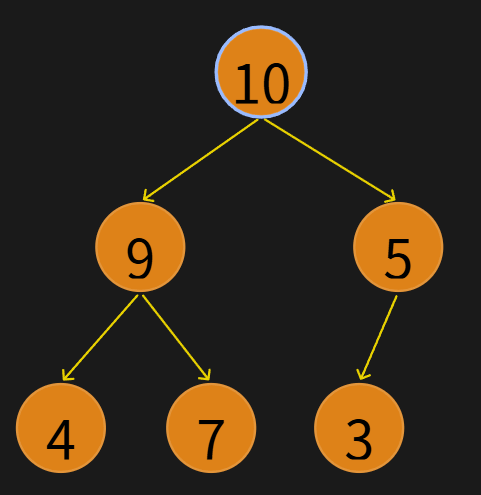

    那么可以表示为
            
            [10,9,5,4,7,3]
         
              1,2,3,4,5,6

    有时候，为了将一些数据进行排序，产生了两种方法：1.上滤法  2.下滤法 ，由这些方法我们可以进行“优先级队列”操作（在下次作业会展开细说）

栈上的局部变量会被编译器管理（当函数返回时，自动进行回收）

堆上的变量不同，当使用malloc创建一个临时的仓库，用完后就要使用free自行进行释放（要先规划好释放路径）

# 感谢观看，这周主要精力在C语言的底层开发与内存管理上了，下周准备提前规划学习内容