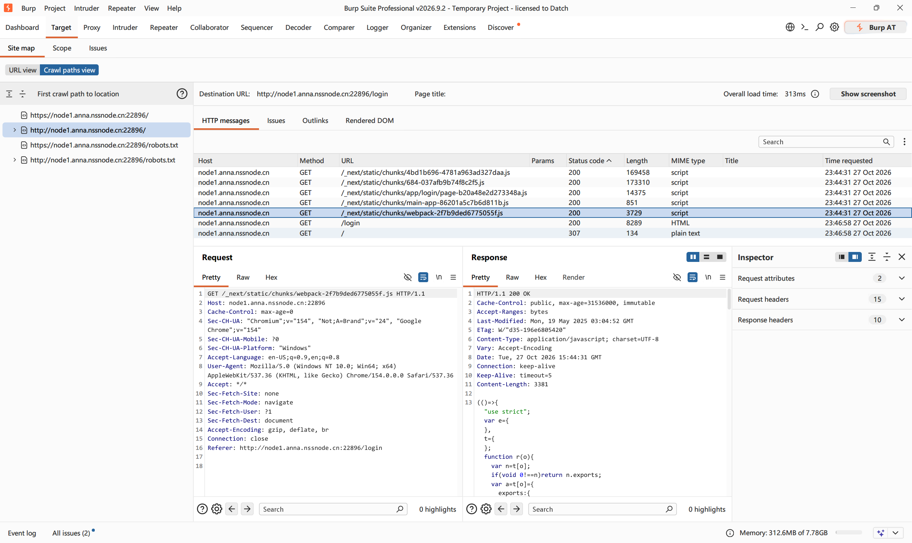
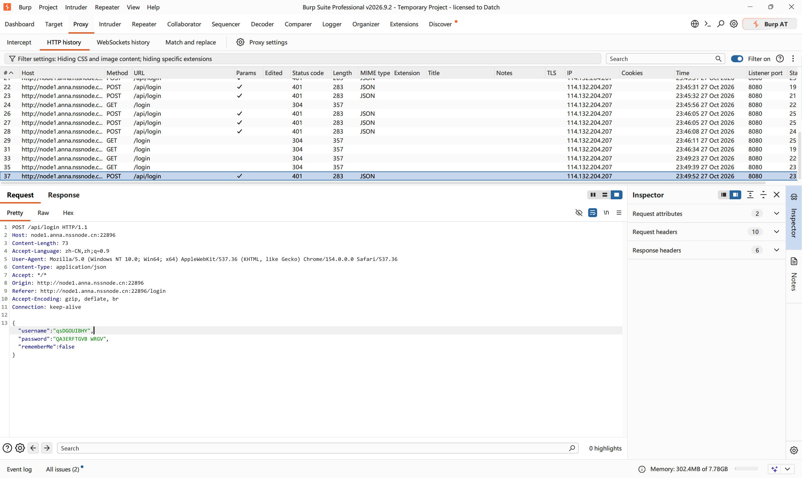
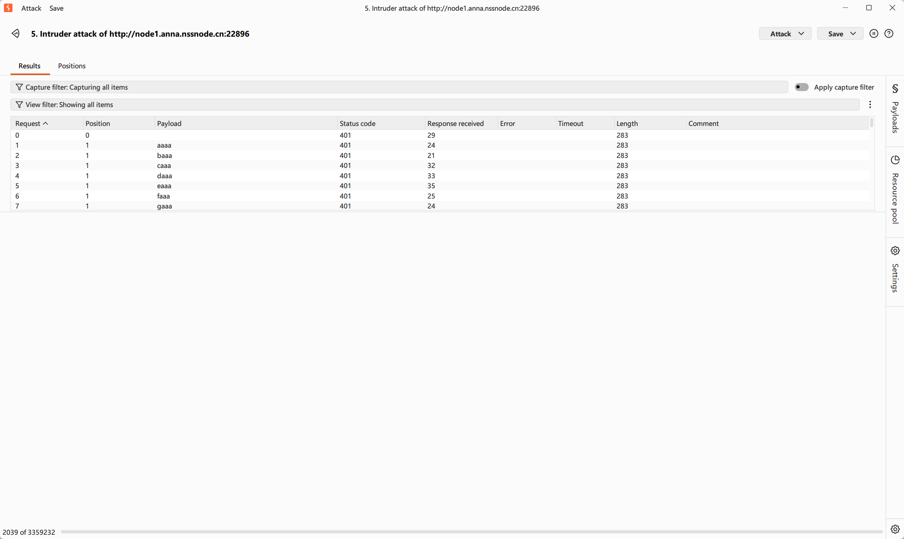
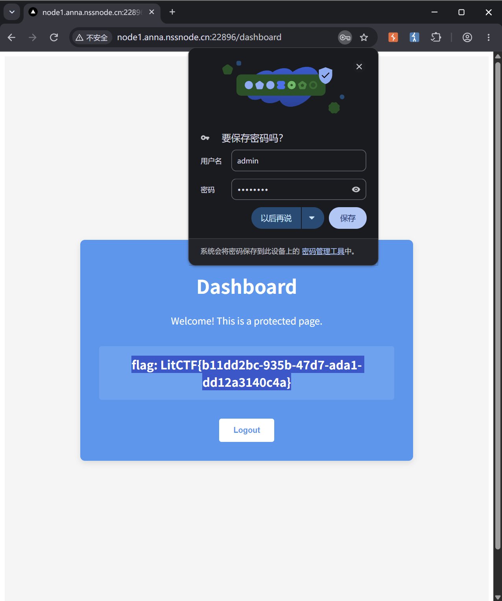

# Web 方向 week3 作业 · 信息收集与解加密

| 项目 | 内容 |
| --- | --- |
| ID | gofkurself |
| 年级-方向 | 26-web |
| 周次 | week3（10.26 - 11.1） |
| 完成日期 | 2026-10-29 |
| 任务来源 | [培训文档](https://hnusec-star.feishu.cn/wiki/U2xfwfP39iWhISkZOa4c1UtInxd) · web 技术文档 信息收集与解加密 |
## 信息收集与解加密

### 4.1 信息收集从哪下手


| 位置 | 能拿到什么 | 
| --- | --- | 
| 页面源码 / 注释 | 账号密码、接口路径、开发留下的提示 |
| `robots.txt` / `sitemap.xml` | 不想被收录的目录 |
| 响应头 | 中间件、版本、自定义头 | 
| 报错信息 | 框架、绝对路径、SQL 片段 |
| 目录扫描 | 后台、备份文件、`.git` |
| 前端 JS | 接口地址、硬编码的 key |

### 4.2 编码与哈希怎么认

| 类型 | 长什么样 | 怎么解 |
| --- | --- | --- |
| Base64 | A-Za-z0-9+/ 组成，末尾常有 `=` | Base64De/Encoder |
| URL 编码 | `%XX`，中文是连续多个 `%E4%B8` | 编解码工具 |
| Hex | 只含 0-9a-f，长度成对 | 编解码工具/py代码转 |
| Unicode | `\uXXXX` 或 `&#xXXXX;` | 编解码工具 |
| MD5 | 32 位十六进制 | 编解码工具 |
| SHA1 | 40 位十六进制 | 编解码工具 |
| 凯撒 / ROT13 | 字母整体平移，词形还在 | 编解码工具 |

- 判断顺序：先看长度,一大长串的就是b64或者sha1或者md5,然后观察特征,b64一般最乱字符种类最多


### 4.3 弱口令和默认口令

- 弱口令是什么：密码强度低的容易被暴力破解匹配到的口令
- 弱口令一般长什么样（举例）：123456 qwerty
- 默认口令是什么：系统出厂自带的初始口令
- 默认口令去哪查：GitHub 仓库或者这个web程序的支持页面
- 两者的区别：一个是人设置的一个是机器自带的

### 4.4 Burp Intruder 爆破

- 什么时候用：爆破弱口令
- 完整流程：抓登录包 → 填写Payload → 选择攻击类型 → 导入字典 → 开始攻击
- 四种攻击类型分别是干什么的：
Sniper: 单位置单参数爆破
Battering Ram: 多位置单参数爆破(Payload相同)
Pitchfork: 成对数据的爆破
Cluster Bomb: 多字典排列组合
- 命中那一行怎么认（Length / Status / 响应时间）：
明显的与其他响应行长度不同 时间不同


### 4.5 hydra 爆破

- 什么时候用它而不是 Burp：
爆破常见的infra网络服务,如sql,vnc,ssh这些(非http web服务)
弱防护,大字典需求
```bash
hydra -l ____ -P ____ ____ http-post-form "____"
```

- 各参数含义：
-l:用户名
-P:字典文件的路径
-p:单个密码
http-post-from:请求路径:POST参数:失败标志
- 输出里哪一行代表成功：
[80],host:,login,password等字段


### 4.6 [LitCTF 2025] nest_js


#### 步骤 1：
检查了页面内容 拿burp扫了一下没啥头绪 注意到题目tag有弱密码 就爆破一下试试

#### 步骤 2：
这里爆破的时候还不会用burp 搞得都是错的没跑出来东西


#### 步骤 3：
索性试试常见弱密码 admin:password进去了XD


#### 结果

- flag：

- 这题考的是：弱口令 爆破

### 4.7 [SWPUCTF 2025 秋季新生赛] DANGEROUS TRIAL
这题不会干 让Agent跑出来了 还在逐步模仿与解析 下次作业一起交

### 4.8 这节的坑

| 现象 | 原因 | 怎么解决的 |
| --- | --- | --- |
| Burp爆破跑不出来东西 | 选错了攻击类型 | 查资料后重选 |
| 拿不到提供的字典 | dirsearch没拿来用 | 形成加强的记忆 |
