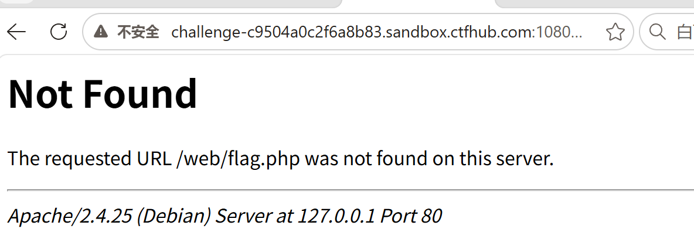
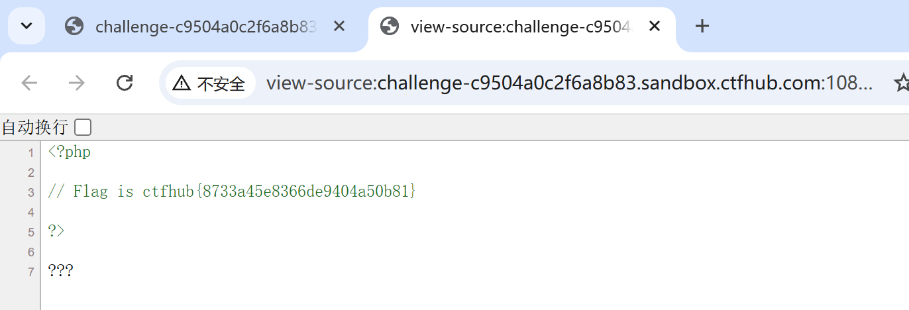

# 2026-10-29 学习记录 · SSRF 伪协议读取文件

## 一、今日目标

- [x] 搞懂 `file://` 伪协议和 `http://` 的区别
- [x] 通过 CTFHub 技能树 web-ssrf 第二关「伪协议读取文件」

## 二、题目信息

| 项 | 值 |
|---|---|
| 平台 / 靶场 | CTFHub 技能树 |
| 题目 | web-ssrf 第二关「伪协议读取文件」 |
| 地址 | http://challenge-2767ad631815441e.sandbox.ctfhub.com:10800/ |
| 参数 | `url`（GET 参数） |
| 题目提示 | 尝试去读取一下 Web 目录下的 flag.php |
| 目标 | 拿到 flag |

## 三、解题过程（边做边填）

### Step 1：误以为是内网访问

- 我输入的：`?url=http://127.0.0.1/web/flag.php`
- 返回：`Not Found ... Apache/2.4.25 (Debian) Server at 127.0.0.1 Port 80`
- 推断：路径不对，但这个 404 证明 SSRF 能访问到内网 Apache
- 证据（截图）：

### Step 2：意识到要用 file:// 伪协议

- 关键理解：这关考"伪协议"，不是 http 内网访问，而是用 `file://` 直接读服务器本地文件
- web 目录 = Apache 网站根目录 = `/var/www/html`

### Step 3：用 file:// 读 flag

- 我输入的：`?url=file:///var/www/html/flag.php`
- 返回：`Flag is ctfhub{8733a45e8366de9404a50b81}`
- 证据（截图）：

## 四、关键 Payload

```text
?url=file:///var/www/html/flag.php
```

## 五、卡点与解决

| 现象 | 真正原因 | 解决 |
|---|---|---|
| `http://127.0.0.1/web/flag.php` 返回 404 | 路径不对，且这关考的是 file 伪协议不是 http 内网 | 改用 `file:///var/www/html/flag.php` |

## 六、知识点复盘（用自己的话）

1. `file://` 让服务器直接读本地文件；`http://` 让服务器发请求访问网址。
2. `http://.../flag.php` 会执行 php 返回结果；`file:///.../flag.php` 读的是文件原始内容。
3. 目标是要读本地文件（源码/配置/passwd）→ 用 `file://`；目标是访问内网服务 → 用 `http://`。

## 七、同类题判断流程

1. 题目出现"伪协议""读文件"这类词 → 往 `file://` 想
2. `file://` 语法是三个斜杠：`file:///绝对路径`
3. 先分清目标：读文件还是访问服务，再选协议

## 八、AI 使用记录

- 用在哪些环节：讲解 `file://` 和 `http://` 的区别、提示 Apache 根目录位置
- AI 给了什么：`file://` 协议语法、web 目录 = `/var/www/html`
- 我独立完成的部分：构造请求、确认拿到 flag

## 九、下一步

- [ ] 打开 CTFHub 技能树 web-ssrf 第三关
