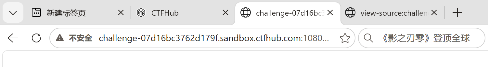
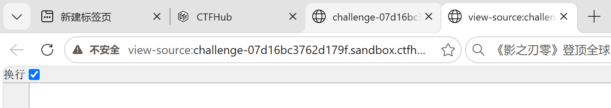
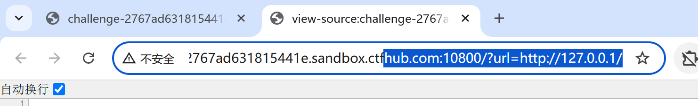
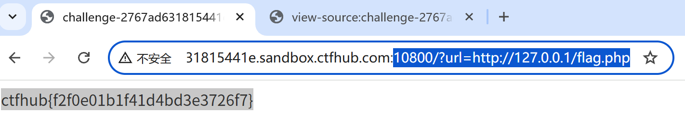

# 2026-10-29 学习记录 · SSRF 内网访问

## 一、今日目标

- [x] 搞懂 SSRF 是什么、为什么危险
- [x] 通过 CTFHub 技能树 web-ssrf 第一关「内网访问」
- [x] 能用自己的话讲清 SSRF 的本质

## 二、题目信息

| 项 | 值 |
|---|---|
| 平台 / 靶场 | CTFHub 技能树 |
| 题目 | web-ssrf 第一关「内网访问」 |
| 地址 | http://challenge-2767ad631815441e.sandbox.ctfhub.com:10800/ |
| 参数 | `url`（GET 参数） |
| 目标 | 拿到内网的 flag |

## 三、解题过程（边做边填）

### Step 1：打开靶机，页面空白

- 现象：直接访问首页，页面空白；`Ctrl+U` 看源码也是空的
- 推断：这题没有前端界面，考点是自己在 URL 上构造请求
- 证据（截图）：

### Step 2：尝试 url 参数访问内网根路径

- 我输入的：`?url=http://127.0.0.1/`
- 返回：空白
- 推断：`127.0.0.1` 根路径本身没内容，所以返回空白（不是回显被吞）

### Step 3：直接访问内网 flag 文件

- 我输入的：`?url=http://127.0.0.1/flag.php`
- 返回：flag
- 证据（截图）：

## 四、关键 Payload

```text
?url=http://127.0.0.1/flag.php
```

## 五、卡点与解决

| 现象 | 真正原因 | 解决 |
|---|---|---|
| 首页空白、源码也空 | 这题没前端界面，需自己构造请求 | 直接在 URL 上传 `?url=` 参数 |
| `?url=http://127.0.0.1/` 返回空白 | 根路径本来就没内容 | 直接怼到具体文件 `flag.php` |

## 六、知识点复盘（用自己的话）

1. **SSRF 本质**：你外网够不到 `127.0.0.1`，但服务器自己能；你通过 `?url=` 让服务器替你去访问它自己的内网，再把结果转交给你。
2. **为什么危险**：能借服务器的手去够它内网里你看不到的东西（内网服务、云元数据 `169.254.169.254`、本地文件 `file://`）。
3. **和蚁剑的区别**：蚁剑是"已经拿到 WebShell 后下命令"；SSRF 是"还没控制服务器，只是利用它'会替你发请求'的功能"。

## 七、同类题判断流程

1. 看到 `url` / `file` / `target` / `link` 这类参数，且服务器会去访问该地址 → 先想到 SSRF
2. 直接试 `?url=http://127.0.0.1/` 看是否访问内网
3. 根路径空白很正常，直接猜内网常见文件（`flag.php`、`flag`、`admin` 等）
4. 有回显走读取；没回显再考虑端口扫描、时间差异等

## 八、AI 使用记录

- 用在哪些环节：讲解 SSRF 基础概念（本质、云元数据）、引导第一关解题思路
- AI 给了什么：SSRF 基础讲解、`url` 参数提示、`flag.php` 路径提示
- 我独立完成的部分：理解 SSRF 本质、自己构造请求、确认拿到 flag
- 我消化后重写了什么：把 SSRF 本质总结成一句话（"让服务器替我去访问它自己的内网"）

## 九、下一步

- [ ] 打开 CTFHub 技能树 web-ssrf 第二关，先自己判断"这关想让我做什么"
